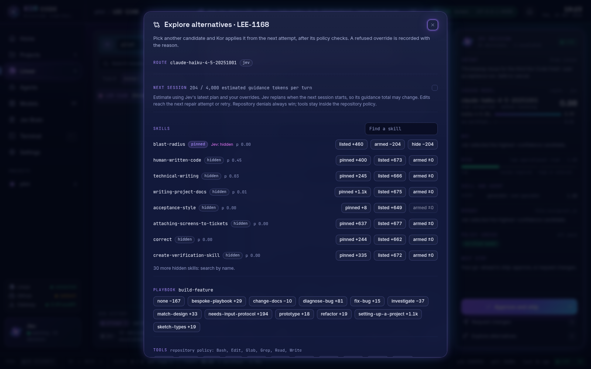

# Kor Code

**Kor turns Linear issues into verified pull requests.** You write an issue with
acceptance criteria. Kor plans it, runs [Claude Code](https://code.claude.com/docs/en/overview)
on it in an isolated git worktree, checks the result against your repository's
checks and your acceptance criteria, and reports progress on the Linear issue.
You run it from Mission Control, a web app the Kor daemon serves on your own
machine. With a fresh installer config’s `ship: merge`, Kor independently reviews and merges
verified pull requests when GitHub checks are green and Jev gives at least 90%
probability of a safe merge. You can choose manual approval and merging instead.

You install Kor once, and it works on any number of projects at the same time.
Each project is a Git checkout on your machine, mapped to a Linear team, and runs
from different projects proceed in parallel
([working on several projects](#work-on-several-projects)).


```text
Linear issue (Todo)
   │  Start or Queue in Mission Control, kor run LEE-123, or the label "kor"
   ▼
Plan      Jev judges readiness, risk, the model, the skills and the tools
   ▼
Work      Claude Code runs in a git worktree through your CLIProxyAPI gateway,
          with only the permissions you allow
   ▼
Verify    your repository checks run, then Jev judges each acceptance criterion;
          a failure goes back to the session, up to two repair attempts
   ▼
Approve   you review the diff and the evidence (with ship: approve)
   ▼
Ship      commit on kor/LEE-123, your delivery gate, a pull request
   ▼
Merge     different-family review, green GitHub checks, Jev probability ≥ 0.90
   ▼
Linear    comments throughout; In Review when the PR opens, Done after merge
```

Jev is the decision service Kor calls through the TypeSafe API. It makes every
per-task choice: whether the issue is ready, which verified model runs it, which
skills and playbook the session gets, and whether each acceptance criterion is met.

In the runs behind these screenshots, each attempt at a small documentation
change took 14 to 18 seconds from start to verified and cost under one cent.
Failed checks and unmet criteria go through verification and bounded repair.
If repair cannot resolve them, the run stops as `blocked` with a reason. Jev
judges recorded permission denials alongside the diff and tool results; a
recovered denial does not automatically block a verified change.

## Requirements

- Linux (built and tested on Ubuntu under WSL2) with Node 24+, Corepack and Git.
- Claude Code 2.1.299 or newer, and a browser.
- A running [CLIProxyAPI](https://github.com/router-for-me/CLIProxyAPI) gateway
  holding your model accounts. Kor expects it at `http://127.0.0.1:8317`.
- A Linear personal API key. Kor reaches Linear only through its API: there is no
  webhook or Linear app to install.
- A TypeSafe API key, for Jev.
- To ship: a GitHub `origin`, Git `user.name` and `user.email`, GitHub write
  access through GitHub CLI (`gh auth login`) or `GH_TOKEN` / `GITHUB_TOKEN`,
  plus verified models from two different families for automatic review.
  The cautious `approve` and `auto` modes use the `no-mistakes` CLI; repositories
  initialised for its pipeline also need its daemon running. An explicit
  "not initialized" response uses direct PR delivery. `gh-axi` is optional: GitHub connections, pull request lists and PR
  creation use the API.
  Tokens need repository contents write and pull request write access.

PR writing reuses the task route, including a cross-provider override. If the
overridden model cannot write the PR, Kor publishes an evidence-based fallback
with a clear note; it does not select a replacement model.

## Install

```sh
curl -fsSL https://raw.githubusercontent.com/korallis/kor-code/main/scripts/install.sh | bash
```

The installer checks the requirements, clones Kor into `~/.local/share/kor-code`,
builds the CLI, daemon and Mission Control, and installs `kor` into
`~/.local/bin`. It also asks for one project to start with: the Git checkout
path and the Linear team key for that project. That is only the first entry in
Kor's config. You can add more projects afterwards in Mission Control or in
`config.yaml` ([working on several projects](#work-on-several-projects)), and
you do not rerun the installer for them. To answer up front, or without a
terminal:

```sh
curl -fsSL https://raw.githubusercontent.com/korallis/kor-code/main/scripts/install.sh | bash -s -- --pilot ~/code/my-project --linear-team APP
```

If `~/.local/bin` is not on your `PATH`, add `export PATH="$HOME/.local/bin:$PATH"`
to your shell profile. On a machine with no gateway key, the installer prints a
new one as an `api-keys` line: **add that line to CLIProxyAPI's config yourself**
and reload the proxy. Kor never edits the proxy. Keep the checkout on disk; the
`kor` command and Mission Control run from it.

The first project cannot be skipped: with no `--pilot` and no terminal the
installer stops and asks you to pass one, and the path must be a Git checkout
root. The Linear team key is only asked for when `~/.config/kor/config.yaml` does
not exist yet; rerunning the installer to update reuses the first project and
never touches an existing config.

`--no-systemd` skips the systemd user unit, `KOR_HOME` moves the checkout and
`KOR_GATEWAY_URL` points at another gateway. The [user guide](docs/user-guide.md#install)
covers forks, private mirrors and a manual build.

## First run

**1. Set your repository policy** in `~/.config/kor/config.yaml`. The installer
writes a scaffold with your first project (its checkout, team key, default
branch and `ship: merge`) under `repos:`. Add the checks that decide whether
work is accepted and the tools sessions may use:

```yaml
repos:
  my-project:
    path: /home/you/code/my-project
    linearTeam: APP
    defaultBranch: main
    ship: merge            # guarded automatic merge; auto or approve leave merging to you
    checks:
      - pnpm test
    toolAllowlist: [Read, Write, Edit, Glob, Grep, Bash, WebFetch, WebSearch, Agent]
limits:
  total: 6
  perRepository: 4
launchProfile: lean
pollIntervalSeconds: 60
intakeLabel: kor
```

Sessions get only what `toolAllowlist` allows, and an unscoped `Read` also allows
file search. See [Configure a repository](docs/user-guide.md#configure-a-repository).

### Work on several projects

`repos:` is a map with one entry per project, so Kor works on as many as you list,
and Mission Control's **Projects** page shows each one. The installer only wrote
the first. Add another in either of two ways:

- **In Mission Control:** open **Settings**, find the **Projects** card, enter a
  project key (any name you like), its checkout path, Linear team and Linear
  project ID, then
  choose **Add project** and **Save configuration**. The daemon validates the
  file, applies it without a restart once no work is running and keeps the old
  one as `config.yaml.bak`. A project added here starts with `ship: approve`; set
  its checks and tool allowlist under the project's **Repository settings**.
- **In `config.yaml`:** add another entry under `repos:`, then stop and restart
  the daemon (`kor ui` starts it again) so it rereads the file.

Two projects look like this. Each entry needs its own checkout and its own
`linearTeam` (or `linearProject`), because that is how Kor routes an issue to the
right repository:

```yaml
repos:
  web-app:
    path: /home/you/code/web-app
    linearTeam: WEB
    defaultBranch: main
    ship: approve
    checks:
      - pnpm test
    toolAllowlist:
      - Read
      - Edit
      - "Bash(pnpm test*)"
  api-service:
    path: /home/you/code/api-service
    linearTeam: API
    defaultBranch: main
    ship: approve
    checks:
      - ./mvnw test
    toolAllowlist:
      - Read
      - Edit
      - "Bash(./mvnw test*)"
limits:
  total: 2
  perRepository: 1
```

Run `kor doctor` afterwards: it prints one block of checks for each project.

Runs from different projects work in parallel, each in its own worktree.
`limits.total` caps how many runs are active across all projects, and
`limits.perRepository` caps how many one project may have active. With the
settings above, a `web-app` run and an `api-service` run go at the same time,
and a second `web-app` issue waits for the first. Raise `total` and
`perRepository` (for example `4` and `2`) to run more at once; in Mission Control
they are **Runs at once** and **Runs per repository** under **Settings**. Waiting
runs do not hold a slot.

**2. Check the setup.** This is `kor doctor` in the throwaway home used for
these docs:

```text
$ kor doctor
PASS Kor config: /tmp/kor-rf/home/.config/kor/config.yaml
PASS Linear key: available
PASS TypeSafe key: available
PASS CLIProxyAPI with Kor key: reachable
FAIL CLIProxyAPI management access: management key missing
FAIL quota-axi: unavailable
PASS Claude Code: 2.1.300 (Claude Code)
FAIL no-mistakes daemon: not running
PASS repo pilot: /tmp/kor-rf/pilot (main)
PASS repo pilot shipping target: github.com
PASS repo pilot git identity: user.name and user.email configured
PASS repo pilot GitHub API: authenticated with repository write access; PR publication uses the API
PASS repo pilot push access: push dry run passed; no remote refs changed
PASS repo pilot tools: Bash, Edit, Glob, Grep, Read, Write (effective permission base names; automatic search requires unscoped Read); Jev selects optional tools per task; availability does not grant command permissions
FAIL doctor: one or more checks failed. Hint: fix the reported checks and rerun `kor doctor`
```

The management key and `quota-axi` are optional: without them Mission Control
cannot show the gateway's account slots and quota windows. `no-mistakes` is
required for repositories using its pipeline. The CLI must be installed for
shipping; a repository explicitly reported as uninitialised uses direct PR
delivery even when the daemon is stopped. Everything else must pass.
[What each line means](docs/user-guide.md#check-your-setup-with-kor-doctor).

**3. Open Mission Control:**

```sh
kor ui
```

This starts the daemon if it is not running and opens Mission Control in your
browser, already signed in (under WSL, in the Windows browser). If the browser
cannot open, it prints the address; paste the token from
`~/.local/state/kor/ui-token` into the connect screen.

**4. Connect.** **Settings** shows Linear, GitHub, the gateway and Jev. Keys in
`~/.config/linear/env`, `~/.config/typesafe/env` and `~/.config/kor/gateway.env`
show as connected already; otherwise paste a key there. Saved keys are
write-only and never sent back to the browser.


**5. Probe models.** Kor only uses models that pass a short compatibility probe
(streaming, tool calls and a final JSON answer). Probe from **Models → Probe a
model**, or:

```sh
kor models probe --dry-run           # list the chat and coding models the gateway offers
kor models probe --model MODEL-ID    # probe one; a few cents
kor models list                      # the verified models
```

Verified models are the candidates Jev chooses from for each task.

## Daily use

### Write and start an issue

Put acceptance criteria in the issue description under a heading named
`Acceptance criteria` (or `Acceptance`), one bullet per criterion. Every line
under that heading counts as a criterion, so keep notes above it. Check a ticket
before you queue it:

```text
$ kor linear lint LEE-1166
LEE-1166: blocked; hasScreenshot=false
  acceptance-criteria: Add explicit acceptance criteria to the issue.
```

Issues labelled `UI` also need a screenshot or mockup; `kor linear attach-image`
uploads one. Then start the work in one of three ways: **Start** on Home's
**Next up**, **Queue an issue** on Agents (or **Queue for Kor** in a project), or
label a Todo issue `kor` and let the daemon pick it up on its next poll.


Jev judges whether essential scope is missing, rather than implementation
difficulty. Concrete file, input and behavior requirements can suffice without
an unrelated build setup; all readiness checks and the 0.70 threshold still apply.

A confidence-only readiness refusal is reported as `uncertain`, with Jev's score
and the required threshold. All deterministic checks pass in that case; review
the acceptance criteria in Linear, add any missing detail, then retry, or answer
in Mission Control to ask Jev again. Once an execution is ready, **Request changes**,
operator answers and adding the configured intake label keep that verdict while
the underlying issue and eligible models stay unchanged. A label that also
requires a screenshot (`UI`) still triggers that check. The intake label
matches regardless of letter case.

### Work in Mission Control

Every screen updates in place over the daemon's live connection, including
changes from the CLI and other open tabs, which share one event stream. Settings,
queue changes and agent output stream as soon as Kor changes them. Linear issues
reuse intake observations on the configured daemon poll schedule; GitHub reads
are shared across tabs and refresh no faster than that schedule or once a minute.
Quota keeps its one-minute throttle. **LIVE** means the event
stream is connected and has supplied a snapshot. If it drops, the app marks the
displayed data as stale, reconnects automatically with backoff, and resyncs missed
changes and terminal output. You do not need to refresh the page.

**Home** shows what needs you, what is ready to ship, running agents, spend and
**Next up**. A run that needs an answer lands in **Needs you**: type the answer
and **Send and retry** writes it to the Linear issue and runs again. Ctrl+K (⌘K)
opens **Ask Jev** anywhere. Execution failures also appear in **Needs you** with
**Retry**, and Kor posts the reason and a `kor:blocked` label to Linear.
**Cancel run** dismisses a failed run from **Needs you**. Retrying reuses the
recorded route while task inputs and eligible models are unchanged; Kor's
failure label does not trigger another route decision.
Ask Jev accepts requests up to 2,000 characters. Give it work, for example
“Kor-Code: fix the release label and add acceptance criteria.” Jev identifies
the project, Kor drafts a scoped Linear issue, labels it `kor` and queues a run.
A free slot starts it through the usual Jev route, model and skill selection.
The reply links the issue and run. “Approve and ship LEE-123”, “retry LEE-123”,
“queue LEE-123” and “make LEE-123 high priority” carry out those actions.
Stopping work asks for confirmation. Questions read the live snapshot without
creating issues or changing runs; recommendation buttons perform their named
action. An unreachable or uncertain Jev is identified plainly, with no action.
Every Jev choice is recorded in the decision audit.

When adding a project in **Settings**, enter its checkout path, Linear team and
Linear project ID. Enter a full checkout path starting with `/` or `~/`;
Mission Control rejects relative paths instead of joining the install directory.
Absolute paths stay as entered. Give repositories on the same
team different Linear project mappings: ambiguous intake is refused and shown
on Home.

**Agents** streams each run's real output, its seven stages, tokens and cost,
with **Stop run**, **Retry** and a **Note for Jev**.


**Linear** is the decision workspace for a run: the issue, Jev's reasoning, the
diff, the checks and each acceptance judgement, with **Approve and ship**,
**Request changes** (`R`) and **Explore alternatives** (`E`).


**Projects** shows each repository's Linear issues with their runs, health and
pull requests, and its repository settings. **Models** shows verified models,
the gateway's account slots and the routing policy. **Jev Brain** shows the
decision audit, calibration and what Jev has learned about skills.

### Skills and your private pack

Kor ships skills (coding and PR standards, Linear and ticket guidance, project
setup, principles) and playbooks (procedures such as `fix-bug` or
`change-docs`). Before each session Jev picks the skills and at most one
playbook within a token budget; the run's **Plan** tab shows what each attempt
received. The bundled [`hard-problem-resolution`](skills/hard-problem-resolution/SKILL.md)
playbook handles accuracy, speed and competing technical approaches with measured
research, an independent challenge and a recorded Jev decision before implementation
and re-measurement. See [how it works](docs/pstack-playbooks.md#resolve-hard-technical-problems).
Keep your own guidance in a private pack outside the repository:

```sh
kor skills init                                         # creates ~/.config/kor/skills
kor skills import --from ./my-skills --dry-run --skip-invalid
kor skills import --from ./my-skills --skip-invalid
kor skills doctor                                       # the merged catalogue and its token costs
```

By default (`skills.jev: full`), Jev sees private skill descriptions and selection
hints through TypeSafe so it can choose your skills automatically; bodies and
references stay local. Opt out in `config.yaml` with `skills: { jev: names-only }`,
or mark an individual skill `metadata.kor.visibility: local-only`. You can still
pin private skills per repository with `skills.pins`. Import reports copy status
without suggesting a visibility override. Doctor reports each body-budget
warning once; skills over the 2,000-token pin limit can still be listed.
Imported skills can reach sessions without adding a license or removing
unrelated frontmatter. Hooks, forked execution and shell interpolation are
refused; bundled scripts must use the session's permitted tools. The inline
interpolation marker must start a line or follow whitespace; ordinary Markdown
non-null assertions and template literals ending in `!` pass. Fenced commands
introduced by three backticks followed by `!` are also refused.
If a private skill shares a bundled name, Kor
keeps the bundled skill active and warns. To use your version, add this to the
private skill's frontmatter:

```yaml
metadata:
  kor:
    overrides: public
```

`kor skills guard` checks private-only names and `deny.txt` entries against the
public tier; existing bundled names are already public. More in
[Skills](docs/skills.md).

### Override Jev

**Explore alternatives** lists every decision Jev made with its other
candidates. Pick one, such as a different verified model, and Kor applies it from
the next attempt if policy allows. The same dialog edits the next session's
skills, playbook and tools, estimating the per-turn token cost of each change
using the latest plan. Jev replans at session start, so the final total may differ;
**Sessions received** records the guidance actually delivered.
Every override is audited, commented on the Linear issue and can be reverted.
Repository deny lists and tool policy always win.



Linear labels do the same per issue: `kor:skill/NAME`, `kor:skill/-NAME`,
`kor:playbook/NAME`, `kor:tool/NAME`, `kor:tool/-NAME`.

The Claude Code status line counts overrides for the run it follows. Jev Brain
reports operator-routed runs under `override`; they do not enter the Jev versus
baseline paired comparison.

### Ship

New installs use `ship: merge`: Kor commits and opens a PR, asks Jev to choose
one verified reviewer from a different model family than every writer, and waits
for green GitHub checks and clean branch protection status. Jev then judges the
review, checks and change summary; automatic merge needs a probability of at least
0.90. Blocking findings or lower probabilities go back for repair within the
run's existing two-repair budget. Otherwise the PR stays open with a reason.
Mission Control shows the review, merge decision and override controls. An owner
can override Jev's merge/wait choice; review and GitHub safeguards still apply.
Kor never force-pushes or bypasses branch protection. Linear reaches Done after
GitHub confirms the merge.

For more control, choose `ship: auto` to open verified PRs automatically and merge
them yourself, or `ship: approve` to approve publication in Mission Control and
then merge yourself. These modes retain the repository's existing delivery gate.
Existing config files are preserved on installation. New scaffolds allow
`Read, Write, Edit, Glob, Grep, Bash, WebFetch, WebSearch, Agent` without command
scoping, with concurrency limits of 6 total and 4 per repository. Narrow the
allowlist and limits in Settings or YAML if preferred. Configure your repository
checks explicitly; Kor does not detect check commands.
See [what happens after approval](docs/user-guide.md#what-happens-after-approval).

## Configuration

Everything Mission Control's **Settings** and **Repository settings** change
lives in `~/.config/kor/config.yaml`; Mission Control validates it and keeps the
previous file as `config.yaml.bak`. The [configuration reference](docs/configuration.md)
has the full schema: `linearProject` mappings, `tools` caps, skill pins and
budgets, run limits, calibration and the session launch profile.

The CLI reaches the same daemon. Every command takes `--json`; the
[CLI contract](docs/cli-contract.md) is the stable schema.

| You want to | Run |
| --- | --- |
| Preview Jev's plan | `kor plan LEE-123` |
| Queue an issue | `kor run LEE-123` (`--dry-run` records and previews Jev's route without queueing) |
| See runs | `kor status --json [LEE-123]` |
| Read a run's timeline | `kor logs EXECUTION-ID` |
| Retry or stop a run | `kor retry LEE-123`, `kor cancel LEE-123` |
| Report routing calibration | `kor calibrate report` |

Inside Claude Code in your project, the installer's plugin adds a Kor status line
and a `/kor` view of the daemon.

## Update and uninstall

Rerun the install one-liner to update, then `kor ui`. It keeps your
configuration, keys and state.

`kor uninstall` stops the daemon and removes the integration but keeps your
configuration and state. `kor uninstall --purge` also removes Kor's data and its
installer cache, registered Kor worktrees and their local `kor/*` branches.
Purge also works after a reinstall. After a plain uninstall, run
`node ~/.local/share/kor-code/packages/cli/dist/cli.js uninstall --purge`.
This discards those branches even if unmerged; save work you want to keep first.
Unrelated worktrees, branches and remote branches remain. The Kor checkout, your
external key files and the gateway's key entry stay; remove them yourself.

## Troubleshooting

- **`FAIL <command>: … Hint: …`.** Every failure is one line with the next step.
- **`HTTP 401` from the gateway.** CLIProxyAPI does not have Kor's key in `api-keys` yet.
- **`route: no-verified-route`.** No model has passed `kor models probe`.
- **A permission denial.** Jev checks whether the session recovered with allowed
  tools. If a required command is missing from `toolAllowlist`, add its narrow
  permission, restart the daemon and retry.
- **A run is `blocked` with a `kor:blocked` label.** Missing criteria, an
  unfinished dependency or a readiness refusal; the Linear comment says which.
  Fix the issue, then retry.
- **Mission Control shows the connect screen or `OFFLINE`.** Run `kor ui`.

The [troubleshooting table](docs/user-guide.md#troubleshooting) has the rest.

## Documentation

- [User guide](docs/user-guide.md): everything above in full.
- [Skills](docs/skills.md) and [principles and playbooks](docs/pstack-playbooks.md).
- [Project setup](docs/project-setup.md): briefs, documentation and ticket mockups for a new project.
- [Configuration](docs/configuration.md), [CLI contract](docs/cli-contract.md),
  [Mission Control API](docs/mission-control-api.md), [model compatibility](docs/model-compatibility.md).
- Design: [architecture](docs/architecture.md), [requirements](docs/requirements.md),
  [glossary](docs/GLOSSARY.md), [specifications](docs/specs/), [decision records](docs/adr/),
  [threat model](docs/threat-model.md), [implementation plan](docs/implementation-plan.md),
  [open questions](docs/open-questions.md), [review follow-ups](docs/review-followups.md).
- [Development and validation](docs/development.md) and
  [measuring session context](docs/context-bench.md): building from source and the proof commands.
  Offline proofs use ephemeral ports and can run alongside Kor on its default port 8327.

## License

[MIT License](LICENSE).
