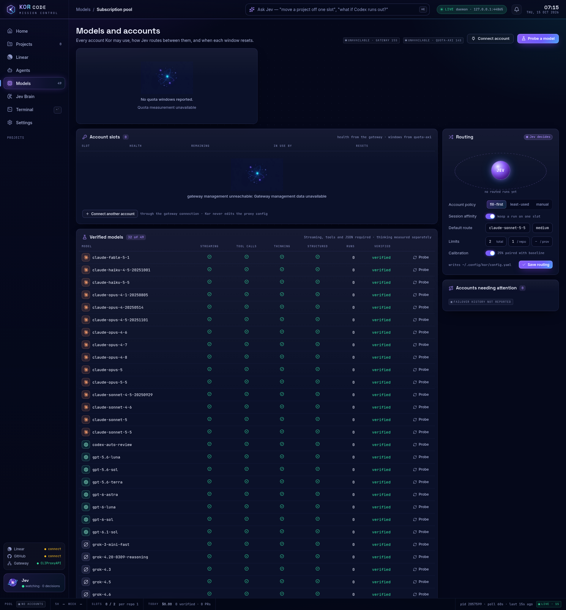
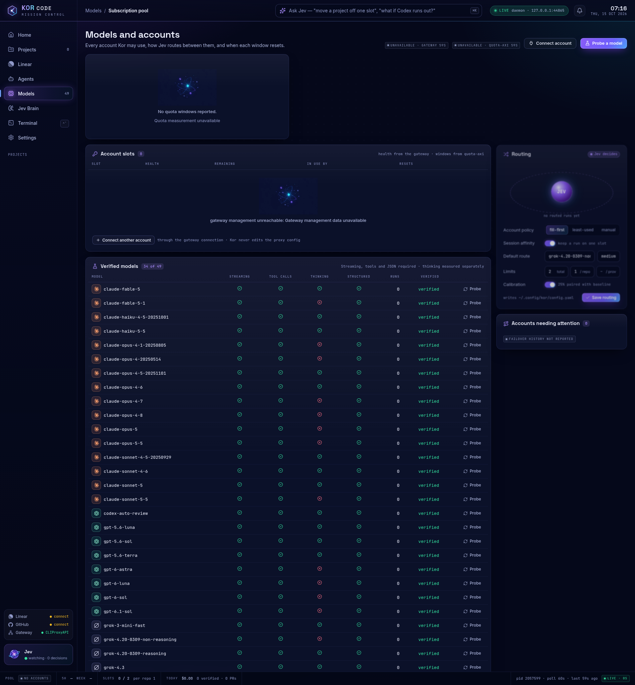

# Live gateway model probes, 2026-10-15

Kor discovered all 121 models in the initial CLIProxyAPI `/v1/models` catalogue. The sweep probed all 108 chat and coding models with one built-in prompt per probe. It excluded 13 image, video and speech models. After the probe fixes, 34 models verified: 16 Anthropic, 8 OpenAI and 10 xAI. The remaining 74 did not verify. These results do not establish working access to every advertised model.

| Family | Provider | Probed | Verified | Failed |
| --- | --- | ---: | ---: | ---: |
| claude | anthropic | 32 | 16 | 16 |
| codex | openai | 1 | 1 | 0 |
| deepseek | deepseek | 3 | 0 | 3 |
| gemini | google | 6 | 0 | 6 |
| glm | zhipu | 4 | 0 | 4 |
| gpt | openai | 20 | 7 | 13 |
| grok | xai | 15 | 10 | 5 |
| inkling | devin | 1 | 0 | 1 |
| kimi | moonshot | 13 | 0 | 13 |
| nemotron | nvidia | 1 | 0 | 1 |
| private | anthropic, openai | 7 | 0 | 7 |
| swe | cognition | 5 | 0 | 5 |
| **Total** | | **108** | **34** | **74** |

The gateway later returned 49 model ids, including 36 text models. The 72 removed ids were the 58 `devin/` routes, ten direct Kimi models, three unavailable older Claude models and `gpt-5.5`. Firstmate traced the Devin disappearance to an upstream permission block followed by an account cooldown. Kor did not change gateway configuration or accounts. Initial failures remain in the report. A catalogue watch from 06:25 to 06:36 UTC still found 49 ids and no Devin or Kimi routes. The final recheck at 09:01:59 UTC found 59 ids: the ten direct Kimi models had returned. Each was re-probed once and again returned HTTP 403 for exhausted monthly quota. All 58 `devin/` ids, the three unavailable older Claude models and `gpt-5.5` were still absent. Those 62 models are not currently served; their recorded errors are earlier observations, not a claim of current access.

## What changed in Kor

Grok's non-reasoning model passed streaming, file creation, a Bash read and JSON output, but the original harness rejected it for lacking a visible thinking block. Thinking is now measured separately. The neutral prompt also lets `claude-fable-5` pass; the old request for extended reasoning triggered its `reasoning_extraction` refusal.

Family selection now includes route prefixes and underscore aliases, such as `devin/gpt-5-6-sol` and `devin/model_gpt_5_2`. Provider metadata comes from `owned_by`. Saving a non-Anthropic default model in Mission Control saves the matching provider. The CLI now reports the provider and each probe failure, and preserves completed results during a long sweep. The verified, currently served models reach Jev as candidates for each task. This change adds no default model, provider preference or fallback ordering. The real preflight request builder produced all 34 candidates, including GPT, Codex and Grok.

## Validation

Probes ran from a disposable HOME and XDG directories under `/tmp`. Each Claude Code child had a separate sandbox HOME, config and working directory. Credentials were read at runtime from `~/.config/kor/gateway.env` and were not copied to the disposable HOME or committed. The built Kor CLI and web app were used. No gateway configuration or real Claude Code or Codex settings changed.

The initial sweep used the original harness. The changed harness re-probed the remaining live models. A targeted pass confirmed JSON responses with explanatory text before the final object. The final Kimi pass used the same built-in prompt after the models reappeared. Every invocation used one built-in prompt; no benchmark prompts were added.

`pnpm build`, `pnpm typecheck` and `git diff --check` passed. A temporary local relay omitted one verified Grok model from the live catalogue without changing the real gateway. The CLI omitted it immediately, and Mission Control disabled it after its automatic refresh. Removing the omission restored the CLI offer and the selectable UI option without another probe. Saved verification remained intact. `kor models list` returned all 34 verified records. In the real `kor ui` app, the model picker offered all 34, including GPT, Codex and Grok. Selecting `grok-4.20-0309-non-reasoning` and clicking **Save routing** persisted both that exact id and `provider: xai` in the disposable configuration.

The screenshots use the original 32-pass registry and the final 34-pass registry in the built app. The final view shows the non-reasoning Grok model verified despite its absent thinking capability. Management and quota panels are unavailable because this proof supplied only the gateway inference credentials.

Before:

After:

## Every text model

The table records the final observed outcome for each initially advertised text model. [The JSON report](model-probe-results-2026-10-15.json) retains exact failure messages, capability flags, duration, cost where reported, and observation time. The cost field is Claude Code's reported estimate, not a gateway invoice.

| Model | Provider | Outcome |
| --- | --- | --- |
| `claude-3-5-haiku-20241022` | anthropic | Not currently served. Earlier probe: HTTP 503: no available auth; upstream model not found |
| `claude-3-7-sonnet-20250219` | anthropic | Not currently served. Earlier probe: HTTP 503: no available auth; upstream model not found |
| `claude-fable-5` | anthropic | Verified |
| `claude-fable-5-1` | anthropic | Verified |
| `claude-haiku-4-5-20251001` | anthropic | Verified |
| `claude-haiku-5-5` | anthropic | Verified |
| `claude-opus-4-1-20250805` | anthropic | Verified |
| `claude-opus-4-20250514` | anthropic | Verified |
| `claude-opus-4-5-20251101` | anthropic | Verified |
| `claude-opus-4-6` | anthropic | Verified |
| `claude-opus-4-7` | anthropic | Verified |
| `claude-opus-4-8` | anthropic | Verified |
| `claude-opus-5` | anthropic | Verified |
| `claude-opus-5-5` | anthropic | Verified |
| `claude-sonnet-4-20250514` | anthropic | Not currently served. Earlier probe: HTTP 503: no available auth; upstream model not found |
| `claude-sonnet-4-5-20250929` | anthropic | Verified |
| `claude-sonnet-4-6` | anthropic | Verified |
| `claude-sonnet-5` | anthropic | Verified |
| `claude-sonnet-5-5` | anthropic | Verified |
| `codex-auto-review` | openai | Verified |
| `devin/claude-5-fable` | anthropic | Not currently served. Earlier probe: HTTP 403: Devin upstream content-policy rejection |
| `devin/claude-fable-5-1` | anthropic | Not currently served. Earlier probe: HTTP 403: Devin upstream content-policy rejection |
| `devin/claude-haiku-5-5` | anthropic | Not currently served. Earlier probe: HTTP 403: Devin upstream content-policy rejection |
| `devin/claude-opus-4-6` | anthropic | Not currently served. Earlier probe: HTTP 403: Devin upstream permission_denied, internal error |
| `devin/claude-opus-4-6-1m` | anthropic | Not currently served. Earlier probe: HTTP 403: Devin upstream permission_denied, internal error |
| `devin/claude-opus-4-7` | anthropic | Not currently served. Earlier probe: HTTP 403: Devin upstream permission_denied, internal error |
| `devin/claude-opus-4-8` | anthropic | Not currently served. Earlier probe: HTTP 403: Devin upstream content-policy rejection |
| `devin/claude-opus-5` | anthropic | Not currently served. Earlier probe: HTTP 403: Devin upstream content-policy rejection |
| `devin/claude-opus-5-5` | anthropic | Not currently served. Earlier probe: HTTP 403: Devin upstream content-policy rejection |
| `devin/claude-sonnet-4-6` | anthropic | Not currently served. Earlier probe: HTTP 403: Devin upstream permission_denied, internal error |
| `devin/claude-sonnet-4-6-1m` | anthropic | Not currently served. Earlier probe: HTTP 403: Devin upstream permission_denied, internal error |
| `devin/claude-sonnet-5` | anthropic | Not currently served. Earlier probe: HTTP 403: Devin upstream permission_denied, internal error |
| `devin/deepseek-v4-1-flash` | deepseek | Not currently served. Earlier probe: HTTP 403: Devin upstream content-policy rejection |
| `devin/deepseek-v4-flash` | deepseek | Not currently served. Earlier probe: HTTP 403: Devin upstream content-policy rejection |
| `devin/deepseek-v4-pro` | deepseek | Not currently served. Earlier probe: HTTP 403: Devin upstream content-policy rejection |
| `devin/gemini-3-1-pro` | google | Not currently served. Earlier probe: HTTP 403: Devin upstream content-policy rejection |
| `devin/gemini-3-5-flash` | google | Not currently served. Earlier probe: HTTP 403: Devin upstream content-policy rejection |
| `devin/gemini-3-6-flash` | google | Not currently served. Earlier probe: HTTP 403: Devin upstream content-policy rejection |
| `devin/gemini-3-7-flash` | google | Not currently served. Earlier probe: HTTP 403: Devin upstream content-policy rejection |
| `devin/gemini-3-8-flash` | google | Not currently served. Earlier probe: HTTP 403: Devin upstream content-policy rejection |
| `devin/glm-5-2` | zhipu | Not currently served. Earlier probe: HTTP 403: Devin upstream content-policy rejection |
| `devin/glm-5-2-1m` | zhipu | Not currently served. Earlier probe: HTTP 403: Devin upstream content-policy rejection |
| `devin/glm-5-3` | zhipu | Not currently served. Earlier probe: HTTP 403: Devin upstream content-policy rejection |
| `devin/glm-5-3-flash` | zhipu | Not currently served. Earlier probe: HTTP 403: Devin upstream content-policy rejection |
| `devin/gpt-5-3-codex` | openai | Not currently served. Earlier probe: HTTP 403: Devin upstream content-policy rejection |
| `devin/gpt-5-4` | openai | Not currently served. Earlier probe: HTTP 403: Devin upstream content-policy rejection |
| `devin/gpt-5-4-mini` | openai | Not currently served. Earlier probe: HTTP 403: Devin upstream content-policy rejection |
| `devin/gpt-5-5` | openai | Not currently served. Earlier probe: HTTP 403: Devin upstream content-policy rejection |
| `devin/gpt-5-6-luna` | openai | Not currently served. Earlier probe: HTTP 403: Devin upstream content-policy rejection |
| `devin/gpt-5-6-sol` | openai | Not currently served. Earlier probe: HTTP 403: Devin upstream content-policy rejection |
| `devin/gpt-5-6-terra` | openai | Not currently served. Earlier probe: HTTP 403: Devin upstream content-policy rejection |
| `devin/gpt-6-astra` | openai | Not currently served. Earlier probe: HTTP 403: Devin upstream content-policy rejection |
| `devin/gpt-6-luna` | openai | Not currently served. Earlier probe: HTTP 403: Devin upstream content-policy rejection |
| `devin/gpt-6-sol` | openai | Not currently served. Earlier probe: HTTP 403: Devin upstream content-policy rejection |
| `devin/grok-4-5` | xai | Not currently served. Earlier probe: HTTP 403: Devin upstream content-policy rejection |
| `devin/grok-4-6` | xai | Not currently served. Earlier probe: HTTP 403: Devin upstream content-policy rejection |
| `devin/grok-4-7` | xai | Not currently served. Earlier probe: HTTP 403: Devin upstream content-policy rejection |
| `devin/inkling` | devin | Not currently served. Earlier probe: HTTP 403: Devin upstream permission_denied, internal error |
| `devin/kimi-k2-6` | moonshot | Not currently served. Earlier probe: HTTP 403: Devin upstream content-policy rejection |
| `devin/kimi-k2-7` | moonshot | Not currently served. Earlier probe: HTTP 403: Devin upstream content-policy rejection |
| `devin/kimi-k3` | moonshot | Not currently served. Earlier probe: HTTP 403: Devin upstream content-policy rejection |
| `devin/model_chat_gpt_4_1_2025_04_14` | openai | Not currently served. Earlier probe: HTTP 403: Devin upstream permission_denied, internal error |
| `devin/model_claude_4_5_opus` | anthropic | Not currently served. Earlier probe: HTTP 403: Devin upstream content-policy rejection |
| `devin/model_google_gemini_3_0_flash` | google | Not currently served. Earlier probe: HTTP 403: Devin upstream content-policy rejection |
| `devin/model_gpt_5_2` | openai | Not currently served. Earlier probe: HTTP 403: Devin upstream content-policy rejection |
| `devin/model_private_11` | anthropic | Not currently served. Earlier probe: HTTP 403: Devin upstream permission_denied, internal error |
| `devin/model_private_12` | openai | Not currently served. Earlier probe: HTTP 403: Devin upstream permission_denied, internal error |
| `devin/model_private_13` | openai | Not currently served. Earlier probe: HTTP 403: Devin upstream permission_denied, internal error |
| `devin/model_private_14` | openai | Not currently served. Earlier probe: HTTP 403: Devin upstream permission_denied, internal error |
| `devin/model_private_15` | openai | Not currently served. Earlier probe: HTTP 403: Devin upstream permission_denied, internal error |
| `devin/model_private_2` | anthropic | Not currently served. Earlier probe: HTTP 403: Devin upstream permission_denied, internal error |
| `devin/model_private_3` | anthropic | Not currently served. Earlier probe: HTTP 403: Devin upstream permission_denied, internal error |
| `devin/nemotron-3-ultra` | nvidia | Not currently served. Earlier probe: HTTP 403: Devin upstream content-policy rejection |
| `devin/swe-1-6` | cognition | Not currently served. Earlier probe: HTTP 403: Devin upstream content-policy rejection |
| `devin/swe-1-6-slow` | cognition | Not currently served. Earlier probe: HTTP 403: Devin upstream permission_denied, internal error |
| `devin/swe-1-7` | cognition | Not currently served. Earlier probe: HTTP 403: Devin upstream content-policy rejection |
| `devin/swe-1-7-lightning` | cognition | Not currently served. Earlier probe: HTTP 403: Devin upstream content-policy rejection |
| `devin/swe-2` | cognition | Not currently served. Earlier probe: HTTP 403: Devin upstream content-policy rejection |
| `gpt-5.5` | openai | Not currently served. Earlier probe: HTTP 503: model unsupported by the gateway’s ChatGPT account |
| `gpt-5.6-luna` | openai | Verified |
| `gpt-5.6-sol` | openai | Verified |
| `gpt-5.6-terra` | openai | Verified |
| `gpt-6-astra` | openai | Verified |
| `gpt-6-luna` | openai | Verified |
| `gpt-6-sol` | openai | Verified |
| `gpt-6.1-sol` | openai | Verified |
| `grok-3-mini` | xai | Probe timed out after 180000 ms; cause unresolved |
| `grok-3-mini-fast` | xai | Verified |
| `grok-4.20-0309-non-reasoning` | xai | Verified |
| `grok-4.20-0309-reasoning` | xai | Verified |
| `grok-4.20-multi-agent-0309` | xai | HTTP 400: client-side tools require multi-agent beta access |
| `grok-4.3` | xai | Verified |
| `grok-4.5` | xai | Verified |
| `grok-4.6` | xai | Verified |
| `grok-4.7` | xai | Verified |
| `grok-4.7-build-fast` | xai | Verified |
| `grok-build-0.1` | xai | Verified |
| `grok-composer-2.5-fast` | xai | Verified |
| `kimi-k2` | moonshot | HTTP 403: monthly Kimi quota exhausted |
| `kimi-k2-thinking` | moonshot | HTTP 403: monthly Kimi quota exhausted |
| `kimi-k2.5` | moonshot | HTTP 403: monthly Kimi quota exhausted |
| `kimi-k2.6` | moonshot | HTTP 403: monthly Kimi quota exhausted |
| `kimi-k2.7-code` | moonshot | HTTP 403: monthly Kimi quota exhausted |
| `kimi-k2.7-code-highspeed` | moonshot | HTTP 403: monthly Kimi quota exhausted |
| `kimi-k2.8` | moonshot | HTTP 403: monthly Kimi quota exhausted |
| `kimi-k2.8-code` | moonshot | HTTP 403: monthly Kimi quota exhausted |
| `kimi-k3` | moonshot | HTTP 403: monthly Kimi quota exhausted |
| `kimi-k3-256k` | moonshot | HTTP 403: monthly Kimi quota exhausted |

`grok-3-mini` timed out under both prompts. This result does not distinguish an upstream problem from a Claude Code interaction problem, so Kor leaves it unverified. No gateway changes or access workarounds were attempted for upstream failures.

## Skipped media models

- `gpt-image-1.5`
- `gpt-image-2`
- `gpt-image-2.5`
- `gpt-image-2.5-flare`
- `gpt-image-2.5-sunburst`
- `grok-imagine-image`
- `grok-imagine-image-2.0`
- `grok-imagine-image-quality`
- `grok-imagine-video`
- `grok-imagine-video-1.5`
- `grok-imagine-video-1.5-preview`
- `grok-tts`
- `grok-voice-tts-1.0`

See [model compatibility](model-compatibility.md) for the commands and an isolated environment example. Re-run probes when account access or the gateway catalogue changes.
