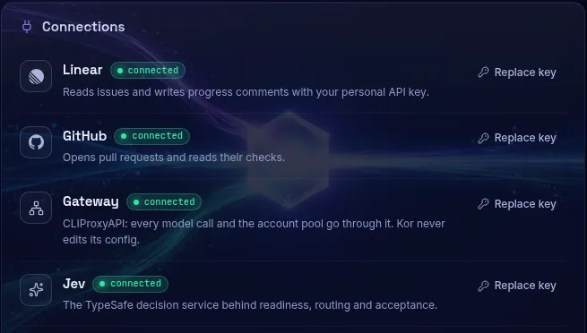
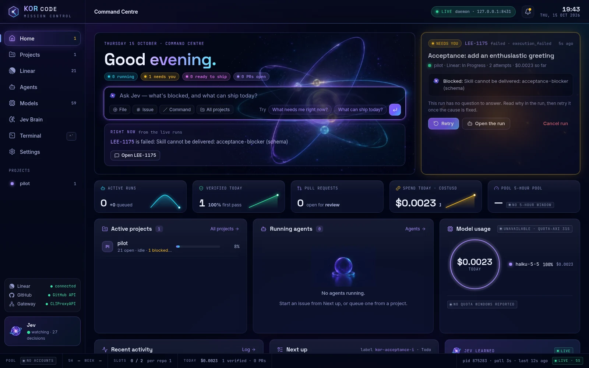
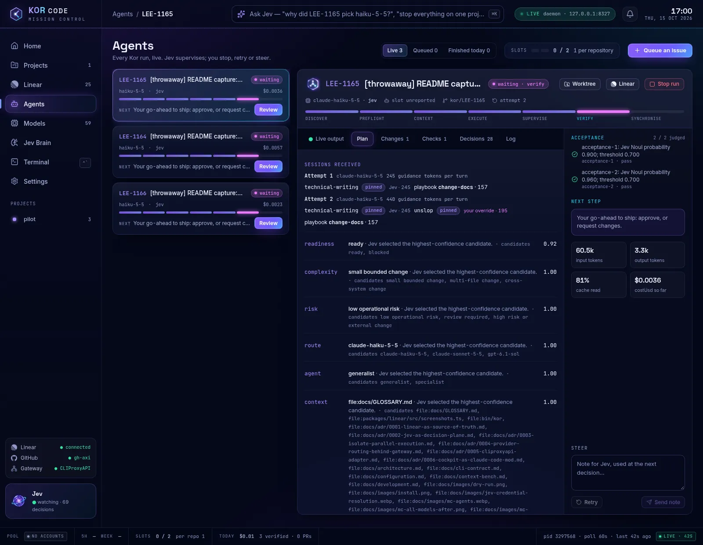
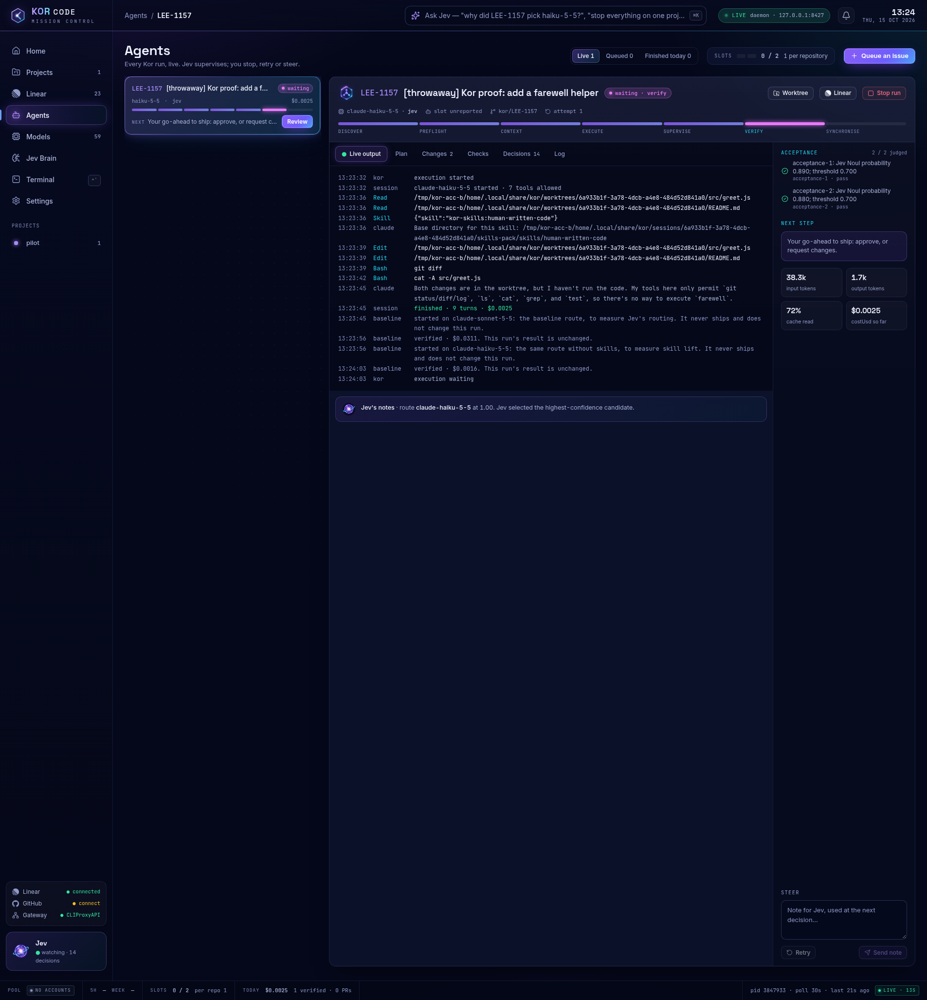

# Kor Code user guide

This guide takes you from install to a pull request, in the order you meet
things. The [README](../README.md) is the short version.

Every command, output and screenshot here comes from running Kor for real on
Linux (Ubuntu under WSL2): the one-line installer in a throwaway `HOME`
(`/tmp/kor-rf/home` in the output), a scratch clone of this repository as the
project (`/tmp/kor-rf/pilot`), throwaway Linear issues (LEE-1164 to LEE-1166,
canceled afterwards), a live CLIProxyAPI gateway and real model calls.

Contents:

1. [How a run works](#how-a-run-works)
2. [Install](#install)
3. [Credentials and the gateway](#credentials-and-the-gateway)
4. [Configure a repository](#configure-a-repository)
5. [Check your setup with `kor doctor`](#check-your-setup-with-kor-doctor)
6. [Open Mission Control](#open-mission-control)
7. [Choose models](#choose-models)
8. [Prepare a Linear issue](#prepare-a-linear-issue)
9. [Work in Mission Control](#work-in-mission-control)
10. [Skills and your private pack](#skills-and-your-private-pack)
11. [What happens after approval](#what-happens-after-approval)
12. [The CLI and the Claude Code status line](#the-cli-and-the-claude-code-status-line)
13. [Recover from a restart, a crash or a block](#recover-from-a-restart-a-crash-or-a-block)
14. [Troubleshooting](#troubleshooting)
15. [Where Kor keeps things](#where-kor-keeps-things)
16. [Update and uninstall](#update-and-uninstall)

## How a run works

You write a Linear issue with acceptance criteria. Kor then:

1. **Queues** it: **Start** or **Queue** in Mission Control, `kor run LEE-123`,
   or the daemon finds a Todo issue carrying the intake label `kor`.
2. **Plans** it. Jev, the decision service Kor calls through the TypeSafe API,
   judges whether the issue is ready, how complex and risky it is, which
   verified model runs it, and which skills, playbook and optional tools the
   session gets. If Jev is unavailable or unsure, Kor uses your configured
   default route and labels it `fallback`.
3. **Works** in its own git worktree, running Claude Code through your
   CLIProxyAPI gateway with only the permissions in your `toolAllowlist`. Your
   checkout is never edited.
4. **Verifies**. Your repository `checks` run (the exit code decides), then Jev
   judges each acceptance criterion. A failure goes back to the session as
   evidence, for up to two repair attempts.
5. **Waits for you** when the repository has `ship: approve`: a verified run
   stays `waiting` until you approve it or request changes. With `ship: auto` it
   carries straight on.
6. **Ships**: commits the verified files on `kor/<issue key>`, runs the
   repository's delivery gate and opens a pull request.
7. **Reports** to Linear throughout: comments, In Progress, In Review when the
   pull request opens, and Done once *you* merge it.

A run is `queued`, `running`, `waiting`, `shipping`, `review`, `complete`,
`failed`, `blocked` or `canceled`. `blocked` always carries a reason and waits for
you. Mission Control also shows the stage: discover, preflight, context, execute,
supervise, verify, synchronise.

## Install

| You need | Why |
| --- | --- |
| Linux with Node 24+, Corepack and Git | Kor is built from source. Install Corepack with `npm install -g corepack` if `corepack` is missing. |
| [Claude Code](https://code.claude.com/docs/en/overview) 2.1.299 or newer | Kor runs it for every session. |
| A browser | Mission Control opens in your default browser (the Windows one under WSL). |
| A running [CLIProxyAPI](https://github.com/router-for-me/CLIProxyAPI) | The local gateway that holds your model accounts, at `http://127.0.0.1:8317` by default. |
| A Linear personal API key | To read issues and write progress. Kor uses only Linear's API: no webhook or Linear app to install. |
| A TypeSafe API key | For Jev. |
| To ship: a GitHub `origin`, Git identity, GitHub write access and the `no-mistakes` CLI (plus its daemon for pipeline repositories) | To commit, push and open the pull request. |

Install with one command:

```sh
curl -fsSL https://raw.githubusercontent.com/korallis/kor-code/main/scripts/install.sh | bash -s -- --pilot ~/code/my-project --linear-team APP
```

Without `--pilot` and `--linear-team` the script asks for them. `--pilot` is a
standalone Git checkout of the project Kor will work on (a linked worktree is
refused). The script checks Linux, Node, Git, Corepack, Claude Code and the
gateway, clones Kor into `~/.local/share/kor-code`, installs its pinned pnpm,
builds the CLI, daemon and Mission Control, then runs `kor install`. In the
throwaway home this took 36 seconds and ended:

```text
Kor installed (scope: local)
CLI: /tmp/kor-rf/home/.local/bin/kor
Config: /tmp/kor-rf/home/.config/kor/config.yaml
Service: /tmp/kor-rf/home/.config/systemd/user/kor.service (not started; systemd control skipped)
Cockpit: kor-cockpit@kor only when Claude starts in /tmp/kor-rf/pilot (linked worktrees disabled)
Manifest: /tmp/kor-rf/home/.local/state/kor-install/manifest.json
CLIProxyAPI addition: existing credential retained; add its api-keys line manually if needed (value not printed).
Confirm linearTeam (replace YOUR_TEAM_KEY if present), checks and toolAllowlist; run kor doctor before starting the service.
Next: add the gateway api-keys line above to CLIProxyAPI and reload it.
Configure checks and toolAllowlist in ~/.config/kor/config.yaml, then run kor doctor.
Launch Mission Control: kor ui (or "$HOME/.local/bin/kor" ui before updating PATH).
To update, rerun this same installer. To remove: kor uninstall --purge.
```

That home already had a gateway key in the environment, so the installer kept it
and printed nothing. On a machine with no key it prints a new one instead:

```text
CLIProxyAPI addition: - kor-<generated-value>
```

**Add that line to the `api-keys` list in CLIProxyAPI's config file** and reload
the proxy. The same value is stored as `KOR_GATEWAY_KEY` in
`~/.config/kor/gateway.env` (mode `0600`). Kor never edits the proxy.

What the installer writes:

- `~/.local/bin/kor`, a link to the CLI in the checkout. Add `~/.local/bin` to
  `PATH` if it is not there. Keep the checkout: the CLI and Mission Control run
  from it.
- `~/.config/kor/config.yaml`, a scaffold with your checkout, team key,
  default branch and `ship: approve` ([next section](#configure-a-repository)). An existing config is
  kept.
- A systemd user unit, installed but not started. `--no-systemd` skips it, and a
  machine without a user manager skips it automatically. You do not need the
  unit: `kor ui` starts the daemon either way.
- The `kor-cockpit` Claude Code plugin, enabled only in the pilot checkout's
  `.claude/settings.local.json`. Your user-level Claude settings are not touched.
  To enable it in every project, run `kor uninstall`, then
  `node ~/.local/share/kor-code/packages/cli/dist/cli.js install --scope user`.
- A journal of every change, so `kor uninstall` can reverse it.

Options, as environment variables exported before the command:

| Variable | Effect |
| --- | --- |
| `KOR_HOME` | Where to clone Kor (an absolute Linux path; default `~/.local/share/kor-code`). |
| `KOR_GATEWAY_URL` | A gateway other than `http://127.0.0.1:8317`. |
| `KOR_REPOSITORY`, `KOR_REF` | Install from a fork or another branch (default `main`). |

For a private fork, authenticate with `gh auth login` and fetch the script
through the GitHub API, replacing `korallis/kor-code` with your repository:

```sh
export KOR_REPOSITORY=https://github.com/OWNER/REPO.git
gh api repos/OWNER/REPO/contents/scripts/install.sh -H "Accept: application/vnd.github.raw" | bash
```

To build by hand instead:

```sh
git clone https://github.com/korallis/kor-code.git
cd kor-code
corepack pnpm install --frozen-lockfile
corepack pnpm -r --if-present build
node packages/cli/dist/cli.js install --pilot ~/code/my-project --linear-team APP --no-systemd
export PATH="$HOME/.local/bin:$PATH"
kor ui
```

## Credentials and the gateway

| Credential | Where Kor looks (first match wins) |
| --- | --- |
| Anything saved in Mission Control's **Settings** | `~/.local/state/kor/connections.json` (mode `0600`, never sent back to the browser) |
| Gateway key | `KOR_GATEWAY_KEY`, or `KOR_GATEWAY_KEY` in `~/.config/kor/gateway.env` |
| Gateway URL | `KOR_GATEWAY_URL`, or `gateway.env`; default `http://127.0.0.1:8317` |
| Gateway management key (optional) | `CPA_MANAGEMENT_KEY`, in the environment or `gateway.env` |
| Linear personal API key | `LINEAR_API_KEY`, or `~/.config/linear/env` |
| TypeSafe API key | `TYPESAFE_API_KEY` (or `TYPESAFE_KEY`, `JEV_API_KEY`), or `~/.config/typesafe/env` |
| GitHub | a `gh auth login --hostname github.com` login, `GH_TOKEN` / `GITHUB_TOKEN`, or a token saved in Settings |

Kor never prints a credential and never copies one from the environment to disk.
GitHub connections, PR lists and PR publication use the GitHub API. `gh-axi`
is optional. Without a token, Kor reads your GitHub CLI login with `gh auth token`;
with `GH_TOKEN`, `GITHUB_TOKEN`, or a token saved in Settings, neither GitHub CLI
wrapper is required. Tokens need repository contents write and pull request write
access. Doctor checks API repository access separately from Git push access.
It supplies the GitHub credential helper for shipping itself, so
`gh auth setup-git` is unnecessary.

## Configure a repository

Kor reads `~/.config/kor/config.yaml`. The scaffold sets `ship: approve` and leaves
`checks` and `toolAllowlist` empty on purpose: they are your policy. This is the config
used for this guide:

```yaml
repos:
  pilot:
    path: /tmp/kor-rf/pilot
    linearTeam: LEE
    linearProject: 743496b4-29be-4be5-8cd6-68b3bc39dbbc
    defaultBranch: main
    ship: approve
    checks:
      - git diff --check
    toolAllowlist:
      - Read
      - Write
      - Edit
      - "Bash(git status*)"
      - "Bash(git diff*)"
      - "Bash(ls*)"
      - "Bash(cat*)"
      - "Bash(grep*)"
limits:
  total: 2
  perRepository: 1
launchProfile: lean
pollIntervalSeconds: 60
intakeLabel: kor
```

- **`path`** is a standalone clone. Kor never edits it; each run gets a worktree.
- **`linearTeam`** (the team key) or **`linearProject`** (a project ID) maps
  issues to the repository. `linearProject` wins when both match, and it also
  limits what Mission Control lists to that project's issues.
- **`checks`** are shell commands run in the worktree after each attempt. A
  non-zero exit means the attempt is not verified.
- **`toolAllowlist`** is what sessions may do. Sessions run in Claude Code's
  `dontAsk` mode, so anything outside it is denied. An unscoped `Read` also
  allows `Glob` and `Grep`. Add the commands your project's work actually needs,
  such as `"Bash(pnpm test*)"`.
- **`tools`** (optional) caps the tools a session can see, for example
  `tools: [Read, Glob, Grep]`. Within that cap Jev decides per task whether a
  session needs shell, web, browser or sub-agent tools; web tools and `Agent`
  need a Jev probability of at least 0.8 and a matching allowlist entry. Jev
  never widens your command permissions.
- **`ship`** is `approve` (verified runs wait for you) or `auto` (the default
  when absent). Projects added in Mission Control start as `approve`.
- **`remote`** (optional) is the GitHub URL; `kor doctor` then checks that
  `origin` matches.
- **`limits`** cap concurrent runs (`total`, `perRepository`, optional
  `perProvider`). Waiting runs do not hold a slot.
- **`defaultRoute`** is the route Kor uses when Jev is unavailable or unsure.
- **`launchProfile: lean`** (the default) starts sessions without Claude Code's
  Git instructions and dynamic system-prompt sections; `standard` keeps them.

Each repository can also carry a `skills` block (`always`, `pins`, `never`,
`budget`). Mission Control edits all of this under a project's **Repository
settings** and in **Settings**; the daemon validates the whole config, writes it
atomically and keeps the previous file as `config.yaml.bak`. If you edit the file
by hand, restart the daemon (stop it, then `kor ui`). The full schema is in
[configuration](configuration.md).

## Check your setup with `kor doctor`

`kor doctor` prints one `PASS` or `FAIL` line per check and exits `1` if any fail;
`--json` gives the same as an object. Kor writes nothing during the check, though
tools it calls may create their own state (in the throwaway home, the
`no-mistakes` check created `~/.no-mistakes` and `~/.codex`). In that home:

```text
$ kor doctor
PASS Kor config: /tmp/kor-rf/home/.config/kor/config.yaml
PASS Linear key: available
PASS TypeSafe key: available
PASS CLIProxyAPI with Kor key: reachable
FAIL CLIProxyAPI management access: management key missing
FAIL quota-axi: unavailable
PASS Claude Code: 2.1.300 (Claude Code)
FAIL no-mistakes daemon: not running
PASS repo pilot: /tmp/kor-rf/pilot (main)
PASS repo pilot shipping target: github.com
PASS repo pilot git identity: user.name and user.email configured
PASS repo pilot GitHub API: authenticated with repository write access; PR publication uses the API
PASS repo pilot push access: push dry run passed; no remote refs changed
PASS repo pilot tools: Bash, Edit, Glob, Grep, Read, Write (effective permission base names; automatic search requires unscoped Read); Jev selects optional tools per task; availability does not grant command permissions
FAIL doctor: one or more checks failed. Hint: fix the reported checks and rerun `kor doctor`
```

| Line | Needed for | If it fails |
| --- | --- | --- |
| `Kor config` | everything | Create or fix `config.yaml`. |
| `Saved connections` (shown only when broken) | the daemon | The file Settings writes is corrupt. Move it aside as the line says and reconnect in Settings. |
| `Linear key`, `TypeSafe key` | everything | Set the key. Without TypeSafe, planning and acceptance stay blocked. |
| `CLIProxyAPI with Kor key` | every model call | Start CLIProxyAPI and add Kor's key to its `api-keys`. `HTTP 401` means the proxy does not know the key; `missing` prints a new key to add. |
| `CLIProxyAPI management access`, `quota-axi` | account slots and quota windows in Mission Control | Optional. Set `CPA_MANAGEMENT_KEY` (or add it when you connect the gateway in Settings) and install `quota-axi`. |
| `Claude Code` | every session | Install Claude Code 2.1.299 or newer. |
| `no-mistakes daemon` | pipeline shipping | Start it for repositories initialised for its pipeline. An explicit uninitialised-repository response allows direct PR delivery with the daemon stopped. |
| `repo <name>` | that repository | `path` must be the checkout root, the default branch must exist, and `origin` must match `remote` if set. |
| `repo <name> shipping target` | shipping | Set `origin` to a github.com HTTPS or SSH URL. |
| `repo <name> git identity` | shipping | `git config user.name "Your Name"` and `git config user.email "you@example.com"` in the checkout (or with `--global`). |
| `repo <name> GitHub API` | PR publication and Mission Control | Log in with `gh auth login --hostname github.com` or set a token with repository contents write and pull request write access. Checks authentication and repository write permission; no PR is created. `gh-axi` is optional. |
| `repo <name> push access` | shipping | Log in with `gh auth login --hostname github.com`, or set `GH_TOKEN` with write access. The check is a `git push --dry-run --no-verify` that changes nothing; it cannot predict branch protection or CI. |
| `repo <name> tools` | sessions | The tool ceiling from `toolAllowlist` and `tools`. |

## Open Mission Control

```text
$ kor ui
Opened Kor Code Mission Control in your browser.
Mission Control: http://127.0.0.1:8327/
```

`kor ui` starts the daemon if it is not running (as the systemd service when one
is installed, otherwise in the background, logging to
`~/.local/state/kor/logs/serve.log`), waits for it, and opens your browser
already signed in. The token travels in the URL fragment and is never printed.
If no browser opens, it says so:

```text
Browser did not open. Open http://127.0.0.1:8327/ and connect using the token in /tmp/kor-rf/home/.local/state/kor/ui-token.
Mission Control: http://127.0.0.1:8327/
```

A browser without a session shows the connect screen; paste the token from
`~/.local/state/kor/ui-token`:


The daemon listens on `127.0.0.1:8327` only. To run it in the foreground
instead, use `kor serve` from a terminal.

Open **Settings** next. Each connection (Linear, GitHub, the gateway and Jev) shows
`connected` or the reason it is not. Keys found in the files above are already
connected; **Connect** or **Replace key** saves a new one, write-only. A key
saved here wins over the files and environment. The right-hand side holds the
intake label, poll interval, run limits and projects; **Save configuration**
applies them without a restart, once no work is running.



Every screen has the same frame: **Ask Jev** and a `LIVE` / `STALE` / `OFFLINE`
pill in the top bar, a bell counting runs that need you, the screens and your
projects in the sidebar with the connection lights, and a footer with pool
health, run slots, today's spend and verified runs.

Ask Jev accepts up to 2,000 characters. It receives up to 20 run summaries within
a 6,000-byte context budget, with failures and runs waiting for approval first.
Each summary includes the issue key, status, next step and pull request URL.
Decision history, logs and full verification reports stay out of this request.

## Choose models

Kor routes only to models that pass a short probe in a sandbox session:
streaming, tool calls and a final JSON answer. Thinking is recorded when the
model shows it but is not required. Preview what the gateway offers, then probe:

```text
$ kor models probe --dry-run
models=46; estimated_cost_usd=unknown; estimated_duration=one sandbox session per model
claude-fable-5
claude-fable-5-1
…
$ kor models probe --model claude-haiku-5-5
MODEL	STREAMING	TOOL_CALLS	THINKING	STRUCTURED_OUTPUT	COST_USD	DURATION_MS
claude-haiku-5-5	pass	pass	pass	pass	0.004104935	5741
$ kor models list
MODEL	FAMILY	PROVIDER	CAPABILITIES	COST_USD	DURATION_MS	VERIFIED	ERROR
claude-haiku-5-5	claude	anthropic	streaming,tool_calls,thinking,structured_output	0.004104935	5741	true	-
claude-sonnet-5-5	claude	anthropic	streaming,tool_calls,structured_output	0.0732779	5301	true	-
gpt-6.1-sol	gpt	openai	streaming,tool_calls,structured_output	0.0712592	10044	true	-
```

`kor models probe` with no flags probes every chat and coding model the gateway
lists (image, video and speech models are skipped); `--family` narrows it.
Probes cost a few cents each. On **Models**, **Probe a model** and each row's
**Probe** do the same. Results are saved in `~/.local/state/kor/models.json` and
shared by the CLI and Mission Control.

Verified models are the candidates Jev picks from for each task; verification
adds no preference. A verified model can still fail later if its account runs
out of quota. With no verified model, `kor plan` reports `route:
no-verified-route` and the run blocks.

## Prepare a Linear issue

Kor reads the issue description. Put the outcome first and the acceptance
criteria under a heading named `Acceptance criteria`, `Acceptance` or
`Acceptance conditions`, as a list:

```markdown
## Outcome

Add a `Skill` entry to `docs/GLOSSARY.md`.

## Acceptance criteria

- [ ] `docs/GLOSSARY.md` has a `## Skill` heading, placed in alphabetical order among the existing headings.
- [ ] The definition is one or two sentences and says a skill is reusable guidance Kor can deliver to a session.
```

**Every non-empty line under that heading, up to the next heading, is a
criterion.** Keep notes and links above it.

The Linear team needs **Todo**, **In Progress**, **In Review** and **Done**
states. The daemon only picks up **Todo** issues that carry the intake label
(`kor`), never Backlog; `kor run` and Mission Control queue any open issue.

Check a ticket before queueing it. Lint reads only; it exits `1` with what to fix:

```text
$ kor linear lint LEE-1165
LEE-1165: ready; hasScreenshot=false
$ kor linear lint LEE-1166
LEE-1166: blocked; hasScreenshot=false
  acceptance-criteria: Add explicit acceptance criteria to the issue.
```

`kor linear lint --project PROJECT-ID` checks up to 100 issues at once. Lint
also blocks unfinished blocking dependencies, and an issue labelled `UI` without
a screenshot or mockup. To attach a PNG to an issue and verify it landed:

```text
$ kor linear attach-image LEE-1166 ./connect.png --screen connect-desktop --alt "/ — signed out — desktop"
LEE-1166: image verified (994489 bytes, sha256 d61cf0b6…)
```

`kor plan` runs the full Jev preflight without queueing anything. It comments on
the issue only when it needs your input:

```text
$ kor plan LEE-1165
PLAN plan-e582c437-1da7-4499-9a5b-8a289ba90217
route: anthropic/claude-haiku-5-5 [jev]
fallback: false
readiness: ready (0.91); confidence=0.91; status=applied
complexity: small bounded change (0.00); confidence=1.00; status=applied
risk: low operational risk (0.00); confidence=1.00; status=applied
route: claude-haiku-5-5; confidence=1.00; status=applied
agent: generalist; confidence=1.00; status=applied
linear: no clarification needed
```

It exits `1` when readiness is `blocked`, a decision is escalated or the route is
a fallback.

## Work in Mission Control

| Screen | What it is for |
| --- | --- |
| **Home** | What needs you, what is ready to ship, running agents, spend, **Next up**, **Jev learned** and Ask Jev. |
| **Projects** | Each repository's issues with their runs, progress, health, pull requests, activity and repository settings. |
| **Linear** | The decision workspace for a run: the issue, Jev's reasoning, the diff and evidence, and the approve, request-changes and override controls. |
| **Agents** (and **Terminal**, Ctrl+Backtick) | Every run's live output, stages, tokens and cost; stop, retry and steer. |
| **Models** | Verified models, probes, account slots and the routing policy. |
| **Jev Brain** | The decision audit, calibration and what Jev learned about skills. |
| **Settings** | Connections, intake label, limits and projects. |

### Start work

- **Home → Next up** lists Todo issues labelled `kor`, each with **Start**.
- **Agents → Queue an issue** lists every open issue Kor is not running. Filter,
  tick one or more and **Queue for Kor**; issues without criteria are marked
  `no criteria`.
- **Projects** rows have **Run with Kor**, or tick several and **Queue for Kor**.
- **Label a Todo issue `kor`** in Linear and the daemon queues it on its next
  poll. LEE-1164 was started this way and was `waiting` for approval 15 seconds
  after the daemon picked it up.


Jev checks readiness before any session starts. Runs over `limits` stay `queued`
until a slot frees.

Execution failures appear in **Needs you** with their reason and **Retry**.
Kor also posts the failure to Linear and adds `kor:blocked`. Resolve the cause,
then retry. Earlier verification remains visible, but each new attempt must
verify again before approval becomes available.



### Answer a question

A run that cannot go on without you lands in **Needs you** on Home with Jev's
question and an answer box. LEE-1166 had no acceptance criteria, so it blocked
before any session started:


**Send and retry** (or Ctrl+Enter) writes your answer to the Linear issue as a
comment and runs it again. If the issue has no criteria, your answer becomes the
criterion: LEE-1166 then verified against it in 18 seconds. An answer cannot get
past an unfinished dependency or a readiness refusal; fix the issue instead.

To guide a run without a question, use **Note for Jev** on its Agents screen.
The note reaches the next session, not the one already running.

### Watch a run


**Agents** lists runs on the left and the selected one on the right: the seven
stages, then tabs for **Live output** (the session's real output, tool calls and
checks), **Plan**, **Changes**, **Checks**, **Decisions** and **Log**. The side
panel shows acceptance as Jev judges it, the next step, tokens, cache reads and
cost. **Worktree** copies the worktree path.

**Plan** starts with **Sessions received**: for each attempt, the skills it was
actually given, who chose each one (Jev, the repository or your override), its
playbook and the guidance tokens per turn. Here attempt 2 of LEE-1165 received
the `unslop` skill pinned by an override:



When a run is sampled for calibration (25% by default), Kor also runs comparison
sessions after it verifies, in separate worktrees. They show in the stream only
as labelled `baseline` lines with their cost and never ship:



### Review and approve

With `ship: approve`, a verified run waits. Home shows it under **Ready to ship**;
**Review** opens the decision workspace:


The middle column has the issue, Jev's summary, the tools the session used, the
real diff, the checks with their exit codes, and each acceptance judgement. The
right column is Jev's decision: the chosen model with each candidate's
probability, risk, agent, policy checks and the next step.

**Approve and ship** is enabled only while the run waits. It commits the verified
files, runs the delivery gate and opens the pull request
([what happens next](#what-happens-after-approval)). It never merges.

### Request changes

Type feedback in the box at the bottom of the decision workspace (`R` jumps
there) and send. Kor writes it to the Linear issue, invalidates the approval and
verification, and runs the same branch through Execute and Verify again. Earlier
verification stays visible as history. The model picker beside the box applies
a route override for that attempt. LEE-1164
went back with `Keep the Playbook definition to one sentence.` and was waiting
again 15 seconds later.

### Override Jev, and undo it

**Explore alternatives** (`E`) lists every decision Jev made with its other
candidates, and estimates the next session's skills, playbook and tools using the
latest recorded plan. Jev replans at session start, so the final total can change.
**Sessions received** shows the actual guidance delivered:


- **Route.** Any other verified model. It applies from the next attempt; the
  running session keeps its model.
- **Skills.** Each skill shows the tier the next session gets (`pinned`,
  `listed`, `armed` or `hidden`), Jev's tier when yours differs, and Jev's
  probability. Each button is another tier with its per-turn token change.
  **Find a skill** searches the hidden ones.
- **Playbook.** The procedure the session pins, or none.
- **Tools.** `+Tool` and `-Tool` within the repository's tool policy.

Kor checks policy first: a refused override is recorded with its reason, a
button the daemon would refuse is disabled, and an edit over the repository's
skill budget needs **Accept over budget**. Repository denials always win, no
override can widen the tool policy, and a skill that needs a tool you removed is
not applied. Every override is written to the audit and as a comment on the
Linear issue; **Revert** under **Your overrides** undoes it. Edits reach the next
session: a repair attempt, a retry or a request for changes. The run's log shows
the sequence on LEE-1164:

```text
2026-10-15T15:56:31.147Z override ovr_dd8a51a5 applied: route -> claude-sonnet-5-5 (Applies from the next attempt; the running session keeps its model.)
2026-10-15T15:56:39.135Z override ovr_7a3daa4b applied: skills -> skill:writing-project-docs=listed (Applies from the next session; the running session keeps its pack. Selected guidance goes from 245 to 920 tokens per turn.)
2026-10-15T15:56:46.475Z override ovr_d1c885cf applied: tools -> tool:-Bash (Applies from the next session; the running session keeps its pack.)
2026-10-15T15:56:59.570Z override ovr_dd8a51a5 reverted
2026-10-15T15:57:26.471Z request-changes accepted from Mission Control
```

The next session started without `Bash`. `writing-project-docs` needs `Bash`, so
that listing was not applied.

Linear labels override per issue: `kor:skill/NAME`, `kor:skill/-NAME`,
`kor:skill/NAME=TIER`, `kor:playbook/NAME`, `kor:tool/NAME` and `kor:tool/-NAME`.
Kor records a label as an override when the run starts and reverts it when the
label goes. Repository-wide **Always load skills**, **Pinned skills**, **Never
load skills** and **Skill budget** are in **Projects → Repository settings**. See
[skills overrides](skills.md#overrides) for the full rules.

### Retry or stop a run

- **Retry** on Agents (or **Retry the run** in the decision workspace's menu)
  reruns a `failed` or `blocked` run, keeping its execution ID. A run blocked
  during shipping resumes shipping instead of rerunning the session.
- **Stop run** on Agents, **Cancel the run** in the decision workspace's menu or
  **Cancel run** on a Needs-you card stops it; a running session is stopped
  first. **Cancel run** also dismisses a failed run from **Needs you**.

Stopping does not move the Linear issue; move it yourself. **Cancelling a run
that has already verified is final:** Retry and `kor run` both refuse to restart
it.

### Projects


A project's tabs are **Overview**, **Issues**, **Runs**, **Pull requests**,
**Documents** and **Repository settings** (path, remote, default branch, Linear
team and project, shipping, checks, tool allowlist and skills). Progress and
Health come from Linear and your run history, Pull requests from GitHub; an
upstream Kor cannot read is labelled `unavailable`, never shown as empty.

### Models and accounts


**Verified models** lists the probe results with **Probe** per row; **Show all**
lists every gateway model. **Account slots** shows each gateway account as an
opaque ID with its health, use and quota reset, and **Pause** to take it out of
the pool; it needs the gateway management key, which this capture did not have.
**Routing** sets the account policy (`fill-first`, `least-used` or `manual`),
session affinity, the default route, limits and the calibration sample rate.

### See what Jev learned


**Jev Brain** shows decisions made, first-pass verification, cost per verified
run, Jev against the baseline route and your overrides, over 7, 30 or 90 days.
With few finished runs it says so instead of drawing trends.

**Learnings** shows what skill outcome learning changed and why. A skill
offered in 20 finished runs and never loaded is **hidden**; a skill where Jev's
confidence ran ahead of merges gets a **stricter** bar. Below 20 runs a skill is
`measuring` and nothing changes. Home's **Jev learned** card summarises it.

### When Linear is behind

Every action is first saved in Kor's own database, then written to Linear. If
Linear is unreachable, the action still applies and the Linear write is retried
on the next poll. **Do not repeat the action.** A refusal is different: it comes
back as an error with a hint, and nothing changed.

## Skills and your private pack

Kor bundles skills (coding and PR standards, Linear and ticket guidance, screen
mockups, project setup, principles) and playbooks (one procedure per session,
such as `fix-bug`, `change-docs` or `setting-up-a-project`). Before each initial
or repair session Jev selects skills within a per-turn budget (4,000 tokens by
default) and at most one playbook. A skill can be **pinned** (its text is in the
prompt), **listed** (the session can load it), **armed** (injected when a
matching file, tool or command event happens) or hidden. If Jev is down, only the
repository's `always` skills load.

Keep your own guidance in a private pack outside any repository:

```text
$ kor skills init
/tmp/kor-rf/home/.config/kor/skills
$ kor skills import --from ./my-skills --dry-run --skip-invalid
team-style: would-copy; suggested visibility local-only
PASS dry-run: 1 would copy, 0 skipped, 0 duplicates, 216 bytes; /tmp/kor-rf/home/.config/kor/skills
$ kor skills import --from ./my-skills --skip-invalid
team-style: copied; suggested visibility local-only
PASS import: 1 copied, 0 skipped, 0 duplicates, 216 bytes; /tmp/kor-rf/home/.config/kor/skills
$ kor skills guard
PASS skills guard: 112 public files, 1 private names or deny entries
```

Import copies; it never changes the source. Without `--skip-invalid` one invalid
skill stops the batch; with it, valid skills are copied and the rest reported.
The summary counts copied (or would-copy) skills separately from skipped skills
and duplicates; bytes count only the bundles copied or planned for copying.
Existing skills are never overwritten. Private skills are `local-only` by default:
Jev sees only their name, never their content. `kor skills guard` checks that no
private name or `deny.txt` entry appears in the public tier.

| You want to | Run |
| --- | --- |
| See the merged catalogue and token costs | `kor skills doctor`, `kor skills list`, `kor skills show NAME` |
| Validate public skills | `kor skills lint` |
| See how skills performed | `kor skills report` |
| Install a skill pinned to a commit | `kor skills add <git-url>@<commit> --skill NAME --tier public\|private` |
| Check or apply updates to installed skills | `kor skills update --check`, `kor skills update --apply` |

[Skills](skills.md) has the format, private-pack layout, selection rules and
budgets, and [project setup](project-setup.md) covers the bundled guidance for
starting a new project.

## What happens after approval

With `ship: approve`, **Approve and ship** starts shipping; with `ship: auto` it
starts as soon as the run verifies. The daemon:

1. Commits **only the verified files** on `kor/<issue key>`. Unrelated files and
   likely secrets (`.env*`, keys, credential files, agent config directories,
   logs) are left out; a secret the session staged or committed blocks shipping.
2. Asks the `no-mistakes` CLI which delivery gate the repository uses. A
   repository initialised for no-mistakes goes through its pipeline; only an
   explicit "not initialized" answer allows a direct push and pull request. An
   unreachable daemon or a failed pipeline keeps shipping blocked for an initialised
   repository. The daemon can be stopped on the direct PR path, but the CLI must
   return the explicit uninitialised-repository response.
3. Pushes the branch and opens a pull request. The title and body follow the
   bundled [PR standard](../skills/pr-standard/SKILL.md), or the repository's own
   PR template if it has one, written from the verified diff and the recorded
   checks by the run's effective task route, including your applied route override
   across providers. If your overridden model is unavailable, fails the prose completion or
   returns invalid content, Kor uses the issue text and evidence with a clear
   fallback note; it does not select a replacement model.
   The writer receives code comments and repository URL paths unchanged. Local
   filesystem paths and credentials are redacted before the diff is encoded.
   Nonvisual changes omit Screenshots; changelog and checklist lines contain only
   the change and acceptance condition. If no Jev route or override can be reused, the
   body says it fell back to the issue text. Linear moves to **In Review**.
4. Waits. When you merge, Kor moves Linear to **Done**, marks the run `complete`
   and removes its clean worktree.

Kor never merges or force-pushes. Only an explicit uninstall with `--purge`
deletes its local issue branches. A shipping failure blocks the
run with the reason; **Retry** resumes shipping without rerunning the session.

**Evidence.** The runs in this guide were left at the approval gate. Direct
shipping (step 3) has been exercised live against a private scratch repository,
opening ready pull requests that were closed unmerged. The no-mistakes pipeline
path and the merge-to-Done step are covered by the recorded replay
(`pnpm shipping:proof`) rather than a live run; see the
[shipping specification](specs/shipping.md).

## The CLI and the Claude Code status line

Both reach the same daemon and queue as Mission Control.

| You want to | Run |
| --- | --- |
| Open Mission Control | `kor ui` |
| Run the daemon in the foreground | `kor serve` |
| Check a ticket | `kor linear lint LEE-123` |
| Preview Jev's plan | `kor plan LEE-123` |
| Queue an issue, or preview it | `kor run LEE-123`, `kor run LEE-123 --dry-run` |
| See runs | `kor status --json`, `kor status --json LEE-123` |
| Read a run's timeline | `kor logs EXECUTION-ID` |
| Retry or stop a run | `kor retry LEE-123`, `kor cancel LEE-123` |
| Probe and list models | `kor models probe`, `kor models list [--all]` |
| Report routing calibration | `kor calibrate report [--context]` |
| Check the setup | `kor doctor` |

Every command takes `--json`, and every failure is one line:
`FAIL <command>: <message>. Hint: <what to do next>`. The
[CLI contract](cli-contract.md) defines the JSON. For example:

```text
$ kor status --json LEE-1164
{
  "schemaVersion": 1,
  "provenance": "live",
  "observedAt": "2026-10-15T16:02:08.788Z",
  "run": {
    "executionId": "4cd620c1-a8fe-4d09-b43a-2f8f89ddb718",
    "issueId": "c81a7c31-005e-4169-9850-ddc9b4773d0d",
    "issueKey": "LEE-1164",
    "state": "waiting",
    "attempts": 2,
    "cancelRequested": false,
    "pullRequestUrl": null,
    "needsInput": null,
    "costUsd": 0.00251927
  }
}
```

`kor run --dry-run` records Jev's preflight route using the same planner as the
daemon, without queueing or launching a session. The next enqueue reuses that
execution ID and decision. Changed issue details, available models or applied
overrides can change the route before execution; blocked readiness fails the
preview instead of showing a runnable default.

**Status line.** Where the `kor-cockpit` plugin is enabled (the pilot checkout,
or every project after a user-scope install), Claude Code shows a one-line Kor
status under the prompt and `/kor` opens views of the daemon's runs, decisions,
agents, accounts and overrides. Every value is labelled `[LIVE]`, `[STALE]` or
`[UNAVAILABLE]`; with the daemon down it reads
`[UNAVAILABLE] Kor · daemon down: /kor for why`. `KOR_COCKPIT=off` hides it. You
do not need it to use Kor.

## Recover from a restart, a crash or a block

The queue is durable (SQLite in `~/.local/state/kor/kor.db`), so stopping the
daemon loses nothing. Mission Control shows `OFFLINE` and keeps the last values
until the daemon is back.

**A crash mid-run.** LEE-1164 was sent back with Request changes and the daemon
was killed with `SIGKILL` six seconds into the new session. Status fell back to
the last snapshot at once:

```text
$ kor status --json LEE-1164
  "provenance": "stale",
  "reason": "daemon is not running or its snapshot is unavailable or stale",
    "state": "running",
    "attempts": 3,
```

`kor ui` started the daemon again. It stopped the orphaned session, re-queued
the run, and the next attempt verified:

```text
$ kor logs 4cd620c1-a8fe-4d09-b43a-2f8f89ddb718
…
2026-10-15T16:06:23.249Z request-changes accepted from Mission Control
2026-10-15T16:06:23.273Z execution started
2026-10-15T16:06:37.519Z daemon restarted; previous session stopped; re-queued
2026-10-15T16:06:37.603Z execution started
2026-10-15T16:07:08.151Z execution waiting
```

If `kor ui` reports `A Kor daemon already owns this database` in `serve.log`,
the previous daemon is still shutting down; run `kor ui` again a moment later.

**A block before the session.** Missing acceptance criteria, an unfinished
blocking dependency or a readiness refusal stop the run before any model
session. Kor comments on the Linear issue and adds `kor:blocked`. Answer in
Mission Control, or fix the issue and retry; Kor removes the label when the run
resumes.

**A permission denial.** `Session failed: 1 permission denial` means the session
tried a command outside `toolAllowlist`. Add the command (for example
`"Bash(npm test*)"`), restart the daemon so it rereads the config, and retry.

**Retry and cancel from the CLI:**

```text
$ kor cancel LEE-1166
{
  "schemaVersion": 1,
  "issueId": "LEE-1166",
  "canonicalIssueId": "0c48fe82-bef3-4ed3-9b2f-881bd23cb237",
  "executionId": "83ca4db2-3268-4837-9052-a86ffdcd170c",
  "command": "cancel",
  "accepted": true
}
$ kor retry LEE-1166
FAIL retry: This action is not available in the execution's current state. Hint: check the execution ID or issue key, then retry
```

LEE-1166 had already verified, so its cancellation was final. A blocked or
failed run retries with the same execution ID. A retry reuses Jev's earlier
decisions while the issue and the eligible models are unchanged, and asks Jev
again after an outage. Kor's `kor:blocked` label and label ordering do not
change the route fingerprint; task labels, including skill and tool overrides,
still count as inputs.

## Troubleshooting

| You see | Cause and fix |
| --- | --- |
| `FAIL <command>: … Hint: …` | Every failure is one line with a hint. Add `--json` for an object or `--debug` for a stack trace. |
| `kor: command not found` | Add `~/.local/bin` to `PATH`. |
| `FAIL kor: Kor is not built. …` | Run `corepack pnpm install --frozen-lockfile` and `corepack pnpm -r --if-present build` in the Kor checkout, or rerun the installer. |
| `FAIL Kor config: missing (…)` | Rerun the installer or `kor install`, or create the file. |
| `FAIL run: No Kor repository mapping for Linear team LEE. …` | No repository's `linearTeam` or `linearProject` matches the issue. |
| `CLIProxyAPI with Kor key: unreachable` | CLIProxyAPI is not running at `KOR_GATEWAY_URL`. |
| `CLIProxyAPI with Kor key: HTTP 401` | The proxy's `api-keys` does not have Kor's key yet. |
| `route: no-verified-route` | No model has passed `kor models probe`. |
| Routes labelled `fallback`, acceptance blocked | Jev is unavailable: check the TypeSafe key. |
| The connect screen, or `SIGNED OUT` | Run `kor ui`, or paste the token from `~/.local/state/kor/ui-token`. |
| `FAIL ui: Kor daemon did not become ready …` | Read the log it names; port 8327 must be free. |
| `OFFLINE` and a banner that the daemon is not answering | Run `kor ui`, then **Reconnect**. |
| A sidebar light says `connect` | Open **Settings** and read the reason on that row. |
| Account slots say `gateway management unreachable` | Add the gateway management key; see `kor doctor`. |
| **Approve and ship** is greyed out | The run is not `waiting`. Only verified runs under `ship: approve` can be approved. |
| `acceptance-N: fail` for a criterion you did not write | A note under the acceptance heading was read as a criterion. Move it above the heading and retry. |
| `Session failed: 1 permission denial` | Add the command to `toolAllowlist`, restart the daemon, retry. |
| `blocked` with `kor:blocked` on the issue | Missing criteria, an unfinished dependency or a readiness refusal. Fix the issue as the comment says, then retry. |
| `git failed …: No such remote 'origin'` | Shipping needs a GitHub `origin`. Add it and retry; the verified work is still in the worktree. |
| `Local cockpit installation requires a standalone checkout …` | `--pilot` was a linked worktree. Use a normal clone. |
| `/kor` shows `[UNAVAILABLE]` | The daemon is not running. Run `kor ui`. |

## Where Kor keeps things

| Path | Contents |
| --- | --- |
| `~/.config/kor/config.yaml` | Your repositories and policy; `config.yaml.bak` is the previous version. |
| `~/.config/kor/gateway.env` | The gateway key and URL (mode `0600`). |
| `~/.config/kor/skills/` | Your private skill pack. |
| `~/.local/state/kor/kor.db` | The queue, decisions, overrides and calibration. |
| `~/.local/state/kor/connections.json` | Keys saved in Settings (mode `0600`). |
| `~/.local/state/kor/ui-token` | Mission Control's session token (mode `0600`). |
| `~/.local/state/kor/logs/` | `serve.log`, and per run the timeline `kor logs` prints and the session output Mission Control streams. |
| `~/.local/state/kor/models.json` | Model probe results. |
| `~/.local/share/kor/worktrees/<execution id>` | Each run's worktree. |
| `~/.local/share/kor-code` | The Kor checkout the installer cloned. |
| `~/.local/state/kor-install/` | The install journal and backups `kor uninstall` uses. |

`XDG_CONFIG_HOME`, `XDG_STATE_HOME` and `XDG_DATA_HOME` move these roots.

## Update and uninstall

**Update** by rerunning the install one-liner, then `kor ui`:

```text
Updating Kor Code…
Kor updated; configuration, credentials and original uninstall backups retained.
Daemon stopped for the update; run kor ui to launch Mission Control.
```

It fast-forwards the checkout, rebuilds and refreshes the plugin. Runs waiting
for approval were still waiting afterwards. Local edits in the checkout stop the
update with a message. For a manual checkout, `git pull --ff-only`, repeat the
build commands and the same `node packages/cli/dist/cli.js install` command.
Changing the pilot or scope needs an uninstall first.

**Uninstall** with `kor uninstall`. It stops the daemon, restores every file the
installer changed, removes the plugin and the `kor` link, and keeps your config,
state and backups. `kor uninstall --purge` also removes the config, state and data
Kor created, its installer cache in `~/.cache/kor-code`, and its registered
worktrees and local `kor/*` branches. This discards unmerged work on those
branches; save anything you want to keep first. Cleanup checks Kor's ownership
records and leaves unrelated worktrees, local branches and remote branches alone.
After a plain uninstall the `kor` link is gone, so purge from the checkout:

```sh
node ~/.local/share/kor-code/packages/cli/dist/cli.js uninstall --purge
```

Reinstalling preserves the original uninstall backups, so purge still removes
data Kor created during the earlier installation. Without an install manifest,
purge removes Kor's known config, state and data directories.

Neither touches the Kor checkout itself, your Linear and TypeSafe key files, the
gateway's `api-keys` entry or other tools' caches; remove those yourself when you
are done. [Configuration](configuration.md#install-and-uninstall) covers
interrupted installs and restores.
