# Kor Code user guide

This guide takes you from a fresh download to a finished run in Mission Control,
and explains what to do when something stops. Start with the [README](../README.md)
for the short version.

Every command, output and screenshot below was run for real. The captures were
made on Linux (Ubuntu under WSL2) in a throwaway `HOME`, against a scratch clone of
this repository as the pilot project, real Linear issues and a live CLIProxyAPI
gateway. In pasted output, paths under that throwaway home appear as written
(`/tmp/kor-demo/…`, or `<sandbox>`). The command-line transcripts in
[Install](#install), [Run an issue from the CLI](#run-an-issue-from-the-cli) and
[Recover](#recover-from-a-restart-a-crash-or-a-block) come from an earlier sandbox
(`/tmp/kor-t15/…`) against the same code path.

Contents:

1. [How a run works](#how-a-run-works)
2. [Install](#install)
3. [Credentials and the gateway](#credentials-and-the-gateway)
4. [Configure a repository](#configure-a-repository)
5. [Check your setup with `kor doctor`](#check-your-setup-with-kor-doctor)
6. [Start the daemon and open Mission Control](#start-the-daemon-and-open-mission-control)
7. [Choose a model](#choose-a-model)
8. [Prepare a Linear issue](#prepare-a-linear-issue)
9. [Work in Mission Control](#work-in-mission-control)
10. [What happens after the checks pass](#what-happens-after-the-checks-pass)
11. [The CLI and the Claude Code status line](#the-cli-and-the-claude-code-status-line)
12. [Recover from a restart, a crash or a block](#recover-from-a-restart-a-crash-or-a-block)
13. [Troubleshooting](#troubleshooting)
14. [Where Kor keeps things](#where-kor-keeps-things)
15. [Update and uninstall](#update-and-uninstall)

## How a run works

You write a Linear issue with acceptance criteria. Kor then:

1. **Queues** it (the **Start** and **Queue** buttons in Mission Control, `kor run
   LEE-123`, or the daemon polls Linear for Todo issues with the intake label `kor`).
2. **Plans** it. One Jev preflight judges whether the issue is ready, how complex
   and risky it is, and which model, skill and agent fit. Jev is the decision
   service Kor calls through the TypeSafe API. If Jev is unavailable or unsure,
   Kor uses your configured default route and labels it `fallback`.
3. **Works** in an isolated git worktree. It starts Claude Code there, with the
   chosen model, through your CLIProxyAPI gateway and only the tools in your
   `toolAllowlist`. Your own checkout is never edited.
4. **Verifies**. Kor runs each of your repository `checks` (an exit code is
   authoritative), then asks Jev one question per acceptance criterion. A failure
   goes back to the session as evidence, up to two repair attempts.
5. **Waits for you**, when the repository has `ship: approve`. A verified run
   stops in the `waiting` state until you **Approve and ship** it, **Request
   changes** or cancel it. With `ship: auto` (the default for a repository that
   does not set it) it goes straight on.
6. **Ships** a verified result: commits it on `kor/<issue key>`, runs your
   repository's delivery gate (see [below](#what-happens-after-the-checks-pass)),
   and opens a pull request.
7. **Reports** to Linear throughout: comments, and the issue state moving to In
   Progress, then In Review, then Done once *you* merge.

Kor never merges a pull request.

A run is in one of these states: `queued`, `running`, `waiting` (verified, awaiting
your approval), `shipping`, `review`, `complete`, `failed`, `blocked` or
`canceled`. `blocked` always carries a reason and waits for you. Mission Control
also shows the stage the run is in: discover, preflight, context, execute,
supervise, verify, synchronise.

## Install

You need:

| Requirement | Why |
| --- | --- |
| Linux, with Node 24+, pnpm and Git | Kor is a TypeScript workspace built from source. The installer's service is a systemd user unit; use `--no-systemd` where there is no user manager. |
| [Claude Code](https://code.claude.com/docs/en/overview) 2.1.299 or newer | Kor runs it for every session; the status line is a Claude Code plugin. |
| A web browser | Mission Control opens in your default browser (under WSL, the Windows one). |
| A running [CLIProxyAPI](https://github.com/router-for-me/CLIProxyAPI) | The local gateway that holds your model-provider accounts. Kor talks to it at `http://127.0.0.1:8317` by default. |
| A Linear personal API key | To read issues and write progress. |
| A TypeSafe API key | For the Jev planning and acceptance judgments. |
| For delivery: a GitHub `origin`, authenticated `gh-axi`, and a running `no-mistakes` daemon | To commit, push and open the pull request. |

Clone, build and install:

```sh
git clone https://github.com/korallis/kor-code.git
cd kor-code
pnpm install --frozen-lockfile
pnpm build
node packages/cli/dist/cli.js install --pilot ~/code/my-project
export PATH="$HOME/.local/bin:$PATH"
kor --help
```

`pnpm build` builds every package, including Mission Control (`packages/web/dist`).
`--pilot` names a **standalone Git checkout** of the project you want Kor to work
on, and the Claude Code status-line plugin activates only when Claude starts in
that exact directory.
Keep the `kor-code` checkout on disk: the installed `kor` command is a symlink to
its compiled CLI, and the daemon serves Mission Control from it. Rebuild after you
update it.

On a machine with no Kor files, the installer prints a new gateway key for you to
add to CLIProxyAPI by hand. The key below is redacted:

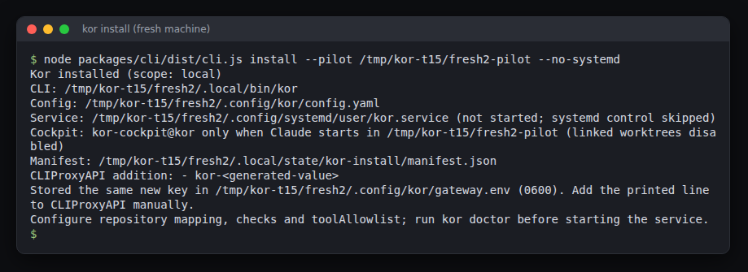

```text
$ node packages/cli/dist/cli.js install --pilot /tmp/kor-t15/fresh2-pilot --no-systemd
Kor installed (scope: local)
CLI: /tmp/kor-t15/fresh2/.local/bin/kor
Config: /tmp/kor-t15/fresh2/.config/kor/config.yaml
Service: /tmp/kor-t15/fresh2/.config/systemd/user/kor.service (not started; systemd control skipped)
Cockpit: kor-cockpit@kor only when Claude starts in /tmp/kor-t15/fresh2-pilot (linked worktrees disabled)
Manifest: /tmp/kor-t15/fresh2/.local/state/kor-install/manifest.json
CLIProxyAPI addition: - kor-<generated-value>
Stored the same new key in /tmp/kor-t15/fresh2/.config/kor/gateway.env (0600). Add the printed line to CLIProxyAPI manually.
Configure repository mapping, checks and toolAllowlist; run kor doctor before starting the service.
```

That capture used `--no-systemd` so that it would not touch the user manager of the
machine it ran on. Without that flag the installer also reloads your systemd user
manager and leaves the `kor` service installed but **not started**. The service
lifecycle on a real user manager was not exercised in these captures; the daemon
was run with `kor serve` in a terminal instead. An earlier validation checked the
generated unit with `systemd-analyze --user verify`.

What the installer does and does not do:

- It writes `~/.local/bin/kor`, a config scaffold, a private `gateway.env`, a
  systemd user unit, and registers the `kor-cockpit@kor` Claude Code plugin from a
  local marketplace under Kor's data directory.
- Local scope (`--pilot`, the default) declares the plugin only in the pilot's
  `.claude/settings.local.json`, so your user-level Claude settings stay
  byte-identical. A linked Git worktree is refused as a pilot; use a normal clone.
- It records every change in a journal so that `kor uninstall` can reverse it.
- It never edits CLIProxyAPI's configuration, `~/.codex` or `~/.agents`. You add
  the printed `api-keys` line to CLIProxyAPI yourself.

**Add the key to CLIProxyAPI.** The `CLIProxyAPI addition:` line is a list item for
the `api-keys` list in CLIProxyAPI's own configuration file. Add it, then restart
or reload the proxy as CLIProxyAPI documents:

```yaml
api-keys:
  - kor-<generated-value>      # the line the installer printed
```

The same value is already stored as `KOR_GATEWAY_KEY` in
`~/.config/kor/gateway.env`, which is how Kor presents it. `kor doctor` then reports
`PASS CLIProxyAPI with Kor key: reachable`; `HTTP 401` means the proxy does not
know the key yet. Kor never edits the proxy's configuration.

When a gateway key already exists (in `gateway.env` or the environment) the
installer keeps it and prints `existing credential retained`, never the value.

To make the status line available in every project instead of one, reinstall at user
scope; your config and keys are reused:

```sh
kor uninstall
node packages/cli/dist/cli.js install --scope user
```

On a machine with no config, a user-scope install scaffolds a config entry for the
`kor-code` checkout itself; edit `repos` to name your project (see below). Real
output of that command on a fresh home:

```text
$ node packages/cli/dist/cli.js install --scope user --no-systemd
Kor installed (scope: user)
CLI: /tmp/kor-t15/fresh2/.local/bin/kor
Config: /tmp/kor-t15/fresh2/.config/kor/config.yaml
Service: /tmp/kor-t15/fresh2/.config/systemd/user/kor.service (not started; systemd control skipped)
Cockpit: kor-cockpit@kor
Manifest: /tmp/kor-t15/fresh2/.local/state/kor-install/manifest.json
CLIProxyAPI addition: - kor-<generated-value>
Stored the same new key in /tmp/kor-t15/fresh2/.config/kor/gateway.env (0600). Add the printed line to CLIProxyAPI manually.
Configure repository mapping, checks and toolAllowlist; run kor doctor before starting the service.
```

## Credentials and the gateway

| Credential | Where Kor looks (first match wins) |
| --- | --- |
| Gateway key (the key your CLIProxyAPI accepts from Kor) | `KOR_GATEWAY_KEY`, or `KOR_GATEWAY_KEY` in `~/.config/kor/gateway.env` (mode `0600`) |
| Gateway URL | `KOR_GATEWAY_URL`, or `~/.config/kor/gateway.env`; default `http://127.0.0.1:8317` |
| Linear personal API key | `LINEAR_API_KEY`, or `LINEAR_API_KEY=…` in `~/.config/linear/env` |
| TypeSafe API key | `TYPESAFE_API_KEY` (or `TYPESAFE_KEY`, `JEV_API_KEY`), or the same names in `~/.config/typesafe/env` |
| CLIProxyAPI management key (optional) | `CPA_MANAGEMENT_KEY`, in `gateway.env` or the environment |
| GitHub | `gh-axi` (or `gh`) logged in with `gh auth login`, or `GH_TOKEN` in the environment |
| Anything you paste into Mission Control's **Settings** | `~/.local/state/kor/connections.json` (mode `0600`, write-only). A saved Linear, Jev, GitHub or gateway key wins over the rows above. |

Runtime environment variables override the files for that one process. Kor never
prints a credential and never copies one from the environment onto disk.

To authorize Kor in CLIProxyAPI, add the line the installer printed to the
`api-keys` list in CLIProxyAPI's configuration, and restart or reload the proxy as
CLIProxyAPI documents. The same value must be `KOR_GATEWAY_KEY` for Kor. If you do
not have a key yet, `kor doctor` generates a fresh suggestion:

```text
FAIL CLIProxyAPI with Kor key: missing; CLIProxyAPI addition: - kor-<generated-value>
```

You can instead leave the files alone and connect everything from Mission Control:
**Settings**, **Connections**, **Connect** (see
[Start the daemon and open Mission Control](#start-the-daemon-and-open-mission-control)).
Either way, the page shows each connection as `connected` or `unavailable` with the
reason, and never shows a key.

## Configure a repository

Kor reads `~/.config/kor/config.yaml` (or `$XDG_CONFIG_HOME/kor/config.yaml`). The
installer scaffolds it with empty `checks` and `toolAllowlist`; they are
deliberate placeholders for your policy. This is the file used for the Mission Control
captures in this guide (the project path is a scratch clone of this repository):

```yaml
repos:
  kor-code:
    path: /tmp/kor-demo/pilot
    linearTeam: LEE
    linearProject: 743496b4-29be-4be5-8cd6-68b3bc39dbbc
    remote: https://github.com/korallis/kor-code.git
    defaultBranch: main
    ship: approve
    checks:
      - git diff --check
    toolAllowlist:
      - Read
      - Write
      - Edit
      - "Bash(git status*)"
      - "Bash(git diff*)"
      - "Bash(git log*)"
      - "Bash(ls*)"
      - "Bash(cat*)"
      - "Bash(grep*)"
      - "Bash(test*)"
limits: { total: 2, perRepository: 1 }
defaultRoute: { provider: anthropic, model: claude-haiku-5-5, accountPolicy: fill-first, sessionAffinity: true, reasoningLevel: medium }
pollIntervalSeconds: 120
intakeLabel: kor
```

- **`path`** is a standalone clone of the repository. Kor never edits it directly;
  every execution gets its own worktree.
- **`linearTeam`** (the team key, for example `LEE`) or **`linearProject`** (a
  project UUID) maps Linear issues to this repository. `linearProject` wins when
  both match. A repository key that equals the team key also works for small
  setups.
- **`checks`** are shell commands run in the worktree after each attempt. A
  non-zero exit means the attempt is not verified.
- **`toolAllowlist`** is the complete list of tools a session may use. Sessions run
  in Claude Code's `dontAsk` mode: anything not on the list is denied, and **a
  single denial fails the attempt**. Add the commands your project's agents
  actually run; see [Troubleshooting](#troubleshooting) for the denial this
  captured.
- **`ship`** is `approve` or `auto` (the default when it is missing). With `approve`
  a verified execution stops in the `waiting` state until you press **Approve and
  ship** in Mission Control (or **Request changes**); with `auto` it goes straight
  on to shipping. New projects added in Mission Control start as `approve`. It is
  also the **Shipping** field of a project's repository settings.
- **`remote`** (optional) is the GitHub URL. If set, `kor doctor` checks that
  `origin` matches it, and delivery pushes to it.
- **`limits`** cap concurrent executions (`total`, `perRepository`, optional
  `perProvider`).
- **`defaultRoute`** is the model Kor uses when Jev is unavailable or unsure, and
  the route of the very first attempt unless Jev picks a verified model.

You can edit all of this in Mission Control (a project's **Repository settings**,
or **Settings**); the daemon validates it, writes `config.yaml` atomically and keeps
the previous file as `config.yaml.bak`. The full schema, including calibration
options, is in [configuration](configuration.md).

## Check your setup with `kor doctor`

`kor doctor` prints one `PASS` or `FAIL` line per check and exits non-zero if any
fail. Kor itself writes nothing during the check (the tools it calls, such as
`claude` or `no-mistakes`, may create their own caches). `kor doctor --json` prints
the same checks as an object ([contract](cli-contract.md#kor-doctor---json-and-kor-plan---json)).
This is the real output on the sandbox used for this guide, with the gateway's
management key and `quota-axi` available:

```text
$ kor doctor
PASS Kor config: <sandbox>/home/.config/kor/config.yaml
PASS Linear key: available
PASS TypeSafe key: available
PASS CLIProxyAPI with Kor key: reachable
PASS CLIProxyAPI management access: available
PASS quota-axi: available
PASS Claude Code: 2.1.300 (Claude Code)
FAIL no-mistakes daemon: not running
PASS repo kor-code: <sandbox>/pilot (main)
FAIL doctor: one or more checks failed. Hint: fix the reported checks and rerun `kor doctor`
```

Without a management key the same machine reports two more failures, and a run
still verified:

```text
FAIL CLIProxyAPI management access: management key missing
FAIL quota-axi: unavailable
```

| Line | Needed for | If it fails |
| --- | --- | --- |
| `Kor config` | everything | Create or fix `config.yaml`. |
| `Linear key`, `TypeSafe key` | everything | Set the key. Without TypeSafe, planning is `blocked` and every acceptance judgment stays blocked. |
| `CLIProxyAPI with Kor key` | every model call | Start CLIProxyAPI, add Kor's key to its `api-keys`, check `KOR_GATEWAY_URL`. `HTTP 401` means the proxy does not know the key. |
| `Claude Code` | every session | Install Claude Code 2.1.299 or newer. |
| `repo <name>` | that repository | The path must be the Git checkout root, the default branch must exist, and `origin` must equal `remote` when you set one. |
| `no-mistakes daemon` | **shipping** | Delivery cannot pass the repository gate without it; see below. Verification does not need it. |
| `CLIProxyAPI management access`, `quota-axi` | Mission Control's account slots, quota windows and footer | Optional. Add the management key when you connect the gateway (or set `CPA_MANAGEMENT_KEY`) and have `quota-axi` available to see the account pool and its windows. |

`kor doctor` does not check GitHub. Mission Control's sidebar and Settings show
whether `gh-axi` or a pasted token can reach it.

## Start the daemon and open Mission Control

Start the daemon. With the service installed that is
`systemctl --user enable --now kor`; from a terminal in the `kor-code` checkout:

```sh
kor serve
```

```text
kor daemon listening on http://127.0.0.1:8327/status
```

The daemon binds to `127.0.0.1` only (port 8327 unless `--port` says otherwise; 8317
is refused because it is CLIProxyAPI's) and also serves Mission Control, the web
app built by `pnpm build` into `packages/web/dist`. `kor serve --ui-dir
/absolute/path/to/dist` serves another build. It must run from (or, for the
service, be installed from) the `kor-code` checkout, because it launches sessions
with that checkout's `scripts/sandbox.sh`. `kor serve` stays in the foreground; a
second terminal is for everything else.

Open it:

```sh
kor ui
```

```text
Opened Kor Code Mission Control in your browser.
```

`kor ui` reads the daemon's address, checks it answers, and opens your default
browser at that address with a session token in the URL fragment. The page reads
the token, clears it from the address bar and keeps it for the tab; the token is
never printed. Under WSL it opens the Windows browser. If the daemon is not
running, `kor ui` fails with `Kor daemon address unavailable; start kor serve
first`.

A browser that has no session, for instance one you opened by typing the address,
shows the connect screen. Paste the token from `~/.local/state/kor/ui-token`
(mode `0600`, created by the daemon on first start and kept across restarts):

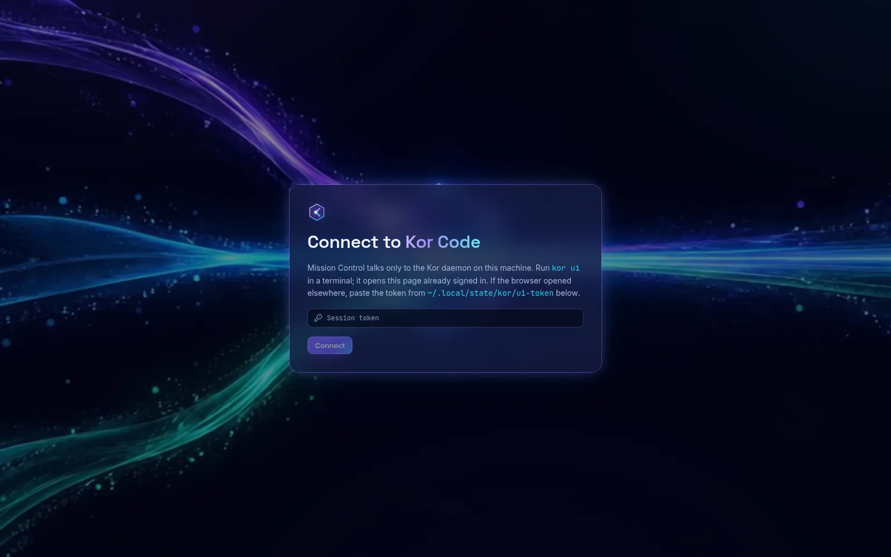

Connect, then open **Settings** to bring Linear, GitHub, the gateway and Jev
online:

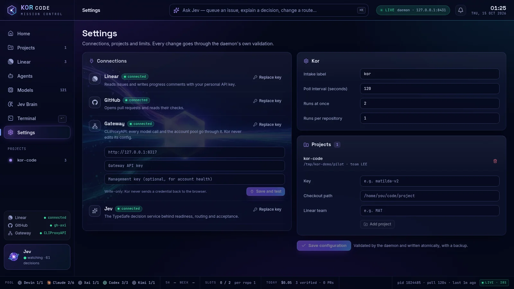

Each connection is a row with a status. **Connect** (or **Replace key**) opens its
fields: Linear and Jev take an API key, GitHub a token, the gateway a URL, a key
and an optional management key. **Save and test** stores them. They are
**write-only**: the daemon keeps them in `~/.local/state/kor/connections.json`
(private, mode `0600`) and never sends one back to the browser. A key saved here
wins over the files and variables in [Credentials](#credentials-and-the-gateway),
and later execution sessions use the saved gateway too. Nothing here edits
CLIProxyAPI: the gateway key still has to be in its `api-keys` list, as
[the installer printed](#install).

The right-hand side of Settings holds the intake label, poll interval, run limits
and the project list. **Save configuration** validates the whole config, writes
`~/.config/kor/config.yaml` atomically with a backup, and applies it without a
restart. The daemon refuses a config change while work or polling is active; try
again when nothing is running.

The page has a persistent frame. The top bar shows the **Ask Jev** field, a
`LIVE` / `STALE` / `OFFLINE` / `SIGNED OUT` pill for the daemon connection and a
bell that counts the runs that need you. The left sidebar has the screens, your
projects and the three connection lights. The footer shows pool health per
provider, the 5-hour and weekly quota windows, run slots in use, today's spend and
verified runs, and a provenance chip for the status the page is reading. If the
event stream fails, a banner says the daemon is not answering and offers
**Reconnect**; every value on screen is then the last one Kor reported.

## Choose a model

Kor only routes to a model that passed its compatibility probe. A model must pass
streaming, tool calls, extended thinking and structured output. Probe the ones you
want to use: on the **Models** screen use **Probe a model** (or **Probe** on a
row), or from a terminal. A probe costs a few cents per model, a little more for
the largest ones. These are the real results on the sandbox gateway (the column
header is printed once and left out of the later probes here):

```text
$ kor models probe --model claude-haiku-5-5
MODEL	STREAMING	TOOL_CALLS	THINKING	STRUCTURED_OUTPUT	COST_USD	DURATION_MS
claude-haiku-5-5	pass	pass	pass	pass	0.00426136	5527

$ kor models probe --model claude-sonnet-5-5
claude-sonnet-5-5	pass	pass	pass	pass	0.0767121	5890

$ kor models probe --model claude-opus-5-5
claude-opus-5-5	pass	pass	pass	pass	0.15289319999999998	6956

$ kor models probe --model claude-haiku-4-5-20251001
claude-haiku-4-5-20251001	pass	pass	pass	pass	0.047562600000000003	7008

$ kor models list
MODEL	FAMILY	CAPABILITIES	COST_USD	DURATION_MS
claude-haiku-5-5	claude	streaming,tool_calls,thinking,structured_output	0.00426136	5527
claude-sonnet-5-5	claude	streaming,tool_calls,thinking,structured_output	0.0767121	5890
claude-opus-5-5	claude	streaming,tool_calls,thinking,structured_output	0.15289319999999998	6956
claude-haiku-4-5-20251001	claude	streaming,tool_calls,thinking,structured_output	0.047562600000000003	7008
```

Whether a model passes depends on your gateway and its accounts, not only on the
model: when this guide was first written, this same gateway failed
`claude-sonnet-5-5` on thinking, and with no verified model `kor plan` reports `route: no-verified-route` and
readiness `blocked`. After a probe, set `defaultRoute.model` to a model in the
list. The Models screen lists every model the gateway offers (121 here) and marks
each `verified` or `unverified`; only verified ones can be a route or an override.

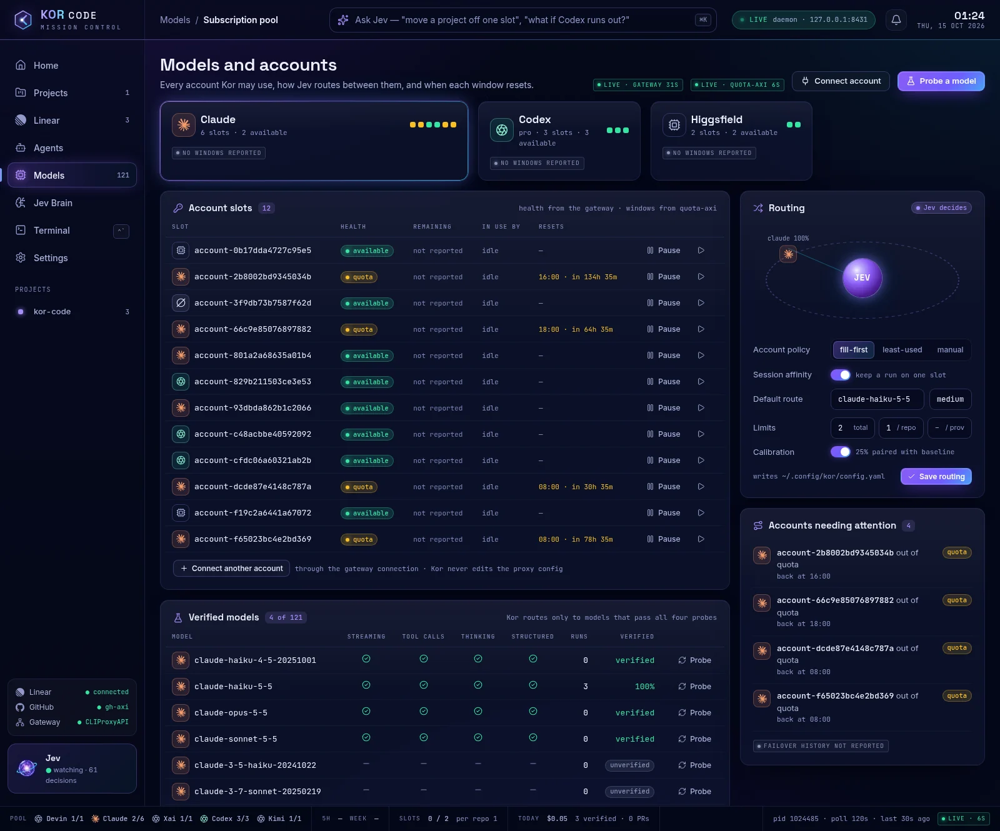

`kor models probe --family claude` probes every Claude model the gateway lists
(`--dry-run` shows the list first, without starting a session; the gateway used
here returned 19). Results are stored in `~/.local/state/kor/models.json`, which
`KOR_MODEL_REGISTRY` can redirect, and the CLI and Mission Control share them.

## Prepare a Linear issue

Kor reads the issue description. Put the outcome and the acceptance criteria in
it, under a heading named `Acceptance`, `Acceptance criteria` or
`Acceptance conditions` (any heading level), as a bullet or checkbox list. This is
the issue used for the captures:

```markdown
## Outcome

Add a `question(name)` function to `src/greeting.js`.

## Acceptance criteria

- [ ] `question("Ada")` returns `How are you, Ada?`.
- [ ] `greeting.test.js` has a test for `question` and `node --test` passes.
```

Each bullet becomes one acceptance condition that Jev judges against the diff.
**Everything under that heading, up to the next heading, counts: every non-empty
line is a condition**, bullet or not. Put notes, links and "this issue is a
disposable test" lines above the heading or under a different one. (A trailing note
under the list is exactly what failed LEE-1127's first attempt, as a third condition
the work could not meet.)
Without acceptance criteria the execution blocks with a needs-input reason before
any model session starts; [recovery](#recover-from-a-restart-a-crash-or-a-block)
explains how to clear that block.

Linear setup:

- Use a **personal API key** with access to the team. Agent-session mutations are
  disabled for personal keys.
- The team's workflow needs **Todo**, **In Progress**, **In Review** and **Done**
  states. A missing In Review state blocks an execution before the model starts.
- Kor only starts work you have opted in: the daemon polls **Todo** issues carrying
  the label named by `intakeLabel` (default `kor`), and never Backlog. `kor run
  ISSUE` queues one issue by hand without the label. Label-based
  polling was exercised live for this guide: LEE-1126 was labelled `kor` while
  in Todo, and the daemon queued it on its next poll.

Before queueing, run the preflight yourself to see what Jev thinks. It writes one
comment to the issue only when it needs your input:

```text
$ kor plan LEE-1111
PLAN plan-d8bf415a-8ca3-4991-b2bb-d0b78959e1a4
route: anthropic/claude-haiku-5-5 [jev]
fallback: false
readiness: ready (0.92); confidence=0.92; status=applied
complexity: small bounded change (0.39); confidence=0.41; status=applied
risk: low operational risk (0.00); confidence=1.00; status=applied
route: claude-haiku-5-5; confidence=0.96; status=applied
skill: generalist; confidence=1.00; status=applied
agent: generalist; confidence=1.00; status=applied
linear: no clarification needed
```

`kor plan` exits `1` while readiness is `blocked`, a decision is escalated, or a
fallback route is in use. The first attempt, before any model had passed the
probe, looked like this, and Kor wrote the `PLAN …` text as an issue comment:

```text
$ kor plan LEE-1111
PLAN plan-be9c64fa-e7dd-446a-bc3e-76e8b0c5fc4d
route: anthropic/claude-sonnet-5-5 [fallback]
fallback: false
readiness: blocked (0.03); confidence=0.03; status=blocked
complexity: small bounded change (0.42); confidence=0.37; status=applied
risk: low operational risk (0.09); confidence=0.88; status=applied
route: no-verified-route; confidence=0.96; status=blocked
skill: generalist; confidence=0.98; status=applied
agent: generalist; confidence=1.00; status=applied
linear: clarification comment written
FAIL plan: preflight did not produce a ready route. Hint: resolve the reported decisions or provide a healthy Jev response, then retry
```

## Work in Mission Control

Mission Control is the main way to use Kor. This section goes through each job, in
the order you meet them. The screenshots are of one real session: three throwaway
issues on a scratch clone of this repository, run with `ship: approve` on
`claude-haiku-5-5`.

The screens, from the sidebar:

| Screen | What it is for |
| --- | --- |
| **Home** (Command Centre) | What needs you, what is ready to ship, running agents, spend, **Next up**, and the Ask Jev field. |
| **Projects** | One page per configured repository: issues with their Kor run, progress, health, pull requests, activity and the repository settings. |
| **Linear** | The decision workspace for one run: the issue, Jev's reasoning, the diff and the evidence, and the approve, request-changes and override controls. |
| **Agents** | Every live run with its actual output, stages, tokens and cost; stop, retry and steer. |
| **Models** | Account slots and their health, the verified-model table, probes and the routing policy. |
| **Jev Brain** | The decision audit and the calibration report. |
| **Terminal** (Ctrl+Backtick) | The Agents view again, opened on the live output. |
| **Settings** | Connections, intake label, limits and projects. |

### Start or queue an issue

There are four ways in. All of them make the same durable assignment, and Jev
checks readiness before any model session starts.

- **Home, Next up.** Lists Todo issues carrying the intake label (`kor`) with a
  **Start** button. An issue with no acceptance criteria shows **Add** instead,
  which opens it in Linear.
- **Agents, Queue an issue.** Opens a dialog of every open issue Kor is not already
  running, with a filter. Tick one or more (an amber `no criteria` pill warns you
  when the issue has no acceptance list) and choose **Queue for Kor**.

  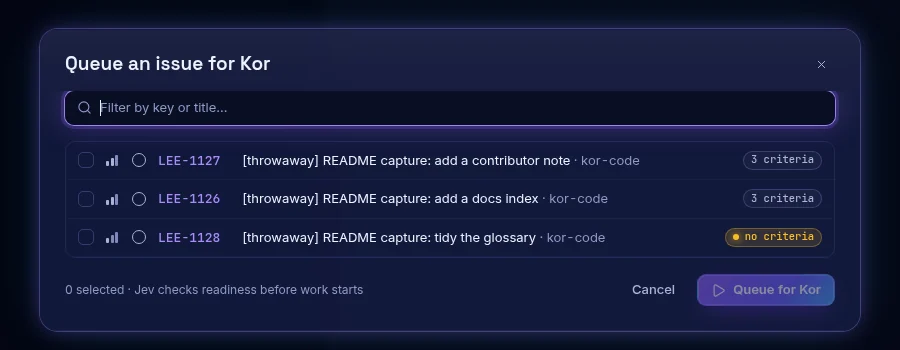

- **Projects, a project.** Tick rows and **Queue for Kor**, or press **Run with Kor**
  on a row. Rows offer **Add criteria** or **Label** where the issue lacks them.
- **Label the issue** `kor` in Linear and leave it in Todo; the daemon picks it up
  on its next poll (every `pollIntervalSeconds`). In the capture, LEE-1126 was
  labelled and started on its own.

Queued runs wait for a slot: `limits.total` caps concurrent runs and
`limits.perRepository` caps them per repository (the footer's **Slots** shows
both). Over the limit a run simply stays `queued`.

### Ask Jev

Press Ctrl+K (⌘K on a Mac), or click the Ask Jev field in the top bar or on Home. On
a run's screen the question is about that run (`"why did LEE-1127 pick haiku-5-5?"`).
Jev reads the daemon's live snapshot and answers with one grounded recommendation,
its confidence, and a button for the action it suggests:

```text
Jev just now · read the live snapshot
Jev recommends: Inspect the agents and their current blockers. Confidence: 51%.
[ Inspect the agents and their current blockers ]   [ Follow up ]
```

Jev's API returns typed choices with probabilities, not free-form chat, so Ask Jev
selects among actions Kor knows. **It never runs the action itself:** you press the
button (or do not). The suggested questions under the field (`What needs me right
now?`, `What can ship today?`) are a good start. The field also has File, Issue, Command and All projects chips.

### Answer a needs-input question

A run that cannot continue without you, for example an issue with no acceptance
criteria, lands in **Needs you** on Home, and the bell in the top bar counts it.

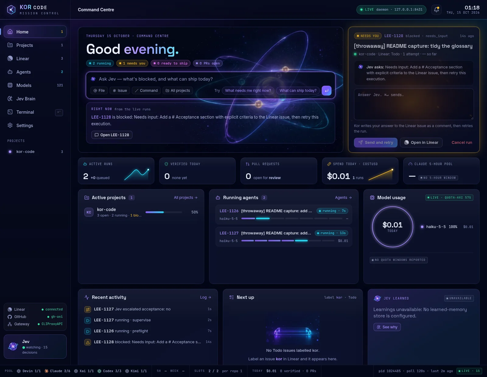

The card shows Jev's question (here: `Needs input: Add a # Acceptance section with
explicit criteria to the Linear issue, then retry this execution.`). Type your
answer and press **Send and retry** (Ctrl+Enter also sends). Kor writes the answer
to the Linear issue as a comment, then queues the run again. If the issue has no
acceptance criteria at all, your answer becomes the criterion for that attempt;
that is what happened to LEE-1128, which verified one condition on the retry. An
answer cannot get past an unfinished dependency or a Jev readiness refusal.

To give guidance without a question outstanding, use **Note for Jev** in the
**Steer** box on the run's Agents screen. Kor stores the note and supplies it to
the next session attempt; it does not reach a session that is already running.

### Watch a run

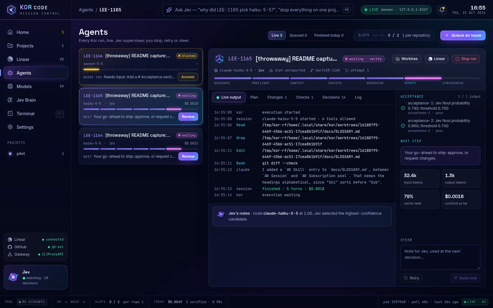

**Agents** lists live runs on the left and the selected one on the right. The strip
under its title is the seven stages; the tabs are **Live output** (the real
stdout and stderr of the session, with tool calls, permission denials and the
checks), **Plan**, **Changes**, **Checks**, **Decisions** and **Log**. The side
panel shows acceptance as Jev judges it, the next step, tokens, cache hit and cost
so far. The header's **Worktree** button copies the worktree path, **Linear** and
the PR button open them.

Tool denials are visible here: the capture shows a session being refused `Bash`
commands outside the allowlist and carrying on with the tools it had. One denial
fails an attempt; the fix is in [Troubleshooting](#troubleshooting).

**Projects** shows the same runs per repository:

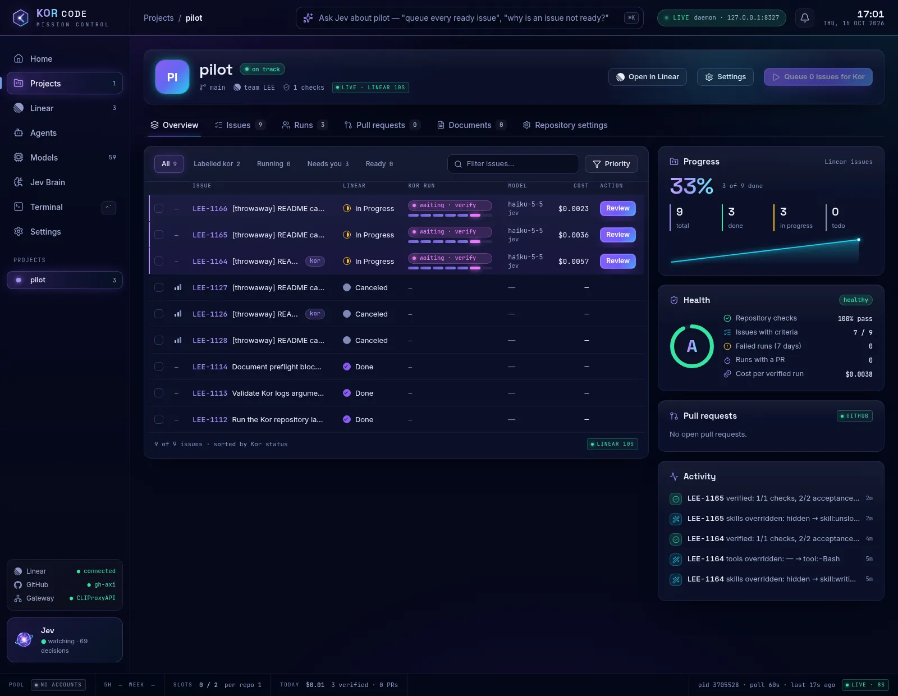

Its tabs are **Overview**, **Issues**, **Runs**, **Pull requests**, **Documents**
and **Repository settings** (checkout path, remote, default branch, Linear team and
project, **Shipping**, checks and the tool allowlist). The Progress, Health and
Pull requests cards come from Linear, your run history and GitHub; an upstream that
cannot be read is labelled `unavailable`, never shown as empty.

### Review, approve and ship

With `ship: approve`, a verified run stops at `waiting`. **Home** announces it in
**Ready to ship** with **Approve and ship** and **Review changes**; the runs also
show as `waiting · your go-ahead` under Running agents.

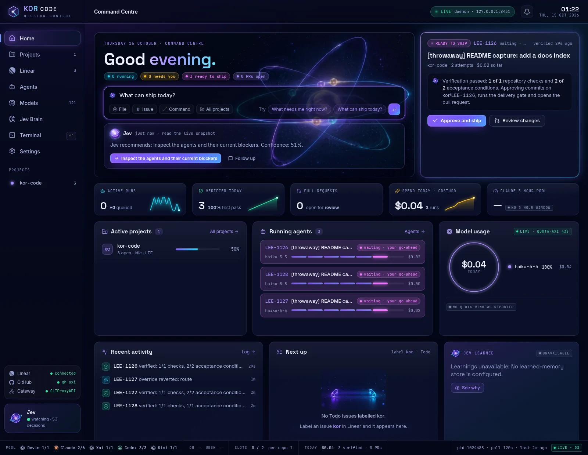

**Review changes** (or the **Linear** screen) opens the decision workspace:

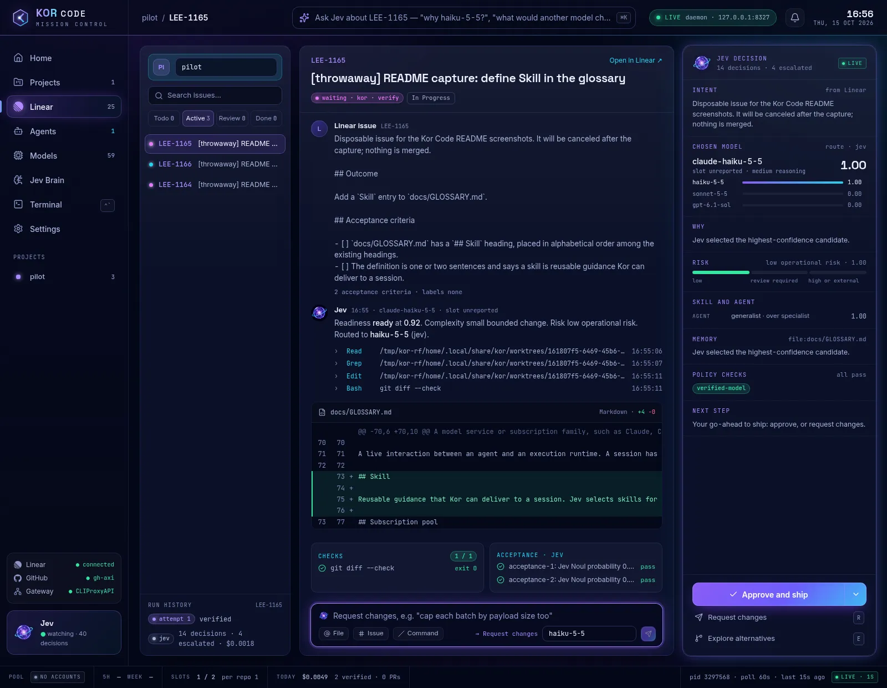

- The middle column is the issue, what Jev decided (readiness, complexity, risk,
  route and skill), the tools the session used, **the actual diff**, the repository
  checks (`git diff --check`, exit 0) and each acceptance condition with Jev's
  judgement.
- The right column is **Jev's decision**: intent, the chosen model with the
  probability of each candidate, why, risk, skill and agent, policy checks and the
  next step.
- **Approve and ship** is enabled only while the run waits. It commits the
  verified files on `kor/<issue key>`, runs the delivery gate and opens the pull
  request. Approving releases publication; it does not merge anything. See [what
  happens next](#what-happens-after-the-checks-pass).

**Approve and ship was not run against GitHub in these captures:** the sandbox
repository is a clone of this one, and nothing was published. The control, the
daemon route behind it (`POST /api/runs/:id/approve`) and the shipping logic are
exercised by the replay and by the [specification](specs/shipping.md).

### Request changes

Type the feedback into the box at the bottom of the decision workspace (press `R` to
jump to it) and **Send**. The model picker beside it chooses the model for the next
attempt; picking a different verified model applies it as a route override first.
Kor stores the feedback, discards the approval and the verification, and reruns the
same issue branch through Execute and Verify. In the capture, LEE-1128 was sent
back with `Keep each glossary definition under 25 words.`: its attempt counter went
from 2 to 3, the run history lists attempt 3 as `verified`, and the diff in the
screenshot is the result. The run returned to
`waiting`. Request changes is refused while a publication is already underway.

### Override a Jev decision, and undo it

Press **Explore alternatives** (or `E`):

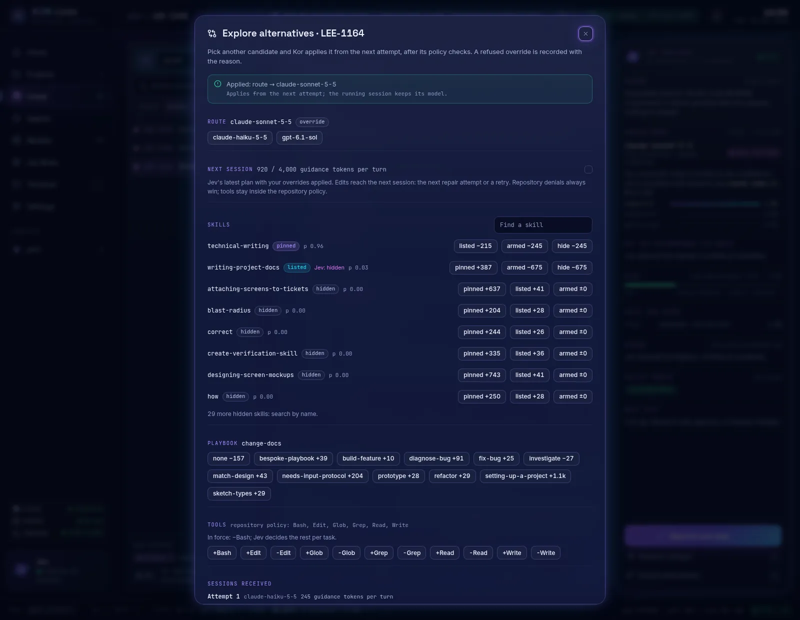

Every decision Jev made for the run is listed (route, readiness, complexity, risk,
skill, agent, acceptance) with its other candidates as buttons. The route can move
to any other verified model. Pick one and the daemon checks policy: the run must
not be finished, the model must have passed `kor models probe`, and it must differ
from the route in force. If the checks pass the override is **applied**, from the
next attempt (the running session keeps its model); otherwise it is **refused** and
recorded with the reason. Either way it goes into the audit (`override_audit`,
`kor logs`) and onto the Linear issue as a comment. **Your overrides** at the foot
of the dialog lists them, and **Revert** puts Jev's choice back, which is also
audited and commented. In the capture the route was switched to
`claude-sonnet-5-5` and reverted again:

```text
2026-10-15T00:20:44.954Z override ovr_3a13daf9 applied: route -> claude-sonnet-5-5 (Applies from the next attempt; the running session keeps its model.)
2026-10-15T00:20:57.944Z override ovr_3a13daf9 reverted
```

### Retry or stop a run

- **Retry.** On **Agents** the **Retry** button (or **Retry the run** in the
  decision workspace's menu) works on `failed`, `blocked` and `canceled` runs and
  keeps the execution ID. A blocked publication resumes its stage rather than
  rerunning the session. The log records `retry accepted from Mission Control`.
- **Stop.** **Stop run** on Agents, **Cancel the run** in the decision workspace's
  menu, or **Cancel run** on a Needs-you card. A running session is stopped first.
  In the capture, stopping LEE-1126 moved it to `canceled`.

Neither touches Linear's workflow state: a stopped run's issue stays **In
Progress** until you move it. Retries also replay the preflight audit while the
issue and the eligible models are unchanged.

### Open the pull request

Once shipping opens it, the pull request is linked everywhere: in the run's header
and the decision workspace's menu, on the **Agents** header's **PR** button, in the
project's **Pull requests** card with an **Open** button, and in Home's pull-request
count. Linear moves to In Review and links it too. You review and merge it on
GitHub; Kor observes the merge, moves Linear to Done and completes the run. This
step is the part of Kor with the least live evidence; see [below](#what-happens-after-the-checks-pass).

### Models and accounts

The **Models** screen (screenshot [above](#choose-a-model)) has four parts:

- **Account slots.** Every account the gateway pool holds, as opaque slot ids (the
  gateway's own account names never reach the page), with health (`available` or
  `quota`), what each slot is in use by, when its window resets, and **Pause** and
  resume buttons that change the account's real status in the gateway. **Connect
  account** and **Connect another account** point you at the gateway connection;
  Kor never edits CLIProxyAPI's config.
- **Provider cards** summarise each provider's slots and quota windows when
  `quota-axi` reports them (`no windows reported` when it does not).
- **Verified models.** The probe results, with **Probe** per row and **Probe a
  model** at the top.
- **Routing.** The account policy (`fill-first`, `least-used`, `manual`), session
  affinity, the default route and reasoning level, the run limits and the
  calibration sample rate. **Save routing** writes them to `config.yaml`.

### See what Jev learned

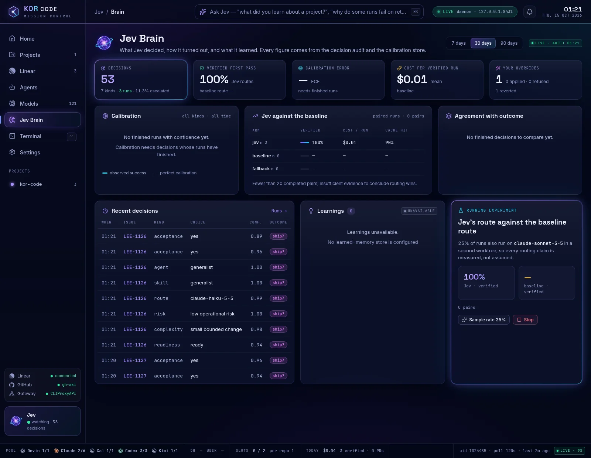

**Jev Brain** reads the persisted decision audit and the same calibration report as
`kor calibrate report`: decisions made, first-pass verification rate, cost per
verified run, Jev against the baseline route, and your overrides, over 7, 30 or 90
days. With few finished runs it says so instead of drawing a trend; the capture
has three runs, so calibration shows `No finished runs with confidence yet` and
the baseline comparison shows `Fewer than 20 completed pairs`. **Learnings** is
unavailable until a learned-memory store exists. The running experiment pairs a
sampled share of runs (25% by default) with the baseline route, in a second
worktree, so routing claims are measured.

### When Linear is behind (synchronization pending)

Every action above first becomes a durable change in Kor's own database, then Kor
writes the matching comment or state to Linear. If Linear cannot be reached at that
moment, the action is still **applied** and the write waits in a durable queue that
the daemon retries on its next Linear poll. The daemon reports this as
`linearSync.status: "pending"` with the number of pending writes; the page shows
the action as done. **Do not repeat the action to force the sync.** A refusal is a
different thing: it comes back as an error with a hint, and nothing changed. This
case was not reproduced live for this guide (Linear was reachable throughout); the
behaviour is the one specified in the
[Mission Control API](mission-control-api.md#actions).

## What happens after the checks pass

After verification passes the execution moves on. With `ship: approve` it first
waits (`waiting`) until you press **Approve and ship** in Mission Control's decision
workspace; with `ship: auto` it goes straight to `shipping`. The daemon then:

1. Commits **only the verified paths** on `kor/<issue key>`. Unrelated files and
   likely secrets (`.env*`, keys, credential files, agent config directories,
   logs) stay untracked, and a secret path already staged or committed by the
   session blocks publication.
2. Asks `no-mistakes axi status` which gate the repository uses. An initialized
   repository goes through the no-mistakes pipeline. Only the explicit "repository
   not initialized" answer allows the direct `git push` and `gh-axi pr create`
   path. An unreachable daemon, an approval gate or a failed pipeline keeps
   delivery blocked and never bypasses the gate.
3. Pushes the branch to `origin` and opens a pull request with redacted evidence.
   Linear moves to **In Review** and links the pull request.
4. Waits. When you merge, Kor observes it, moves Linear to **Done**, reports
   `complete`, and removes only its own clean worktree.

Kor does not merge, force-push, delete branches, or start or stop the shared
no-mistakes daemon.

**What these captures show.** In the Mission Control captures, three runs verified and
were left at the approval gate on purpose, so no pull request was opened. In the
earlier command-line captures the demo project had no `origin` remote, so shipping
stopped at step 2 for every run with the message in the logs above:
`git failed (2): error: No such remote 'origin'`. The verified work stayed in its
worktree and the execution is `blocked` (Mission Control and Linear show the same
reason). Delivery through no-mistakes and the pull request itself were **not**
exercised against GitHub in these captures. They are covered by the committed
replay (`pnpm shipping:proof`, see [development](development.md)) and the
[shipping specification](specs/shipping.md), which is explicit about that
boundary. Once your repository has a GitHub `origin`, a gh-axi login and a running
no-mistakes daemon, this is the path to expect; until you have seen it work, treat
the pull-request step as the part of Kor with the least live evidence.

## The CLI and the Claude Code status line

Mission Control is the main route. These two are secondary routes to the same
daemon and the same queue: use them from a terminal, a script, or inside Claude Code.

### Run an issue from the CLI

With the daemon running (see [Start the daemon](#start-the-daemon-and-open-mission-control)),
preview and queue an issue from a second terminal:

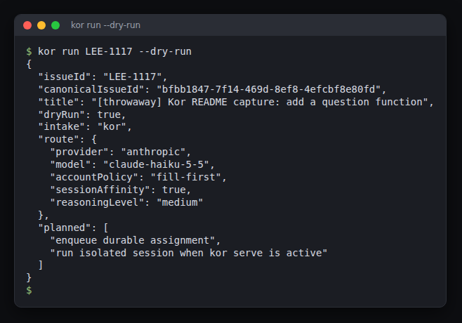

```text
$ kor run LEE-1111 --dry-run
{
  "issueId": "LEE-1111",
  "canonicalIssueId": "d8028008-c8b4-47a3-8b64-c00770784e73",
  "title": "[throwaway] Kor README capture: add a farewell function",
  "dryRun": true,
  "intake": "kor",
  "route": {
    "provider": "anthropic",
    "model": "claude-haiku-5-5",
    "accountPolicy": "fill-first",
    "sessionAffinity": true,
    "reasoningLevel": "medium"
  },
  "planned": [
    "enqueue durable assignment",
    "run isolated session when kor serve is active"
  ]
}

$ kor run LEE-1111
{
  "schemaVersion": 1,
  "issueId": "LEE-1111",
  "canonicalIssueId": "d8028008-c8b4-47a3-8b64-c00770784e73",
  "executionId": "cd1e6aa4-be39-466f-8d69-eb4b8687dfaf",
  "status": "queued",
  "queued": true
}
```

The daemon claims it within seconds; it then appears in Mission Control like any
other run. Follow it from the terminal with `kor status` and `kor logs`:

```sh
kor status --json LEE-1111 | jq -c '{state: .run.state, attempts: .run.attempts}'
kor logs cd1e6aa4-be39-466f-8d69-eb4b8687dfaf
```

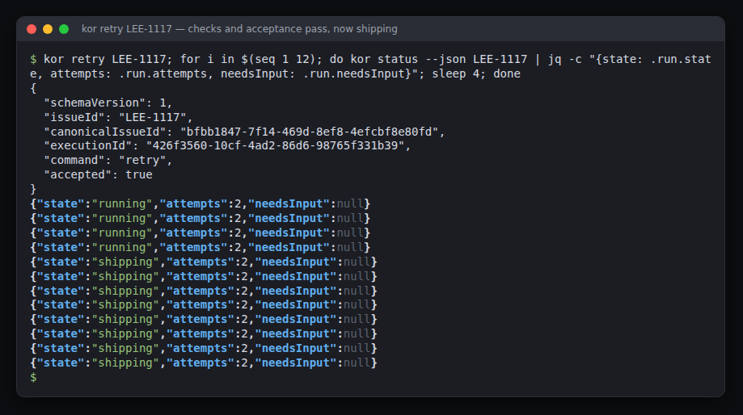

| You want to | Run |
| --- | --- |
| Open Mission Control | `kor ui` |
| Preview Jev's plan for an issue (writes one Linear comment only when it needs your input) | `kor plan LEE-123` |
| Queue an issue, or preview it | `kor run LEE-123`, `kor run LEE-123 --dry-run` |
| See every execution, or one | `kor status --json`, `kor status --json LEE-123` (or the execution ID) |
| Read an execution's timeline | `kor logs EXECUTION-ID` |
| Try a blocked, failed or canceled execution again | `kor retry LEE-123` |
| Stop an execution | `kor cancel LEE-123` (Kor's queue only; the Linear issue is not moved) |
| Check your setup | `kor doctor` |
| Probe and list models | `kor models probe --model MODEL`, `kor models list` |
| Report calibration | `kor calibrate report` |

`kor retry` and `kor cancel` go through the running daemon when there is one, so
they obey the same cancellation fencing and publication rules as the buttons in
Mission Control. `kor plan` exits `1` while readiness is `blocked`, a decision is
escalated, or a fallback route is in use. Full JSON for scripts, and the error
format, are in the [CLI contract](cli-contract.md).

The run log is a plain timeline. This is the same run, LEE-1117 (its first attempt
was denied a tool, the second verified, and shipping stopped because that demo
project had no GitHub `origin`):

```text
$ kor logs 426f3560-10cf-4ad2-86d6-98765f331b39
2026-10-14T18:06:09.952Z execution started
2026-10-14T18:06:37.756Z execution blocked: Session failed: 1 permission denial
2026-10-14T18:10:24.075Z execution started
2026-10-14T18:10:39.371Z execution shipping
2026-10-14T18:11:21.807Z shipping blocked: git failed (2): error: No such remote 'origin'
```

A verified change sits in the execution's worktree, uncommitted until shipping
commits it. The path is `worktree` in the status (here
`~/.local/share/kor/worktrees/<execution id>` while it exists), and Mission Control's
**Worktree** button copies it:

```text
$ git -C ~/.local/share/kor/worktrees/426f3560-10cf-4ad2-86d6-98765f331b39 status --short
 M greeting.test.js
 M src/greeting.js
```

### The Claude Code status line

The installer registers the `kor-cockpit` Claude Code plugin (see
[Install](#install)). Where it is active, Claude Code shows a one-line Kor status
under the prompt, for example:

```text
[LIVE] Kor LEE-1111 · blocked 0/7 · blocked · claude-haiku-5-5 · medium
```

That line, from an earlier capture, is the current execution, its stage count, state,
route and reasoning level. `/kor` draws the same daemon's status as a pane (views
for the issue, project, decisions, agents, accounts, context, Linear and
overrides) and `/kor override` and `/kor revert` send the same policy-checked
overrides that Mission Control's **Explore alternatives** does. Every row is labelled
`[LIVE]`, `[STALE]` (last known, with its age, read from the daemon's snapshot file)
or `[UNAVAILABLE]`. Set `KOR_COCKPIT=off` to hide it, `KOR_STATUS_URL` to read
another daemon (`off` reads only the snapshot) and `KOR_STATE_DIR` to read another
state directory.

The plugin is active only where it was installed: in the `--pilot` checkout, or in
every project after a user-scope install (`kor install --scope user`). To try it
without installing anything, in a disposable Claude configuration, run `pnpm
cockpit` from the `kor-code` checkout while the daemon is running and type `/kor`.
Mission Control is where you review, approve and override; nothing in this section
is needed to use Kor.

## Recover from a restart, a crash or a block

Kor's queue and leases are durable (SQLite in `~/.local/state/kor/kor.db`), so
stopping the daemon never loses an assignment. All of this was run for real. In
Mission Control a stopped daemon shows as an `OFFLINE` pill and a banner (`The Kor
daemon is not answering`) with every value frozen at what it last reported;
**Reconnect** (or just starting `kor serve` again) brings it back. The CLI
transcripts below show the same recovery from a terminal.

**Stop the daemon.** `kor status --json ISSUE` reports `provenance: "stale"` at
once and still returns the last record:

```text
$ kor status --json LEE-1111
{
  "schemaVersion": 1,
  "provenance": "stale",
  "observedAt": "2026-10-14T18:00:09.000Z",
  "reason": "daemon is not running or its snapshot is unavailable or stale",
  "run": {
    "executionId": "cd1e6aa4-be39-466f-8d69-eb4b8687dfaf",
    "issueId": "d8028008-c8b4-47a3-8b64-c00770784e73",
    "issueKey": "LEE-1111",
    "state": "blocked",
    "attempts": 1,
    "cancelRequested": false,
    "pullRequestUrl": null,
    "needsInput": {
      "reason": "git failed (2): error: No such remote 'origin'\n"
    },
    "costUsd": null
  }
}
```

The unselected `kor status` keeps reading `live` until the last snapshot is older
than twice the poll interval; at 132 seconds with a 60-second poll it reported:

```text
$ kor status --json | jq '{provenance, reason, observedAt, snapshotObservedAt: .snapshot.observedAt}'
{
  "provenance": "stale",
  "reason": "snapshot is 132s old",
  "observedAt": "2026-10-14T18:02:19.311Z",
  "snapshotObservedAt": "2026-10-14T18:00:06.883Z"
}
```

**Crash the daemon mid-run.** The daemon was killed with `SIGKILL` while LEE-1116
was `running`:

```text
$ kor status --json LEE-1116
{
  "schemaVersion": 1,
  "provenance": "stale",
  "observedAt": "2026-10-14T18:03:48.992Z",
  "reason": "daemon is not running or its snapshot is unavailable or stale",
  "run": {
    "executionId": "5520bb1e-3b82-4063-8e92-98cdb7fc1fa2",
    "issueId": "73248b73-2db9-4ac9-a341-ba087589a317",
    "issueKey": "LEE-1116",
    "state": "running",
    "attempts": 1,
    "cancelRequested": false,
    "pullRequestUrl": null,
    "needsInput": null,
    "costUsd": null
  }
}
```

Starting `kor serve` again stopped the orphaned session, re-queued the execution
and ran it again, with `attempts` going to 2:

```text
$ kor logs 5520bb1e-3b82-4063-8e92-98cdb7fc1fa2
2026-10-14T18:03:44.420Z execution started
2026-10-14T18:03:53.315Z daemon restarted; previous session stopped; re-queued
2026-10-14T18:03:53.338Z execution started
2026-10-14T18:04:20.106Z execution blocked: Session failed: 1 permission denial
```

**A permission denial.** That second attempt blocked because the session tried to
run a command that was not on the repository's `toolAllowlist`. Kor reports the
count and the Linear comment says so:

```text
Kor verification blocked: Session failed: 1 permission denial
acceptance-1: pass
acceptance-2: pass
```

The status does not name the tool. To find out, I re-ran the prompt of a sibling
demo issue (LEE-1117, which was blocked the same way) by hand under the flags
Kor uses (`claude -p … --permission-mode dontAsk --allowedTools … --output-format
stream-json`) and read `permission_denials` from the final result line. The session
had run `npm test`, and only `Bash(node --test*)` was on the list:

```json
{"tool_name":"Bash","tool_input":{"command":"npm test 2>&1 | tail -15","description":"Run test suite via npm test"}}
```

The fix is to add the command to the list (`"Bash(npm test*)"`), restart `kor
serve` so it rereads `config.yaml`, then retry. The retry reuses the execution:

```text
$ kor retry LEE-1116
{
  "schemaVersion": 1,
  "issueId": "LEE-1116",
  "canonicalIssueId": "73248b73-2db9-4ac9-a341-ba087589a317",
  "executionId": "5520bb1e-3b82-4063-8e92-98cdb7fc1fa2",
  "command": "retry",
  "accepted": true
}
$ kor logs 5520bb1e-3b82-4063-8e92-98cdb7fc1fa2
2026-10-14T18:03:44.420Z execution started
2026-10-14T18:03:53.315Z daemon restarted; previous session stopped; re-queued
2026-10-14T18:03:53.338Z execution started
2026-10-14T18:04:20.106Z execution blocked: Session failed: 1 permission denial
2026-10-14T18:04:45.086Z execution started
2026-10-14T18:05:01.775Z execution shipping
2026-10-14T18:05:42.939Z shipping blocked: git failed (2): error: No such remote 'origin'
```

**A preflight block.** Missing acceptance criteria, an unfinished blocking dependency
or a healthy Jev readiness denial stop the execution before any model session
starts. The execution is `blocked`, Kor writes a durable clarification comment on the
Linear issue and adds the `kor:blocked` label. Fix the issue (add the `Acceptance`
section, finish the dependency, or state the clarified intent in the issue
description), then run `kor retry`. When execution resumes, Kor removes
`kor:blocked`.

A retry with unchanged input replays the recorded preflight audit instead of
deciding again. Clarified intent, or a change to the eligible models, creates a
fresh immutable decision revision. Earlier decisions stay in the audit. With
calibration enabled, recorded attempt metrics show provider-reported costs when
available; a provider cost may be unknown.

**Retry and cancel.** In Mission Control these are **Retry** and **Stop run** (see
[Retry or stop a run](#retry-or-stop-a-run)). On the command line, `kor retry
EXECUTION-ID|ISSUE-ID` works on failed, blocked
and canceled executions and keeps the execution ID. It does not rerun a session
whose work already verified and reached shipping; it continues delivery. `kor
cancel` stops a queued, running or blocked execution; a running session is stopped
first. Cancelling an execution that is already finished is refused:

```text
$ kor cancel LEE-1111
{
  "schemaVersion": 1,
  "issueId": "LEE-1111",
  "canonicalIssueId": "d8028008-c8b4-47a3-8b64-c00770784e73",
  "executionId": "cd1e6aa4-be39-466f-8d69-eb4b8687dfaf",
  "command": "cancel",
  "accepted": true
}
$ kor cancel LEE-1111 --json
{"schemaVersion":1,"error":{"code":"not_accepted","message":"cancel was not accepted for execution cd1e6aa4-be39-466f-8d69-eb4b8687dfaf","hint":"cancel only queued, running, or blocked executions"}}
```

**`kor cancel` only changes Kor's queue.** In these captures the Linear issue was
still **In Progress** afterwards and no cancellation comment appeared, so move the
issue back to Todo (or cancel it) in Linear yourself.

## Troubleshooting

| You see | Cause and fix |
| --- | --- |
| `FAIL <command>: … Hint: …` | Every failure is one line with a hint. Add `--json` for the structured object ([contract](cli-contract.md#errors)), `--debug` for a stack trace. |
| `kor: command not found` | Add `~/.local/bin` to `PATH`, or run `bin/kor` / `pnpm kor` from the checkout. |
| `FAIL kor: Kor is not built. Hint: run pnpm install --frozen-lockfile and pnpm build in the Kor checkout.` | Run those two commands in the `kor-code` checkout. |
| `FAIL run: No Kor repository mapping for Linear team LEE. …` | No repository in `config.yaml` has `linearTeam` (or `linearProject`) matching the issue. Add the mapping. |
| `FAIL Kor config: missing (…/config.yaml)` | Run `kor install`, or create the file ([configuration](configuration.md)). |
| `FAIL CLIProxyAPI with Kor key: unreachable` | CLIProxyAPI is not running at `KOR_GATEWAY_URL` (default `http://127.0.0.1:8317`). |
| `FAIL CLIProxyAPI with Kor key: HTTP 401` | The proxy does not have Kor's key in `api-keys`. |
| `FAIL CLIProxyAPI with Kor key: missing; CLIProxyAPI addition: - kor-…` | No Kor key is configured; add the printed line to the proxy and the same value to `gateway.env`. |
| `route: no-verified-route`, readiness `blocked` | No model has passed `kor models probe`. Probe one and set `defaultRoute.model` to it. |
| `jev: unavailable (TypeSafe API key not found …)` | Set `TYPESAFE_API_KEY`. Until then routes are labelled `fallback` and acceptance stays blocked. |
| Mission Control shows the connect screen, or the pill says `SIGNED OUT` | This browser holds no valid session. Run `kor ui`, or paste the token from `~/.local/state/kor/ui-token` (the daemon creates it on first start). |
| `FAIL ui: Kor daemon address unavailable; start kor serve first. Hint: …` (or `Kor daemon unavailable; …`) | The daemon is not running, or did not answer. Start `kor serve` (or the service) and run `kor ui` again. |
| `OFFLINE` pill, and a banner saying the daemon is not answering | The event stream closed. Start `kor serve`, then press **Reconnect**. Values on screen are the last ones Kor reported. |
| A sidebar light shows `connect` | That connection is missing or failing. Open **Settings**, read the reason on its row, and connect it. GitHub needs `gh auth login` or a token. |
| **Approve and ship** is greyed out | The run is not waiting. It must be verified under `ship: approve`; a blocked or running run is not approvable. |
| Models and Pool panels say `unavailable` or `not reported` | The gateway's management key or `quota-axi` is missing; [see `kor doctor`](#check-your-setup-with-kor-doctor). The panel never shows an upstream failure as an empty list. |
| `acceptance-N: fail` for a condition you did not write | A line under the `Acceptance` heading that is not a criterion (a note, a link) was read as one. Move it out from under the heading, then retry. |
| `Session failed: 1 permission denial` | The session used a tool outside `toolAllowlist`; see the [walk-through](#recover-from-a-restart-a-crash-or-a-block). |
| `git failed (2): error: No such remote 'origin'` | Delivery needs a GitHub `origin` (or `remote` in the config). The verified work is still in the worktree; add the remote and `kor retry`. |
| Execution `blocked` with a clarification comment and `kor:blocked` on the issue | A preflight block: missing acceptance criteria, an unfinished dependency or a Jev readiness denial. Fix the issue as the comment says, then `kor retry` ([walk-through](#recover-from-a-restart-a-crash-or-a-block)). |
| `Local cockpit installation requires a standalone checkout …` | `--pilot` was a linked worktree. Use a normal clone. |
| `/kor` shows `[STALE]` or `[UNAVAILABLE]` | The daemon is down, or the status-line plugin cannot reach it. Start `kor serve`; check `KOR_STATUS_URL` and `KOR_STATE_DIR`. |
| `FAIL status: …` | `kor status` could not read the snapshot or the execution; the hint says which. |

## Where Kor keeps things

| Path | Contents |
| --- | --- |
| `~/.config/kor/config.yaml` | Repository mappings and policy. `config.yaml.bak` is the previous version, kept when Mission Control saves. |
| `~/.config/kor/gateway.env` | Gateway key and URL (mode `0600`). |
| `~/.local/state/kor/kor.db` | The queue, leases, decisions, overrides and calibration rows. |
| `~/.local/state/kor/snapshots/` | `index.json` plus one file per execution. |
| `~/.local/state/kor/ui-token` | The session token `kor ui` hands to the browser (mode `0600`, directory `0700`). |
| `~/.local/state/kor/ui-address.json` | The daemon's address and process ID, written while it runs. |
| `~/.local/state/kor/connections.json` | Keys you saved in Mission Control's Settings (mode `0600`, write-only). |
| `~/.local/state/kor/logs/<execution id>.log` | What `kor logs` prints. `<execution id>.terminal.log` beside it is the session's output that Mission Control streams. |
| `~/.local/state/kor/models.json` | The model probe results. |
| `~/.local/share/kor/worktrees/<execution id>` | The isolated checkout for each execution. |
| `~/.local/state/kor-install/` | The installation journal and backups used by `kor uninstall`. |

`XDG_CONFIG_HOME`, `XDG_STATE_HOME` and `XDG_DATA_HOME` move these roots.

## Update and uninstall

To update, pull and rebuild, then **reinstall**. Building updates the checkout, but
the installer copied the status-line plugin into Kor's marketplace and Claude's plugin
cache, and neither copy follows the source (Mission Control is served from the
checkout's `packages/web/dist`, so `pnpm build` and restarting the daemon refresh it). The installer also refuses to run over
an existing installation, so uninstall first. Use the same options you installed
with (`--pilot …` or `--scope user`):

```sh
cd kor-code
git pull
pnpm install --frozen-lockfile
pnpm build
kor uninstall
node packages/cli/dist/cli.js install --pilot ~/code/my-project
systemctl --user enable --now kor     # uninstall disabled the service; or run `kor serve`
```

The uninstall keeps your config, gateway key and state, and the reinstall reuses
them (it prints `existing credential retained`). I checked this by adding a marker
line to the plugin source and running `pnpm build`: the installed copy did not
have it until the reinstall, and `gateway.env` was byte-identical afterwards:

```text
$ kor uninstall && node packages/cli/dist/cli.js install --pilot /tmp/kor-t15/fresh4-pilot --no-systemd
Kor uninstalled; config and state retained
Backups: /tmp/kor-t15/fresh4/.local/state/kor-install/backups/1792003406272-aac9bb9d
Kor installed (scope: local)
CLI: /tmp/kor-t15/fresh4/.local/bin/kor
Config: /tmp/kor-t15/fresh4/.config/kor/config.yaml
Service: /tmp/kor-t15/fresh4/.config/systemd/user/kor.service (not started; systemd control skipped)
Cockpit: kor-cockpit@kor only when Claude starts in /tmp/kor-t15/fresh4-pilot (linked worktrees disabled)
Manifest: /tmp/kor-t15/fresh4/.local/state/kor-install/manifest.json
CLIProxyAPI addition: existing credential retained; add its api-keys line manually if needed (value not printed).
Configure repository mapping, checks and toolAllowlist; run kor doctor before starting the service.
```

One consequence: `kor uninstall --purge` after a reinstall restores the config and
state as they were just before the *latest* install, which includes what the earlier
installation created, so a purge after an update cycle leaves those files in place.
Delete `~/.config/kor`, `~/.local/state/kor` and `~/.local/share/kor` by hand if you
want them gone.

To remove Kor, run `kor uninstall`. It stops and disables the service, restores
every file it changed from its backups, and removes the status-line plugin and
marketplace, while keeping your config, state and the backups. `kor uninstall
--purge` also removes the config, state and data Kor created, and restores
anything that predated the installation. Run on a fresh home, the pair left
nothing behind:

```text
$ kor uninstall
Kor uninstalled; config and state retained
Backups: /tmp/kor-t15/fresh/.local/state/kor-install/backups/1792000537354-86e40e1d
$ kor uninstall --purge
Kor uninstalled (purged new Kor data; restored pre-existing data)
Replayed /tmp/kor-t15/fresh/.local/state/kor-install/backups/1792000537354-86e40e1d
$ find $HOME -mindepth 1 | wc -l
0
```

A normal uninstall also removes the `kor` link, so to purge afterwards run
`node packages/cli/dist/cli.js uninstall --purge` from the checkout. Do not remove
Kor's key from CLIProxyAPI's `api-keys` until you are finished with it; Kor never
edits the proxy. Kor never touches `~/.codex` or `~/.agents`. More recovery detail
(unrelated settings edits, interrupted installs) is in
[configuration](configuration.md#install-and-uninstall).
