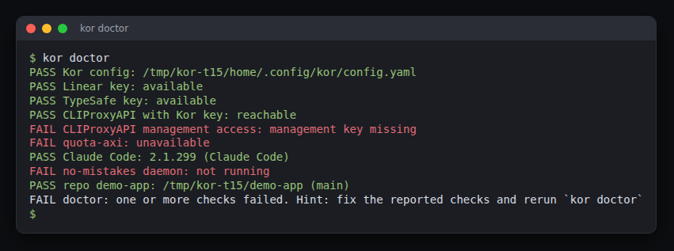
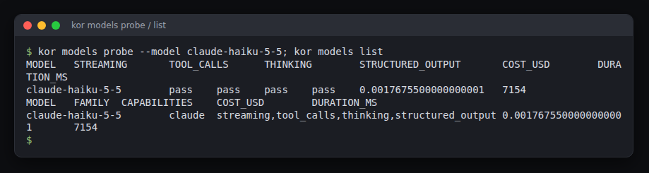
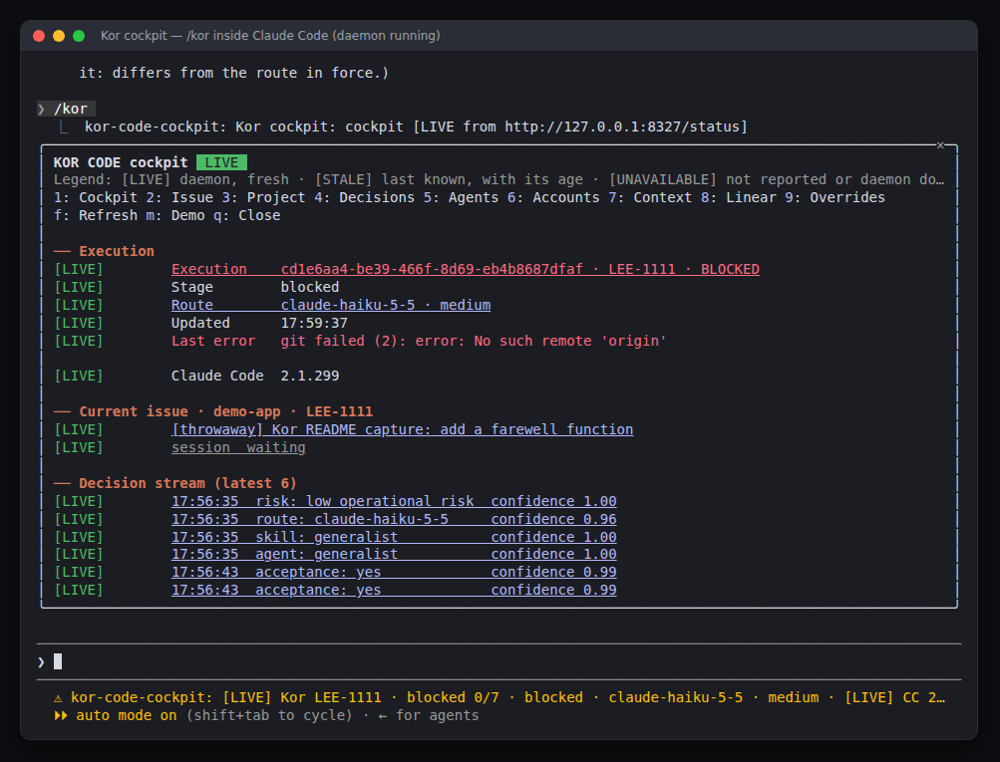
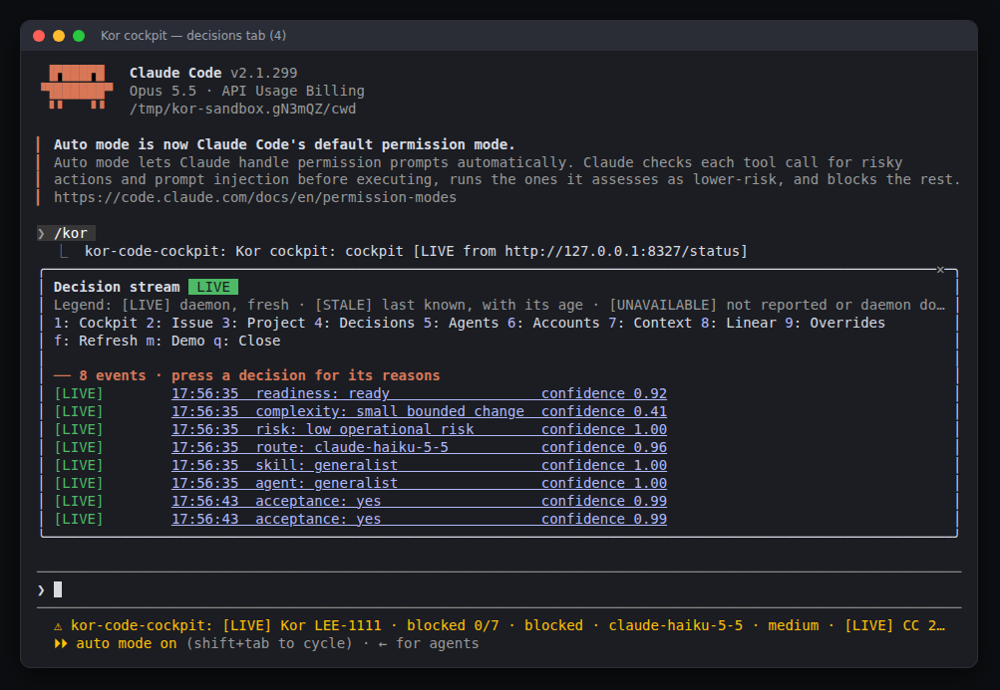
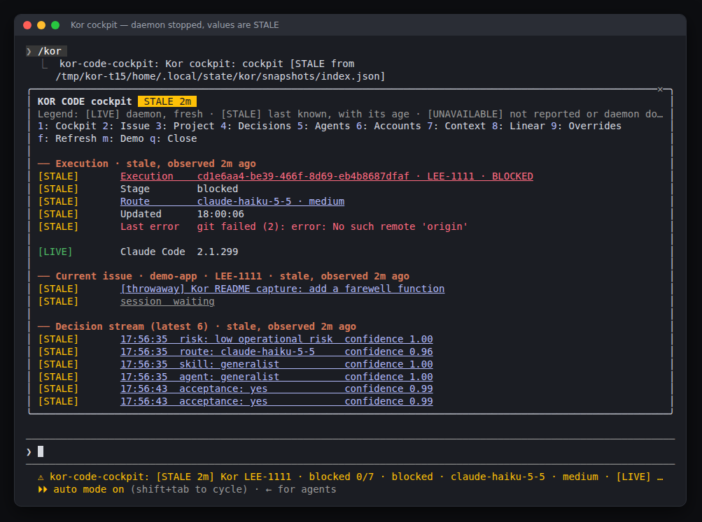

# Kor Code user guide

This guide takes you from a fresh download to a finished run, and explains what
to do when something stops. Start with the [README](../README.md) for the short
version.

Every command and output below was run for real. The captures were made on Linux
(Ubuntu under WSL2) in a throwaway `HOME`, against a small demo project and real
Linear issues, with a live CLIProxyAPI gateway. In pasted output, paths under that
throwaway home appear as written. The screenshots are renderings of real terminal
captures taken in the same sandbox.

Contents:

1. [How a run works](#how-a-run-works)
2. [Install](#install)
3. [Credentials and the gateway](#credentials-and-the-gateway)
4. [Configure a repository](#configure-a-repository)
5. [Check your setup with `kor doctor`](#check-your-setup-with-kor-doctor)
6. [Choose a model](#choose-a-model)
7. [Prepare a Linear issue](#prepare-a-linear-issue)
8. [Run an issue](#run-an-issue)
9. [What happens after the checks pass](#what-happens-after-the-checks-pass)
10. [The cockpit](#the-cockpit)
11. [Recover from a restart, a crash or a block](#recover-from-a-restart-a-crash-or-a-block)
12. [Troubleshooting](#troubleshooting)
13. [Where Kor keeps things](#where-kor-keeps-things)
14. [Update and uninstall](#update-and-uninstall)

## How a run works

You write a Linear issue with acceptance criteria. Kor then:

1. **Queues** it (`kor run LEE-123`, or the daemon polls Linear for Todo issues
   with the intake label `kor`).
2. **Plans** it. One Jev preflight judges whether the issue is ready, how complex
   and risky it is, and which model, skill and agent fit. Jev is the decision
   service Kor calls through the TypeSafe API. If Jev is unavailable or unsure,
   Kor uses your configured default route and labels it `fallback`.
3. **Works** in an isolated git worktree. It starts Claude Code there, with the
   chosen model, through your CLIProxyAPI gateway and only the tools in your
   `toolAllowlist`. Your own checkout is never edited.
4. **Verifies**. Kor runs each of your repository `checks` (an exit code is
   authoritative), then asks Jev one question per acceptance criterion. A failure
   goes back to the session as evidence, up to two repair attempts.
5. **Ships** a verified result: commits it on `kor/<issue key>`, runs your
   repository's delivery gate (see [below](#what-happens-after-the-checks-pass)),
   and opens a pull request.
6. **Reports** to Linear throughout: comments, and the issue state moving to In
   Progress, then In Review, then Done once *you* merge.

Kor never merges a pull request.

An execution is in one of these states: `queued`, `running`, `shipping`, `review`,
`complete`, `failed`, `blocked` or `canceled`. `blocked` always carries a reason
and waits for you.

## Install

You need:

| Requirement | Why |
| --- | --- |
| Linux, with Node 24+, pnpm and Git | Kor is a TypeScript workspace built from source. The installer's service is a systemd user unit; use `--no-systemd` where there is no user manager. |
| [Claude Code](https://code.claude.com/docs/en/overview) 2.1.299 or newer | Kor runs it for every session and the cockpit is a Claude Code plugin. |
| A running [CLIProxyAPI](https://github.com/router-for-me/CLIProxyAPI) | The local gateway that holds your model-provider accounts. Kor talks to it at `http://127.0.0.1:8317` by default. |
| A Linear personal API key | To read issues and write progress. |
| A TypeSafe API key | For the Jev planning and acceptance judgments. |
| For delivery: a GitHub `origin`, authenticated `gh-axi`, and a running `no-mistakes` daemon | To commit, push and open the pull request. |

Clone, build and install:

```sh
git clone https://github.com/korallis/kor-code.git
cd kor-code
pnpm install --frozen-lockfile
pnpm build
node packages/cli/dist/cli.js install --pilot ~/code/my-project
export PATH="$HOME/.local/bin:$PATH"
kor --help
```

`--pilot` names a **standalone Git checkout** of the project you want Kor to work
on, and the cockpit activates only when Claude starts in that exact directory.
Keep the `kor-code` checkout on disk: the installed `kor` command is a symlink to
its compiled CLI. Rebuild after you update it.

On a machine with no Kor files, the installer prints a new gateway key for you to
add to CLIProxyAPI by hand. The key below is redacted:


```text
$ node packages/cli/dist/cli.js install --pilot /tmp/kor-t15/fresh2-pilot --no-systemd
Kor installed (scope: local)
CLI: /tmp/kor-t15/fresh2/.local/bin/kor
Config: /tmp/kor-t15/fresh2/.config/kor/config.yaml
Service: /tmp/kor-t15/fresh2/.config/systemd/user/kor.service (not started; systemd control skipped)
Cockpit: kor-cockpit@kor only when Claude starts in /tmp/kor-t15/fresh2-pilot (linked worktrees disabled)
Manifest: /tmp/kor-t15/fresh2/.local/state/kor-install/manifest.json
CLIProxyAPI addition: - kor-<generated-value>
Stored the same new key in /tmp/kor-t15/fresh2/.config/kor/gateway.env (0600). Add the printed line to CLIProxyAPI manually.
Configure repository mapping, checks and toolAllowlist; run kor doctor before starting the service.
```

That capture used `--no-systemd` so that it would not touch the user manager of the
machine it ran on. Without that flag the installer also reloads your systemd user
manager and leaves the `kor` service installed but **not started**. The service
lifecycle on a real user manager was not exercised in these captures; the daemon
was run with `kor serve` in a terminal instead. An earlier validation checked the
generated unit with `systemd-analyze --user verify`.

What the installer does and does not do:

- It writes `~/.local/bin/kor`, a config scaffold, a private `gateway.env`, a
  systemd user unit, and registers the `kor-cockpit@kor` Claude Code plugin from a
  local marketplace under Kor's data directory.
- Local scope (`--pilot`, the default) declares the plugin only in the pilot's
  `.claude/settings.local.json`, so your user-level Claude settings stay
  byte-identical. A linked Git worktree is refused as a pilot; use a normal clone.
- It records every change in a journal so that `kor uninstall` can reverse it.
- It never edits CLIProxyAPI's configuration, `~/.codex` or `~/.agents`. You add
  the printed `api-keys` line to CLIProxyAPI yourself.

When a gateway key already exists (in `gateway.env` or the environment) the
installer keeps it and prints `existing credential retained`, never the value.

To make the cockpit available in every project instead of one, reinstall at user
scope; your config and keys are reused:

```sh
kor uninstall
node packages/cli/dist/cli.js install --scope user
```

On a machine with no config, a user-scope install scaffolds a config entry for the
`kor-code` checkout itself; edit `repos` to name your project (see below). Real
output of that command on a fresh home:

```text
$ node packages/cli/dist/cli.js install --scope user --no-systemd
Kor installed (scope: user)
CLI: /tmp/kor-t15/fresh2/.local/bin/kor
Config: /tmp/kor-t15/fresh2/.config/kor/config.yaml
Service: /tmp/kor-t15/fresh2/.config/systemd/user/kor.service (not started; systemd control skipped)
Cockpit: kor-cockpit@kor
Manifest: /tmp/kor-t15/fresh2/.local/state/kor-install/manifest.json
CLIProxyAPI addition: - kor-<generated-value>
Stored the same new key in /tmp/kor-t15/fresh2/.config/kor/gateway.env (0600). Add the printed line to CLIProxyAPI manually.
Configure repository mapping, checks and toolAllowlist; run kor doctor before starting the service.
```

## Credentials and the gateway

| Credential | Where Kor looks (first match wins) |
| --- | --- |
| Gateway key (the key your CLIProxyAPI accepts from Kor) | `KOR_GATEWAY_KEY`, or `KOR_GATEWAY_KEY` in `~/.config/kor/gateway.env` (mode `0600`) |
| Gateway URL | `KOR_GATEWAY_URL`, or `~/.config/kor/gateway.env`; default `http://127.0.0.1:8317` |
| Linear personal API key | `LINEAR_API_KEY`, or `LINEAR_API_KEY=…` in `~/.config/linear/env` |
| TypeSafe API key | `TYPESAFE_API_KEY` (or `TYPESAFE_KEY`, `JEV_API_KEY`), or the same names in `~/.config/typesafe/env` |
| CLIProxyAPI management key (optional) | `CPA_MANAGEMENT_KEY`, in `gateway.env` or the environment |

Runtime environment variables override the files for that one process. Kor never
prints a credential and never copies one from the environment onto disk.

To authorize Kor in CLIProxyAPI, add the line the installer printed to the
`api-keys` list in CLIProxyAPI's configuration, and restart or reload the proxy as
CLIProxyAPI documents. The same value must be `KOR_GATEWAY_KEY` for Kor. If you do
not have a key yet, `kor doctor` generates a fresh suggestion:

```text
FAIL CLIProxyAPI with Kor key: missing; CLIProxyAPI addition: - kor-<generated-value>
```

## Configure a repository

Kor reads `~/.config/kor/config.yaml` (or `$XDG_CONFIG_HOME/kor/config.yaml`). The
installer scaffolds it with empty `checks` and `toolAllowlist`; they are
deliberate placeholders for your policy. This is the file used for the captures in
this guide (the project path is the demo project):

```yaml
repos:
  demo-app:
    path: /tmp/kor-t15/demo-app
    linearTeam: LEE
    defaultBranch: main
    checks:
      - node --test
    toolAllowlist:
      - Read
      - Write
      - Edit
      - "Bash(git status*)"
      - "Bash(git add*)"
      - "Bash(git commit*)"
      - "Bash(node --test*)"
      - "Bash(npm test*)"
      - "Bash(git diff*)"
      - "Bash(git log*)"
      - "Bash(ls*)"
      - "Bash(cat*)"
limits: { total: 1, perRepository: 1 }
defaultRoute: { provider: anthropic, model: claude-haiku-5-5, accountPolicy: fill-first, sessionAffinity: true, reasoningLevel: medium }
pollIntervalSeconds: 60
intakeLabel: kor
```

- **`path`** is a standalone clone of the repository. Kor never edits it directly;
  every execution gets its own worktree.
- **`linearTeam`** (the team key, for example `LEE`) or **`linearProject`** (a
  project UUID) maps Linear issues to this repository. `linearProject` wins when
  both match. A repository key that equals the team key also works for small
  setups.
- **`checks`** are shell commands run in the worktree after each attempt. A
  non-zero exit means the attempt is not verified.
- **`toolAllowlist`** is the complete list of tools a session may use. Sessions run
  in Claude Code's `dontAsk` mode: anything not on the list is denied, and **a
  single denial fails the attempt**. Add the commands your project's agents
  actually run; see [Troubleshooting](#troubleshooting) for the denial this
  captured.
- **`remote`** (optional) is the GitHub URL. If set, `kor doctor` checks that
  `origin` matches it, and delivery pushes to it.
- **`limits`** cap concurrent executions (`total`, `perRepository`, optional
  `perProvider`).
- **`defaultRoute`** is the model Kor uses when Jev is unavailable or unsure, and
  the route of the very first attempt unless Jev picks a verified model.

The full schema, including calibration options, is in
[configuration](configuration.md).

## Check your setup with `kor doctor`

`kor doctor` prints one `PASS` or `FAIL` line per check and exits non-zero if any
fail. It never edits anything. This is the real output on the sandbox used for
this guide:



```text
$ kor doctor
PASS Kor config: /tmp/kor-t15/home/.config/kor/config.yaml
PASS Linear key: available
PASS TypeSafe key: available
PASS CLIProxyAPI with Kor key: reachable
FAIL CLIProxyAPI management access: management key missing
FAIL quota-axi: unavailable
PASS Claude Code: 2.1.299 (Claude Code)
FAIL no-mistakes daemon: not running
PASS repo demo-app: /tmp/kor-t15/demo-app (main)
FAIL doctor: one or more checks failed. Hint: fix the reported checks and rerun `kor doctor`
```

Three lines failed here, and the runs in this guide still completed their
verification, because those three are not needed to run and verify an issue:

| Line | Needed for | If it fails |
| --- | --- | --- |
| `Kor config` | everything | Create or fix `config.yaml`. |
| `Linear key`, `TypeSafe key` | everything | Set the key. Without TypeSafe, planning is `blocked` and every acceptance judgment stays blocked. |
| `CLIProxyAPI with Kor key` | every model call | Start CLIProxyAPI, add Kor's key to its `api-keys`, check `KOR_GATEWAY_URL`. `HTTP 401` means the proxy does not know the key. |
| `Claude Code` | every session | Install Claude Code 2.1.299 or newer. |
| `repo <name>` | that repository | The path must be the Git checkout root, the default branch must exist, and `origin` must equal `remote` when you set one. |
| `no-mistakes daemon` | **shipping** | Delivery cannot pass the repository gate without it; see below. Verification does not need it. |
| `CLIProxyAPI management access`, `quota-axi` | the cockpit's Accounts tab and account-health data | Optional. Set `CPA_MANAGEMENT_KEY` (and have `quota-axi` available) to see the account pool. |

## Choose a model

Kor only routes to a model that passed its compatibility probe. A model must pass
streaming, tool calls, extended thinking and structured output. Probe the ones you
want to use. This costs a few cents per model:



```text
$ kor models probe --model claude-sonnet-5-5
MODEL	STREAMING	TOOL_CALLS	THINKING	STRUCTURED_OUTPUT	COST_USD	DURATION_MS
claude-sonnet-5-5	pass	pass	fail	pass	0.0742081	7061

$ kor models list
MODEL	FAMILY	CAPABILITIES	COST_USD	DURATION_MS

$ kor models probe --model claude-haiku-5-5
MODEL	STREAMING	TOOL_CALLS	THINKING	STRUCTURED_OUTPUT	COST_USD	DURATION_MS
claude-haiku-5-5	pass	pass	pass	pass	0.004153385	6064

$ kor models list
MODEL	FAMILY	CAPABILITIES	COST_USD	DURATION_MS
claude-haiku-5-5	claude	streaming,tool_calls,thinking,structured_output	0.004153385	6064
```

Through this gateway `claude-sonnet-5-5` failed the thinking check, so it was not
routable and `kor models list` stayed empty until `claude-haiku-5-5` passed. That
difference matters: with no verified model, `kor plan` reports
`route: no-verified-route` and readiness `blocked`. After the probe, set
`defaultRoute.model` to a model in the list.

`kor models probe --family claude` probes every Claude model the gateway lists
(`--dry-run` shows the list first, without starting a session; the gateway used
here returned 19). Results are stored in `~/.local/state/kor/models.json`, which
`KOR_MODEL_REGISTRY` can redirect.

## Prepare a Linear issue

Kor reads the issue description. Put the outcome and the acceptance criteria in
it, under a heading named `Acceptance`, `Acceptance criteria` or
`Acceptance conditions` (any heading level), as a bullet or checkbox list. This is
the issue used for the captures:

```markdown
## Outcome

Add a `question(name)` function to `src/greeting.js`.

## Acceptance criteria

- [ ] `question("Ada")` returns `How are you, Ada?`.
- [ ] `greeting.test.js` has a test for `question` and `node --test` passes.
```

Each bullet becomes one acceptance condition that Jev judges against the diff.
Without acceptance criteria the execution blocks with a needs-input reason before
any model session starts.

Linear setup:

- Use a **personal API key** with access to the team. Agent-session mutations are
  disabled for personal keys.
- The team's workflow needs **Todo**, **In Progress**, **In Review** and **Done**
  states. A missing In Review state blocks an execution before the model starts.
- Kor only starts work you have opted in: the daemon polls **Todo** issues carrying
  the label named by `intakeLabel` (default `kor`), and never Backlog. `kor run
  ISSUE` queues one issue by hand without the label. The label-based polling was
  not exercised against a live Linear label in these captures.

Before queueing, run the preflight yourself to see what Jev thinks. It writes one
comment to the issue only when it needs your input:

```text
$ kor plan LEE-1111
PLAN plan-d8bf415a-8ca3-4991-b2bb-d0b78959e1a4
route: anthropic/claude-haiku-5-5 [jev]
fallback: false
readiness: ready (0.92); confidence=0.92; status=applied
complexity: small bounded change (0.39); confidence=0.41; status=applied
risk: low operational risk (0.00); confidence=1.00; status=applied
route: claude-haiku-5-5; confidence=0.96; status=applied
skill: generalist; confidence=1.00; status=applied
agent: generalist; confidence=1.00; status=applied
linear: no clarification needed
```

`kor plan` exits `1` while readiness is `blocked`, a decision is escalated, or a
fallback route is in use. The first attempt, before any model had passed the
probe, looked like this, and Kor wrote the `PLAN …` text as an issue comment:

```text
$ kor plan LEE-1111
PLAN plan-be9c64fa-e7dd-446a-bc3e-76e8b0c5fc4d
route: anthropic/claude-sonnet-5-5 [fallback]
fallback: false
readiness: blocked (0.03); confidence=0.03; status=blocked
complexity: small bounded change (0.42); confidence=0.37; status=applied
risk: low operational risk (0.09); confidence=0.88; status=applied
route: no-verified-route; confidence=0.96; status=blocked
skill: generalist; confidence=0.98; status=applied
agent: generalist; confidence=1.00; status=applied
linear: clarification comment written
FAIL plan: preflight did not produce a ready route. Hint: resolve the reported decisions or provide a healthy Jev response, then retry
```

## Run an issue

Start the daemon. With the service installed that is
`systemctl --user enable --now kor`; from a terminal in the `kor-code` checkout:

```sh
kor serve
```

```text
kor daemon listening on http://127.0.0.1:8327/status
```

The daemon must run from (or, for the service, be installed from) the `kor-code`
checkout, because it launches sessions with that checkout's `scripts/sandbox.sh`.

In a second terminal, preview and queue the issue:


```text
$ kor run LEE-1111 --dry-run
{
  "issueId": "LEE-1111",
  "canonicalIssueId": "d8028008-c8b4-47a3-8b64-c00770784e73",
  "title": "[throwaway] Kor README capture: add a farewell function",
  "dryRun": true,
  "intake": "kor",
  "route": {
    "provider": "anthropic",
    "model": "claude-haiku-5-5",
    "accountPolicy": "fill-first",
    "sessionAffinity": true,
    "reasoningLevel": "medium"
  },
  "planned": [
    "enqueue durable assignment",
    "run isolated session when kor serve is active"
  ]
}

$ kor run LEE-1111
{
  "schemaVersion": 1,
  "issueId": "LEE-1111",
  "canonicalIssueId": "d8028008-c8b4-47a3-8b64-c00770784e73",
  "executionId": "cd1e6aa4-be39-466f-8d69-eb4b8687dfaf",
  "status": "queued",
  "queued": true
}
```

The daemon claims it within seconds. A small change with Haiku took 32 seconds
from claim to verified in this capture. Watch it:

```sh
kor status --json LEE-1111 | jq -c '{state: .run.state, attempts: .run.attempts}'
kor logs cd1e6aa4-be39-466f-8d69-eb4b8687dfaf
```


The full snapshot is long: it holds each attempt's check output, diff and findings.
This is the same run (the second issue, LEE-1117), narrowed with `jq`:

```text
$ kor status --json | jq '.snapshot.runs[] | select(.issueKey=="LEE-1117") | {executionId, issueKey, status, attempts, issueState, routeSource, route: .route.model, branch, checks: [.verification.attempts[-1].checks[] | {command, exitCode, status}], acceptance: [.verification.attempts[-1].findings[] | {conditionId, status, note}], error}'
{
  "executionId": "426f3560-10cf-4ad2-86d6-98765f331b39",
  "issueKey": "LEE-1117",
  "status": "blocked",
  "attempts": 2,
  "issueState": "In Progress",
  "routeSource": "jev",
  "route": "claude-haiku-5-5",
  "branch": "kor/LEE-1117",
  "checks": [
    {
      "command": "node --test",
      "exitCode": 0,
      "status": "pass"
    }
  ],
  "acceptance": [
    {
      "conditionId": "acceptance-1",
      "status": "pass",
      "note": "acceptance-1: Jev Noul probability 0.990; threshold 0.700"
    },
    {
      "conditionId": "acceptance-2",
      "status": "pass",
      "note": "acceptance-2: Jev Noul probability 0.990; threshold 0.700"
    }
  ],
  "error": "git failed (2): error: No such remote 'origin'\n"
}
```

`attempts: 2` and `blocked` have an explanation in the next two sections: the
first attempt was denied a tool and the second one verified.

The run log is a plain timeline:

```text
$ kor logs 426f3560-10cf-4ad2-86d6-98765f331b39
2026-10-14T18:06:09.952Z execution started
2026-10-14T18:06:37.756Z execution blocked: Session failed: 1 permission denial
2026-10-14T18:10:24.075Z execution started
2026-10-14T18:10:39.371Z execution shipping
2026-10-14T18:11:21.807Z shipping blocked: git failed (2): error: No such remote 'origin'
```

### What you get

The verified change sits in the execution's worktree, uncommitted until shipping
commits it. The path is `worktree` in the status (for this run
`~/.local/share/kor/worktrees/<execution id>` while it exists):

```text
$ git -C ~/.local/share/kor/worktrees/426f3560-10cf-4ad2-86d6-98765f331b39 status --short
 M greeting.test.js
 M src/greeting.js
$ git -C ~/.local/share/kor/worktrees/426f3560-10cf-4ad2-86d6-98765f331b39 diff
diff --git a/greeting.test.js b/greeting.test.js
index f97e87d..202c7ac 100644
--- a/greeting.test.js
+++ b/greeting.test.js
@@ -1,7 +1,11 @@
 import test from "node:test";
 import assert from "node:assert/strict";
-import { greet } from "./src/greeting.js";
+import { greet, question } from "./src/greeting.js";
 
 test("greet says hello", () => {
   assert.equal(greet("Ada"), "Hello, Ada!");
 });
+
+test("question asks how are you", () => {
+  assert.equal(question("Ada"), "How are you, Ada?");
+});
diff --git a/src/greeting.js b/src/greeting.js
index a106507..9327ef1 100644
--- a/src/greeting.js
+++ b/src/greeting.js
@@ -1,3 +1,7 @@
 export function greet(name) {
   return `Hello, ${name}!`;
 }
+
+export function question(name) {
+  return `How are you, ${name}?`;
+}
```

On Linear, Kor wrote these comments on the issue and moved it from Todo to In
Progress:

```text
Kor started execution cd1e6aa4-be39-466f-8d69-eb4b8687dfaf; state → In Progress

Kor execution cd1e6aa4-be39-466f-8d69-eb4b8687dfaf: blocked
git failed (2): error: No such remote 'origin'

policy: unresolved — git failed (2): error: No such remote 'origin'
```

## What happens after the checks pass

After verification passes, the execution moves to `shipping`. The daemon then:

1. Commits **only the verified paths** on `kor/<issue key>`. Unrelated files and
   likely secrets (`.env*`, keys, credential files, agent config directories,
   logs) stay untracked, and a secret path already staged or committed by the
   session blocks publication.
2. Asks `no-mistakes axi status` which gate the repository uses. An initialized
   repository goes through the no-mistakes pipeline. Only the explicit "repository
   not initialized" answer allows the direct `git push` and `gh-axi pr create`
   path. An unreachable daemon, an approval gate or a failed pipeline keeps
   delivery blocked and never bypasses the gate.
3. Pushes the branch to `origin` and opens a pull request with redacted evidence.
   Linear moves to **In Review** and links the pull request.
4. Waits. When you merge, Kor observes it, moves Linear to **Done**, reports
   `complete`, and removes only its own clean worktree.

Kor does not merge, force-push, delete branches, or start or stop the shared
no-mistakes daemon.

**What these captures show.** The demo project had no `origin` remote, so shipping
stopped at step 2 for every run with the message in the logs above:
`git failed (2): error: No such remote 'origin'`. The verified work stayed in its
worktree and the execution is `blocked` (the cockpit and Linear show the same
reason). Delivery through no-mistakes and the pull request itself were **not**
exercised against GitHub in these captures. They are covered by the committed
replay (`pnpm shipping:proof`, see [development](development.md)) and the
[shipping specification](specs/shipping.md), which is explicit about that
boundary. Once your repository has a GitHub `origin`, a gh-axi login and a running
no-mistakes daemon, this is the path to expect; until you have seen it work, treat
the pull-request step as the part of Kor with the least live evidence.

## The cockpit

The cockpit is a Claude Code plugin: type `/kor` in Claude Code started in your
pilot directory (or anywhere, after a user-scope install) and it draws the running
daemon's status. Every row carries a label:

| Label | Meaning |
| --- | --- |
| `[LIVE]` | The daemon answered just now and the value is younger than its poll interval. |
| `[STALE]` | The last value the daemon published, read from its snapshot file; the section shows its age. |
| `[UNAVAILABLE]` | The daemon did not report it, or neither the daemon nor a snapshot could be read. |
| `[FIXTURE]` | Demo data, drawn only by `/kor demo`. |

To try the cockpit without installing anything, with a disposable Claude
configuration, run it from the `kor-code` checkout while the daemon is running:

```sh
pnpm cockpit            # the Claude Code TUI with the plugin loaded; type /kor
scripts/sandbox.sh "/kor"   # the same view, printed once
```



Press `1`–`9` to switch tabs (Cockpit, Issue, Project, Decisions, Agents, Accounts,
Context, Linear, Overrides), `f` to refresh and `q` to close. Selecting a decision
shows its reasons:



The status line below the prompt shows the current execution, for example
`[LIVE] Kor LEE-1111 · blocked 0/7 · blocked · claude-haiku-5-5 · medium`. Set
`KOR_COCKPIT=off` to hide it, `KOR_STATUS_URL` to read another daemon (`off` reads
only the snapshot) and `KOR_STATE_DIR` to read another state directory.

### Overrides

You can change a decision from the cockpit. The daemon applies an override only
when policy allows, records it in `override_audit` and in `kor logs`, and comments
on the Linear issue. A route override must name a model that `kor models probe`
verified and that differs from the route in force. Naming the route already in force
was refused, and the message quotes the policy check that failed (the check is named
"differs from the route in force"):

```text
/kor override route claude-haiku-5-5
[LIVE] daemon refused: ovr_e1d23e7b: route → claude-haiku-5-5 rejected (Policy refused it: differs from the route in force.)
```

```text
$ kor logs cd1e6aa4-be39-466f-8d69-eb4b8687dfaf
2026-10-14T17:59:14.377Z override ovr_e1d23e7b rejected: route -> claude-haiku-5-5 (Policy refused it: differs from the route in force.)
```

Use a decision ID instead of `route` to override another Jev decision with one of
its candidates, and `/kor revert <override>` to undo one.

### Stopped daemon

If the daemon is not running, the cockpit falls back to its last snapshot and
labels everything `[STALE]`, with the age:



With no daemon and no snapshot every daemon value is `[UNAVAILABLE]`, and
`/kor override` sends nothing.

## Recover from a restart, a crash or a block

Kor's queue and leases are durable (SQLite in `~/.local/state/kor/kor.db`), so
stopping the daemon never loses an assignment. All of this was run for real.

**Stop the daemon.** `kor status --json ISSUE` reports `provenance: "stale"` at
once and still returns the last record:

```text
$ kor status --json LEE-1111
{
  "schemaVersion": 1,
  "provenance": "stale",
  "observedAt": "2026-10-14T18:00:09.000Z",
  "reason": "daemon is not running or its snapshot is unavailable or stale",
  "run": {
    "executionId": "cd1e6aa4-be39-466f-8d69-eb4b8687dfaf",
    "issueId": "d8028008-c8b4-47a3-8b64-c00770784e73",
    "issueKey": "LEE-1111",
    "state": "blocked",
    "attempts": 1,
    "cancelRequested": false,
    "pullRequestUrl": null,
    "needsInput": {
      "reason": "git failed (2): error: No such remote 'origin'\n"
    },
    "costUsd": null
  }
}
```

The unselected `kor status` keeps reading `live` until the last snapshot is older
than twice the poll interval; at 132 seconds with a 60-second poll it reported:

```text
$ kor status --json | jq '{provenance, reason, observedAt, snapshotObservedAt: .snapshot.observedAt}'
{
  "provenance": "stale",
  "reason": "snapshot is 132s old",
  "observedAt": "2026-10-14T18:02:19.311Z",
  "snapshotObservedAt": "2026-10-14T18:00:06.883Z"
}
```

**Crash the daemon mid-run.** The daemon was killed with `SIGKILL` while LEE-1116
was `running`:

```text
$ kor status --json LEE-1116
{
  "schemaVersion": 1,
  "provenance": "stale",
  "observedAt": "2026-10-14T18:03:48.992Z",
  "reason": "daemon is not running or its snapshot is unavailable or stale",
  "run": {
    "executionId": "5520bb1e-3b82-4063-8e92-98cdb7fc1fa2",
    "issueId": "73248b73-2db9-4ac9-a341-ba087589a317",
    "issueKey": "LEE-1116",
    "state": "running",
    "attempts": 1,
    "cancelRequested": false,
    "pullRequestUrl": null,
    "needsInput": null,
    "costUsd": null
  }
}
```

Starting `kor serve` again stopped the orphaned session, re-queued the execution
and ran it again, with `attempts` going to 2:

```text
$ kor logs 5520bb1e-3b82-4063-8e92-98cdb7fc1fa2
2026-10-14T18:03:44.420Z execution started
2026-10-14T18:03:53.315Z daemon restarted; previous session stopped; re-queued
2026-10-14T18:03:53.338Z execution started
2026-10-14T18:04:20.106Z execution blocked: Session failed: 1 permission denial
```

**A permission denial.** That second attempt blocked because the session tried to
run a command that was not on the repository's `toolAllowlist`. Kor reports the
count and the Linear comment says so:

```text
Kor verification blocked: Session failed: 1 permission denial
acceptance-1: pass
acceptance-2: pass
```

The status does not name the tool. To find out, I re-ran the prompt of a sibling
demo issue (LEE-1117, which was blocked the same way) by hand under the flags
Kor uses (`claude -p … --permission-mode dontAsk --allowedTools … --output-format
stream-json`) and read `permission_denials` from the final result line. The session
had run `npm test`, and only `Bash(node --test*)` was on the list:

```json
{"tool_name":"Bash","tool_input":{"command":"npm test 2>&1 | tail -15","description":"Run test suite via npm test"}}
```

The fix is to add the command to the list (`"Bash(npm test*)"`), restart `kor
serve` so it rereads `config.yaml`, then retry. The retry reuses the execution:

```text
$ kor retry LEE-1116
{
  "schemaVersion": 1,
  "issueId": "LEE-1116",
  "canonicalIssueId": "73248b73-2db9-4ac9-a341-ba087589a317",
  "executionId": "5520bb1e-3b82-4063-8e92-98cdb7fc1fa2",
  "command": "retry",
  "accepted": true
}
$ kor logs 5520bb1e-3b82-4063-8e92-98cdb7fc1fa2
2026-10-14T18:03:44.420Z execution started
2026-10-14T18:03:53.315Z daemon restarted; previous session stopped; re-queued
2026-10-14T18:03:53.338Z execution started
2026-10-14T18:04:20.106Z execution blocked: Session failed: 1 permission denial
2026-10-14T18:04:45.086Z execution started
2026-10-14T18:05:01.775Z execution shipping
2026-10-14T18:05:42.939Z shipping blocked: git failed (2): error: No such remote 'origin'
```

**Retry and cancel.** `kor retry EXECUTION-ID|ISSUE-ID` works on failed, blocked
and canceled executions and keeps the execution ID. It does not rerun a session
whose work already verified and reached shipping; it continues delivery. `kor
cancel` stops a queued, running or blocked execution; a running session is stopped
first. Cancelling an execution that is already finished is refused:

```text
$ kor cancel LEE-1111
{
  "schemaVersion": 1,
  "issueId": "LEE-1111",
  "canonicalIssueId": "d8028008-c8b4-47a3-8b64-c00770784e73",
  "executionId": "cd1e6aa4-be39-466f-8d69-eb4b8687dfaf",
  "command": "cancel",
  "accepted": true
}
$ kor cancel LEE-1111 --json
{"schemaVersion":1,"error":{"code":"not_accepted","message":"cancel was not accepted for execution cd1e6aa4-be39-466f-8d69-eb4b8687dfaf","hint":"cancel only queued, running, or blocked executions"}}
```

**`kor cancel` only changes Kor's queue.** In these captures the Linear issue was
still **In Progress** afterwards and no cancellation comment appeared, so move the
issue back to Todo (or cancel it) in Linear yourself.

## Troubleshooting

| You see | Cause and fix |
| --- | --- |
| `FAIL <command>: … Hint: …` | Every failure is one line with a hint. Add `--json` for the structured object ([contract](cli-contract.md#errors)), `--debug` for a stack trace. |
| `kor: command not found` | Add `~/.local/bin` to `PATH`, or run `bin/kor` / `pnpm kor` from the checkout. |
| `FAIL kor: Kor is not built. Hint: run pnpm install --frozen-lockfile and pnpm build in the Kor checkout.` | Run those two commands in the `kor-code` checkout. |
| `FAIL run: No Kor repository mapping for Linear team LEE. …` | No repository in `config.yaml` has `linearTeam` (or `linearProject`) matching the issue. Add the mapping. |
| `FAIL Kor config: missing (…/config.yaml)` | Run `kor install`, or create the file ([configuration](configuration.md)). |
| `FAIL CLIProxyAPI with Kor key: unreachable` | CLIProxyAPI is not running at `KOR_GATEWAY_URL` (default `http://127.0.0.1:8317`). |
| `FAIL CLIProxyAPI with Kor key: HTTP 401` | The proxy does not have Kor's key in `api-keys`. |
| `FAIL CLIProxyAPI with Kor key: missing; CLIProxyAPI addition: - kor-…` | No Kor key is configured; add the printed line to the proxy and the same value to `gateway.env`. |
| `route: no-verified-route`, readiness `blocked` | No model has passed `kor models probe`. Probe one and set `defaultRoute.model` to it. |
| `jev: unavailable (TypeSafe API key not found …)` | Set `TYPESAFE_API_KEY`. Until then routes are labelled `fallback` and acceptance stays blocked. |
| `Session failed: 1 permission denial` | The session used a tool outside `toolAllowlist`; see the [walk-through](#recover-from-a-restart-a-crash-or-a-block). |
| `git failed (2): error: No such remote 'origin'` | Delivery needs a GitHub `origin` (or `remote` in the config). The verified work is still in the worktree; add the remote and `kor retry`. |
| Execution `blocked` with a needs-input reason about acceptance criteria | Add an `Acceptance` section to the Linear issue, then `kor retry`. |
| `Local cockpit installation requires a standalone checkout …` | `--pilot` was a linked worktree. Use a normal clone. |
| `/kor` shows `[STALE]` or `[UNAVAILABLE]` | The daemon is down, or the cockpit cannot reach it. Start `kor serve`; check `KOR_STATUS_URL` and `KOR_STATE_DIR`. |
| `FAIL status: …` | `kor status` could not read the snapshot or the execution; the hint says which. |

## Where Kor keeps things

| Path | Contents |
| --- | --- |
| `~/.config/kor/config.yaml` | Repository mappings and policy. |
| `~/.config/kor/gateway.env` | Gateway key and URL (mode `0600`). |
| `~/.local/state/kor/kor.db` | The queue, leases, decisions, overrides and calibration rows. |
| `~/.local/state/kor/snapshots/` | `index.json` plus one file per execution. |
| `~/.local/state/kor/logs/<execution id>.log` | What `kor logs` prints. |
| `~/.local/state/kor/models.json` | The model probe results. |
| `~/.local/share/kor/worktrees/<execution id>` | The isolated checkout for each execution. |
| `~/.local/state/kor-install/` | The installation journal and backups used by `kor uninstall`. |

`XDG_CONFIG_HOME`, `XDG_STATE_HOME` and `XDG_DATA_HOME` move these roots.

## Update and uninstall

To update, `git pull` in the `kor-code` checkout, then `pnpm install --frozen-lockfile
&& pnpm build`. Restart the service (`systemctl --user restart kor`) or `kor
serve`.

To remove Kor, run `kor uninstall`. It stops and disables the service, restores
every file it changed from its backups, and removes the cockpit plugin and
marketplace, while keeping your config, state and the backups. `kor uninstall
--purge` also removes the config, state and data Kor created, and restores
anything that predated the installation. Run on a fresh home, the pair left
nothing behind:

```text
$ kor uninstall
Kor uninstalled; config and state retained
Backups: /tmp/kor-t15/fresh/.local/state/kor-install/backups/1792000537354-86e40e1d
$ kor uninstall --purge
Kor uninstalled (purged new Kor data; restored pre-existing data)
Replayed /tmp/kor-t15/fresh/.local/state/kor-install/backups/1792000537354-86e40e1d
$ find $HOME -mindepth 1 | wc -l
0
```

A normal uninstall also removes the `kor` link, so to purge afterwards run
`node packages/cli/dist/cli.js uninstall --purge` from the checkout. Do not remove
Kor's key from CLIProxyAPI's `api-keys` until you are finished with it; Kor never
edits the proxy. Kor never touches `~/.codex` or `~/.agents`. More recovery detail
(unrelated settings edits, interrupted installs) is in
[configuration](configuration.md#install-and-uninstall).
